# Manual de usuario de ProxLaunch

ProxLaunch es una aplicación de escritorio para crear máquinas virtuales (MV) en un servidor
**Proxmox VE** (versiones 8.0 a 9.2) sin tener que conocer todos sus detalles. Este manual explica,
pantalla por pantalla, **todas las opciones** que verás, qué hace cada una, qué valores admite y cuál
es su valor por defecto. Está pensado para administradores de sistemas que no son necesariamente
expertos en Proxmox: cada término se explica la primera vez que aparece, y al final hay un
[glosario](#glosario).

Con ProxLaunch puedes:

- crear **una** máquina con un formulario sencillo (modo básico) o detallado (modo avanzado);
- elegir **de dónde sale el sistema operativo**: disco vacío, instalación desde un ISO, un disco ya hecho
  (qcow2, vmdk, raw) o la copia de una plantilla de Proxmox;
- crear **hasta 100 máquinas iguales** de una vez (un **lote**), simular antes de crear y deshacer después;
- **reutilizar configuraciones** (perfiles de máquina) y **guardar y abrir lotes** como archivos;
- **importar una hoja de cálculo (CSV)** en la que cada fila es una máquina distinta;
- **dejar la máquina lista para trabajar**: encenderla al terminar, hacer que arranque con el servidor, añadirle
  notas, etiquetas propias, ponerla en un pool, protegerla contra borrado y ajustar el MTU y el límite de velocidad
  de su red (ver [Opciones de la máquina](#opciones-de-la-máquina)).

Por defecto todas las máquinas se crean **detenidas**: solo se encienden si marcas **Encender al terminar**. ProxLaunch
nunca instala el sistema operativo por ti (con un ISO, la instalación la terminas tú desde la consola de Proxmox).

> **Qué se ha verificado.** ProxLaunch se probó contra un Proxmox VE 9.2 real con un servidor
> individual. Los clústeres de varios nodos (incluido el reparto de un lote entre nodos), Proxmox 8.x
> (incluida la importación de discos en 8.4 o superior) solo se verificaron con respuestas simuladas, y la
> instalación de Windows no se probó con un ISO de Windows real (las pruebas usaron Linux). Las opciones de la máquina de
> la versión 0.6 (encender, notas, etiquetas, pool, protección, MTU y límite, y el Deshacer con apagado y desprotección) se
> verificaron con respuestas simuladas de Proxmox, no contra un servidor real. Si usas esos casos, revisa siempre el
> resumen y simula antes de crear.

## Cómo leer este manual

- Los **nombres de botones, menús, campos y mensajes** están en negrita o entre comillas y son los que ves en
  la aplicación.
- Las **capturas** son de la aplicación real con datos inventados: el servidor es `192.0.2.10`, el usuario
  `ana@pve`, el perfil de conexión `Oficina`, el clúster `demo` con los nodos `pve1`, `pve2` y `pve3`
  (en las capturas de un solo servidor, el nodo `pve`). Están en tema claro (salvo una) y no incluyen la barra
  de título del sistema operativo.
- En las **tablas de opciones**, «Modo» indica si el campo se ve en modo **básico** (siempre visible) o solo en
  **avanzado** (ver [Modo avanzado](#modo-avanzado)). «Defecto» es el valor con el que arranca el formulario.
- Los **ejemplos de archivos** (CSV, lotes y perfiles) están en la carpeta [`ejemplos/`](ejemplos/LEEME.md). Todos
  sus datos son ficticios: sustituye los nombres de almacenamientos, redes, nodos, ISO y plantillas por los de
  tu servidor.

## Índice

1. [Instalar y desinstalar ProxLaunch](#instalar-y-desinstalar-proxlaunch)
2. [Antes de empezar](#antes-de-empezar): datos del servidor, [permisos](#permisos-que-hacen-falta) y
   [cómo se prepara un API Token](#cómo-se-prepara-pasos-para-el-administrador)
3. [Primer inicio y conexión](#primer-inicio-y-conexión): ventana de bienvenida, datos de conexión, token,
   «Recordar credenciales», huella del certificado (TOFU) y segundo factor
4. [Crear una máquina en modo básico](#crear-una-máquina-en-modo-básico): recorrido de la ventana y cada
   sección del formulario
5. [Modo avanzado](#modo-avanzado) y [tema](#cambiar-el-tema), con las
   [opciones de la máquina](#opciones-de-la-máquina): encender, arrancar con el servidor, notas, etiquetas, pool,
   protección, MTU y límite de red
6. [Elegir el origen del sistema operativo](#elegir-el-origen-del-sistema-operativo): vacía, ISO, disco
   existente y plantilla
7. [Transferencias: subir y descargar archivos](#transferencias-subir-y-descargar-archivos)
8. [Entender el progreso y los resultados](#entender-el-progreso-y-los-resultados): tiempo agotado,
   «Comprobar» y deshacer
9. [Crear varias máquinas de una vez (lotes)](#crear-varias-máquinas-de-una-vez-lotes)
10. [Perfiles de máquina](#perfiles-de-máquina)
11. [Guardar y abrir lotes](#guardar-y-abrir-lotes)
12. [Importar máquinas desde un CSV](#importar-máquinas-desde-un-csv): formato y validación
13. [Lote por filas](#lote-por-filas)
14. [Cambios sin guardar](#cambios-sin-guardar)
15. [Menús y ajustes](#menús-y-ajustes)
16. [Referencia de ventanas y menús](#referencia-de-ventanas-y-menús)
17. [Formatos de archivo](#formatos-de-archivo): CSV, lotes y perfiles, versiones del formato y
    [compatibilidad con 0.5.1](#compatibilidad-con-versiones-anteriores)
18. [Solución de problemas](#solución-de-problemas): mensajes de error y preguntas frecuentes
19. [Privacidad y seguridad](#privacidad-y-seguridad)
20. [Glosario](#glosario)

### Ejemplo que se repite en el manual

Para no perderte entre opciones, casi todo el manual vuelve a una misma tarea: **«quiero crear 10 servidores
web iguales»** (`srv-web-01` a `srv-web-10`, 2 núcleos, 2 GiB de memoria y un disco de 32 GiB). Verás cómo se hace con
el formulario ([lotes](#crear-varias-máquinas-de-una-vez-lotes)), cómo se guarda para repetirlo
([lote guardado](#guardar-y-abrir-lotes)), cómo se haría con una hoja de cálculo
([CSV](#importar-máquinas-desde-un-csv)) y qué pasa si algo falla.

¿Qué método me conviene?

| Quiero… | Usa | Sección |
|---|---|---|
| Una sola máquina | El formulario | [Modo básico](#crear-una-máquina-en-modo-básico) |
| Muchas máquinas **iguales** (cambian nombre, número y nodo) | Un lote | [Lotes](#crear-varias-máquinas-de-una-vez-lotes) |
| Repetir ese lote otro día o en otro servidor | Un lote guardado | [Guardar y abrir lotes](#guardar-y-abrir-lotes) |
| Máquinas **distintas** entre sí (hardware, origen, nodo por fila) | Un CSV | [Importar desde CSV](#importar-máquinas-desde-un-csv) |
| Partir siempre del mismo hardware (por ejemplo «servidor web de la oficina») | Un perfil de máquina | [Perfiles](#perfiles-de-máquina) |
| Que las máquinas salgan encendidas, con notas, etiquetas, pool o protección | Las opciones de la máquina | [Opciones de la máquina](#opciones-de-la-máquina) |

---

## Instalar y desinstalar ProxLaunch

Desde la versión 0.5.0 ProxLaunch se entrega como instalador, sin necesidad de Python ni de preparar un entorno.
Hay uno para **Ubuntu** (un paquete `.deb`) y otro para **Windows** (un `-setup.exe`). Ambos son de 64 bits e incluyen
todo lo que necesitan. Quien desarrolla o prefiere ejecutar desde el código fuente tiene los pasos en el
[README](../README.md#instalación-para-desarrollo).

Los archivos se llaman:

- `proxlaunch_0.6.0_amd64.deb` (Ubuntu 22.04 y 24.04)
- `proxlaunch-0.6.0-windows-x64-setup.exe` (Windows 10 y 11)
- `SHA256SUMS` (las sumas de control de los dos, para comprobar que no están dañados ni alterados)

### Comprobar la descarga (recomendado)

El archivo `SHA256SUMS` tiene una línea por instalador con su «huella» SHA-256. Compara la de tu archivo con la de
esa línea. Si no coincide, **no lo instales**: descárgalo de nuevo.

En **Ubuntu**, desde la carpeta donde dejaste los archivos (`--ignore-missing` evita errores si solo bajaste uno):

```bash
sha256sum -c SHA256SUMS --ignore-missing
```

Debe responder `proxlaunch_0.6.0_amd64.deb: OK`.

En **Windows**, en PowerShell, desde esa carpeta:

```powershell
Get-FileHash -Algorithm SHA256 .\proxlaunch-0.6.0-windows-x64-setup.exe
```

Compara el valor de `Hash` con el de la línea del instalador en `SHA256SUMS` (puedes abrirlo con el Bloc de notas;
mayúsculas y minúsculas no importan).

> Los instaladores **no están firmados** con un certificado de código. La huella de `SHA256SUMS` es la forma de
> comprobar que el archivo es el que se publicó.

### Ubuntu

**Instalar.** Desde la carpeta del `.deb`:

```bash
sudo apt install ./proxlaunch_0.6.0_amd64.deb
```

Escribe `./` al principio: sin ella, `apt` buscaría un paquete en los repositorios. `apt` instala también las
bibliotecas del sistema que ProxLaunch necesita (las de Qt para la ventana en X11, `libxcb-cursor0`, `libegl1`,
`libgl1`, `libfontconfig1`, `libfreetype6` y otras básicas); no tienes que instalar nada a mano. El paquete trae su propio
intérprete de Python, así que **no usa el Python del sistema**.

**Llavero (opcional).** Para que «Recordar credenciales» funcione hace falta un servicio de secretos del escritorio,
por ejemplo GNOME Keyring, que el paquete solo **sugiere**. Si no hay ninguno, ProxLaunch funciona igual, pero no podrá
recordar credenciales.

**Abrir.** Busca «ProxLaunch» en las actividades o el menú de aplicaciones (categoría Red), o escribe `proxlaunch` en
una terminal. `proxlaunch --version` muestra la versión sin abrir la ventana.

**Actualizar.** Instala el `.deb` nuevo con la misma orden `apt install ./…`. Se reemplaza el programa y tus datos y
credenciales se conservan.

**Desinstalar.**

```bash
sudo apt remove proxlaunch    # quita el programa
sudo apt purge proxlaunch     # igual; no hay archivos de configuración del sistema que borrar
```

Ninguna de las dos órdenes toca tu carpeta personal. **Tus datos se conservan.**

**Dónde quedan tus datos.** Son los de tu usuario (las carpetas que elige el sistema para ProxLaunch):

| Carpeta | Qué hay |
|---|---|
| `~/.config/ProxLaunch` | Perfiles de conexión, huellas, preferencias y perfiles de máquina |
| `~/.local/share/ProxLaunch` | Lotes guardados e informes |
| `~/.local/state/ProxLaunch` | Registro de la aplicación |

Para borrarlos tras desinstalar, hazlo tú: `rm -r ~/.config/ProxLaunch ~/.local/share/ProxLaunch ~/.local/state/ProxLaunch`.
Revisa antes lo que hay: no se puede deshacer. **El llavero no se toca**: las credenciales que guardaste siguen en
«Contraseñas y claves» y reaparecen si reinstalas. Para quitarlas, antes de desinstalar borra el perfil de conexión o
desmarca «Recordar credenciales» en ProxLaunch (así se borra su secreto); si ya desinstalaste, abre «Contraseñas y claves»
y elimina a mano las entradas del servicio `ProxLaunch`.

### Windows

**Instalar.** Haz doble clic en `proxlaunch-0.6.0-windows-x64-setup.exe`. El asistente está en español.

- **¿Para quién?** Al inicio eliges entre instalar **solo para ti** (opción predeterminada, no pide permisos de
  administrador) o **para todos los usuarios** del equipo (pide permisos de administrador). Si dudas, deja la
  predeterminada.
- Puedes cambiar la carpeta de instalación y marcar la creación de un acceso directo en el escritorio (viene
  desmarcado). El acceso del menú Inicio siempre se crea.
- Al terminar puedes abrir ProxLaunch desde la última página.

**Aviso de SmartScreen (instalador sin firma).** Como el instalador no está firmado, Windows puede mostrar «Windows
protegió su PC» (el texto puede variar según la versión de Windows). Para continuar:

1. Pulsa **Más información**.
2. Pulsa **Ejecutar de todas formas**.

Hazlo solo si comprobaste la huella como se explica arriba.

**Pantallas muy pequeñas con escala alta.** El asistente de instalación tiene un tamaño fijo. Si la pantalla es muy
pequeña para la escala elegida (por ejemplo 1024 × 768 al 175 %), los botones del asistente pueden quedar fuera de
la pantalla: pulsa **Enter** en cada página para avanzar (equivale a «Siguiente» y, al final, a «Finalizar»).
ProxLaunch, en cambio, se adapta: si una ventana no cabe, su contenido se desplaza y los botones quedan siempre
visibles.

**Actualizar.** Ejecuta el instalador nuevo: se instala encima de la versión anterior (aparece una sola entrada en
«Aplicaciones instaladas») y tus datos y credenciales se conservan. Si ProxLaunch está abierto, el instalador puede
pedirte que lo cierres.

**Desinstalar.** Abre **Configuración → Aplicaciones → Aplicaciones instaladas**, busca ProxLaunch y elige
**Desinstalar**.

- **Instalación «solo para mí».** El desinstalador pregunta: «¿Desea borrar también sus datos de ProxLaunch (perfiles,
  huellas de certificados, preferencias, lotes y registro de este usuario)? Las contraseñas guardadas en el Administrador
  de credenciales de Windows NO se borran. Si no está seguro, elija «No»: sus datos se conservarán.» La respuesta
  predeterminada es **No**. Con «Sí» se borra la carpeta `%LOCALAPPDATA%\ProxLaunch\ProxLaunch` de tu usuario y nada más.
- **Instalación «para todos los usuarios».** El desinstalador no pregunta «¿Borrar también mis datos?» y no borra datos
  de ningún usuario: los datos pertenecen a cada usuario y quien desinstala como administrador no puede borrar con
  seguridad los de los demás. Cada persona puede borrar a mano su carpeta `%LOCALAPPDATA%\ProxLaunch\ProxLaunch` si lo desea.
- **Desinstalación silenciosa** (para administradores): `unins000.exe /VERYSILENT` conserva los datos;
  `unins000.exe /VERYSILENT /BORRARDATOS=1` borra solo los del usuario que desinstala, y solo en la instalación por
  usuario. En la instalación «para todos los usuarios» `/BORRARDATOS=1` se **ignora**.

**El llavero no se toca.** Las credenciales que guardaste en el Administrador de credenciales de Windows siguen ahí y
reaparecen si reinstalas. Para quitarlas, antes de desinstalar borra el perfil de conexión o desmarca «Recordar
credenciales» en ProxLaunch; si ya desinstalaste, abre el **Administrador de credenciales** y elimina a mano las
entradas del servicio `ProxLaunch`.

Para construir y verificar los instaladores (quien empaqueta, no quien usa la aplicación) consulta
[Empaquetado](empaquetado.md).

---

## Antes de empezar

Necesitas tres cosas de tu administrador de Proxmox:

1. **La dirección del servidor:** una IP (por ejemplo `192.0.2.10`) o un nombre (por
   ejemplo `pve1`). El puerto casi siempre es `8006`.
2. **Una forma de entrar:** un **API Token** (recomendado) o un usuario y contraseña.
3. **La huella del certificado del servidor**, para compararla la primera vez que te
   conectes.

### Permisos que hacen falta

Para crear máquinas, la cuenta necesita ciertos permisos. Lo más cómodo es que el
administrador cree un **rol** llamado `ProxLaunchCreador` con estos privilegios:

```text
VM.Allocate
VM.Audit
VM.Config.Options
VM.Config.HWType
VM.Config.CPU
VM.Config.Memory
VM.Config.Network
Datastore.AllocateSpace
SDN.Use
Sys.Audit
VM.Config.Disk
VM.Clone
Datastore.AllocateTemplate
Sys.AccessNetwork
```

Los **10 primeros** son los mínimos para crear máquinas con disco vacío. Los **4 últimos** sirven para instalar
desde un ISO, subir o descargar archivos, importar discos y clonar plantillas:

| Privilegio | Para qué sirve |
|---|---|
| `VM.Config.Disk` | Fijar el orden de arranque con un ISO y ampliar discos. |
| `VM.Clone` | Clonar plantillas. |
| `Datastore.AllocateTemplate` | Subir y descargar ISOs e imágenes de disco. |
| `Sys.AccessNetwork` | Que el servidor descargue archivos desde una dirección web. |

Si no los das, crear máquinas vacías sigue funcionando y ProxLaunch solo desactiva esas
opciones, indicando qué permiso falta. Donde asignar estos permisos (en todo el servidor o solo
donde hacen falta) se explica en
[Permisos para el administrador: alcance acotado](#permisos-para-el-administrador-alcance-acotado).

**El rol no cambia en la versión 0.6**: sigue siendo la misma lista de 14 privilegios. Crear lotes, etiquetar las
máquinas, deshacer un lote y casi todas las [opciones de la máquina](#opciones-de-la-máquina) usan privilegios que ya
están en la lista (borrar una máquina solo exige `VM.Allocate`). Hay dos privilegios **opcionales** que no forman parte
del rol y habilitan funciones concretas (ver [Privilegios opcionales](#privilegios-opcionales-no-forman-parte-del-rol)).
Tu administrador, además, puede restringir qué etiquetas se pueden poner (ver
[Etiquetas](#etiquetas-propias-y-política-del-centro-de-datos)).

- Sin `VM.Audit`, la máquina se crea, pero ProxLaunch no puede confirmar cómo quedó y lo
  verás como «creada con avisos».
- Sin `Sys.Audit`, la máquina se crea, pero no verás la memoria y los procesadores libres de
  cada nodo ni el estado del clúster. Tampoco se puede leer la política de etiquetas del centro de datos (ProxLaunch
  avisa, pero no bloquea).
- Sin cualquiera de los demás, Proxmox rechaza la creación. ProxLaunch te avisa al conectar
  de los permisos que faltan.

### Privilegios opcionales (no forman parte del rol)

Son dos y **no hacen falta para crear máquinas**. Sin ellos ProxLaunch **no avisa al conectar**: solo deja
**desactivada** (no oculta) la opción afectada y escribe debajo qué privilegio falta y dónde. Si ProxLaunch no puede
leer tus permisos, no desactiva nada y es Proxmox quien decide al crear.

| Privilegio | Ruta | Qué habilita | Sin él |
|---|---|---|---|
| `VM.PowerMgmt` | `/vms` | La casilla **Encender al terminar**, y que **Deshacer** pueda apagar a la fuerza las máquinas encendidas del lote. | La casilla sale desactivada; Deshacer **omite** las máquinas encendidas (no las toca). |
| `Pool.Audit` | `/pool` | Ver la lista de pools para elegir uno en **Pool**. | La lista de pools sale desactivada con el motivo; no se puede elegir pool desde el formulario. |

- **`VM.PowerMgmt` debe concederse en `/vms`** (con propagar), no solo en una máquina concreta: al rellenar el formulario
  todavía no existe el número de la máquina, así que ProxLaunch solo mira `/vms` para habilitar **Encender al terminar**.
  Si usas la [asignación acotada](#permisos-para-el-administrador-alcance-acotado), añádelo al rol que asignas en `/vms`.
- **`Pool.Audit` en `/pool`.** Sin él, Proxmox devuelve la lista de pools **vacía** sin avisar, así que ProxLaunch no puede
  distinguir «no hay pools» de «no puedes verlos»: usa los permisos para decirlo (ver [Pool](#pool)).
- **Crear una máquina en un pool no necesita ningún privilegio nuevo**: basta `VM.Allocate` sobre la máquina (`/vms/<vmid>`)
  o sobre el pool (`/pool/<id>`).
- **`Sys.Modify` y `Pool.Allocate` nunca se piden.** `Sys.Modify` solo lo tiene el rol Administrator; las etiquetas
  que dependen de él las autoriza el administrador desde el centro de datos (ver
  [Etiquetas](#etiquetas-propias-y-política-del-centro-de-datos)).


*La guía del token (**Ayuda > ¿Cómo creo un API Token?**) incluye este apartado, y «Copiar texto para mi administrador»
lo añade al mensaje (punto 6, «Opcional»).*

### Cómo se prepara (pasos para el administrador)

ProxLaunch trae estos mismos pasos en el menú **Ayuda > ¿Cómo creo un API Token?**
y también en el enlace «¿Cómo creo un API Token?» de la pantalla de conexión.

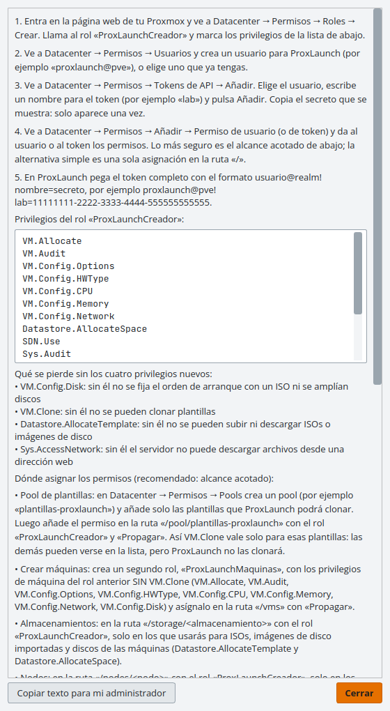

*La guía del token es larga y se desplaza. «Copiar texto para mi administrador» pone el texto en el portapapeles para que se lo envíes.*

1. En la página web de Proxmox, ve a **Datacenter → Permisos → Roles → Crear**. Llama al
   rol `ProxLaunchCreador` y marca los privilegios de la lista de arriba.
2. Ve a **Datacenter → Permisos → Usuarios** y crea un usuario para ProxLaunch (por
   ejemplo `proxlaunch@pve`), o usa uno que ya tengas.
3. Ve a **Datacenter → Permisos → Tokens de API → Añadir**. Elige el usuario, escribe un
   nombre para el token (por ejemplo `lab`) y pulsa **Añadir**. **Copia el secreto que se
   muestra: solo aparece una vez.**
4. Ve a **Datacenter → Permisos → Añadir → Permiso de usuario** (o **de token**). Pon la
   ruta `/`, elige el usuario o el token, el rol `ProxLaunchCreador` y deja marcado
   **Propagar**. Esta es la **alternativa simple**: es cómoda, pero da el permiso sobre todo el
   servidor. Si vas a usar ISOs, importar discos o clonar plantillas, lo recomendado es el
   [alcance acotado](#permisos-para-el-administrador-alcance-acotado).
5. En ProxLaunch, pega el token completo con el formato `usuario@realm!nombre=secreto`.
   Por ejemplo: `proxlaunch@pve!lab=11111111-2222-3333-4444-555555555555`.

Recomendaciones de la propia aplicación:

- Usa siempre un token con los permisos mínimos en lugar de `root@pam`. Si el token se
  filtra, el daño es mucho menor y puedes revocarlo sin cambiar contraseñas.
- Al crear el token puedes desmarcar **Separación de privilegios** solo si ya asignaste los
  permisos al usuario. Si la dejas marcada, el token necesita sus propios permisos
  (paso 4, eligiendo el token).

Un token **no pasa por el segundo factor (2FA)**. Si tu usuario exige un método de 2FA que
ProxLaunch no admite, el token es la salida.

---

## Primer inicio y conexión

### La ventana de bienvenida

Al abrir ProxLaunch por primera vez (o sin una sesión abierta) ves la ventana sin conexión.


Pulsa **Conectar...** (o usa **Archivo > Conectar...**, atajo `Ctrl+K`) para abrir la ventana
**Conectar con Proxmox**.

### Los datos de conexión

Con el método **API Token (recomendado)** la ventana se ve así:


Con el método **Usuario y contraseña** aparecen los campos de usuario, realm y contraseña, y si el usuario es
`root` con realm `pam`, un aviso:

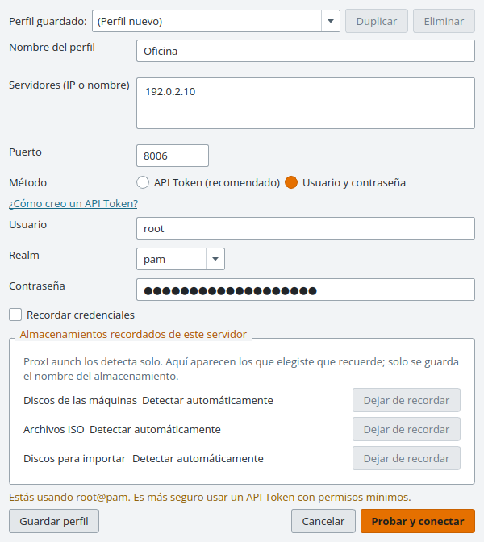

En **modo avanzado** se añaden dos opciones y los almacenamientos recordados pasan a ser listas editables:


#### Opciones de la ventana «Conectar con Proxmox»

| Campo | Modo | Para qué sirve | Valores | Defecto | Límites y notas |
|---|---|---|---|---|---|
| **Perfil guardado** | Básico | Carga un perfil de conexión que ya guardaste. | «(Perfil nuevo)» o el nombre de un perfil. | «(Perfil nuevo)» en un equipo sin perfiles. | Al elegir uno se rellenan los campos. |
| **Duplicar** | Básico | Copia el perfil elegido; la copia se llama, por ejemplo, «Oficina (copia)». | Botón. | Desactivado sin perfil elegido. | |
| **Eliminar** | Básico | Borra el perfil elegido, su secreto del llavero y las huellas que solo usaba ese perfil. | Botón; pide confirmar (por defecto «No»). | Desactivado sin perfil elegido. | |
| **Nombre del perfil** | Básico | Un nombre que te ayude a reconocerlo. | Texto libre. | Vacío (se usa el primer servidor). | Si ya existe otro con el mismo nombre ves un aviso que **no bloquea**: «Ya existe otro perfil con este nombre. Puedes guardarlo igualmente, pero costará distinguirlos.» |
| **Servidores (IP o nombre)** | Básico | Dónde está Proxmox. Con varios, ProxLaunch prueba el primero y, si no responde, el siguiente. | Un servidor por línea: IPv4, IPv6 o nombre DNS. | Vacío. | Puedes pegar `https://192.0.2.10:8006`: se quitan `https://`, la ruta y el puerto. Si no es válido: «Escribe solo el nombre o la IP del servidor.» |
| **Puerto** | Básico | Puerto HTTPS de la API. | Entero. | `8006` | 1 a 65535. Si pegas un servidor con puerto (`192.0.2.10:8443`) y dejas el campo en blanco o en 8006, manda el puerto del servidor. |
| **Método** | Básico | Cómo te identificas. | **API Token (recomendado)** o **Usuario y contraseña**. | API Token. | Cambia los campos visibles. |
| **Token** | Básico (método token) | La «llave» creada por tu administrador. | `usuario@realm!nombre=secreto` | Vacío; marcador «usuario@realm!nombre=secreto». | Si no tiene ese formato: «El token debe tener el formato usuario@realm!nombre=secreto.» Con credenciales recordadas ves «(guardado en el llavero)». |
| **¿Cómo creo un API Token?** | Básico | Abre la guía con los pasos y los privilegios (ver [Cómo se prepara](#cómo-se-prepara-pasos-para-el-administrador)). | Enlace. | | |
| **Usuario** | Básico (método contraseña) | Tu usuario, sin el realm. | Texto. | Vacío. | Obligatorio: «Escribe tu usuario.» Si escribes `root@pam` completo se normaliza. |
| **Realm** | Básico (método contraseña) | De dónde viene la cuenta. | `pam`, `pve` o el que escribas (lista editable). | `pam` | |
| **Contraseña** | Básico (método contraseña) | Tu contraseña. | Texto enmascarado. | Vacío. | Obligatoria: «Escribe tu contraseña.» |
| **Recordar credenciales** | Básico | Guarda el token o la contraseña en el llavero del sistema. | Casilla. | **Desmarcada.** | Ver [más abajo](#la-casilla-recordar-credenciales). |
| **Ignorar verificación SSL** | Avanzado | Conectar sin comprobar la huella del servidor. **Es inseguro**: solo en redes de prueba que controles. | Casilla (con botón de ayuda «?»). | Desmarcada. | Con contraseña pide confirmar «Conexión sin verificar» en cada conexión. La barra superior muestra «⚠ Conexión sin verificar». |
| **Forzar compatibilidad con la versión...** | Avanzado | Hace que ProxLaunch se comporte como si el servidor tuviera otra versión de Proxmox. | «Detectada» o una versión conocida. | «Detectada». | Solo para casos especiales. La barra superior lo marca como «(forzada)». |
| **Almacenamientos recordados de este servidor** | Básico (texto) / Avanzado (listas) | Muestra el almacenamiento que elegiste recordar para **Discos de las máquinas**, **Archivos ISO** y **Discos para importar**. | Nombre o «Detectar automáticamente». | «Detectar automáticamente». | En avanzado, **Dejar de recordar** lo olvida. Si el recordado ya no existe aparece «x (no disponible)». |
| **Guardar perfil** | Básico | Guarda los datos sin conectar. | Botón. | | No exige credenciales; no guarda el secreto salvo que marques «Recordar credenciales». |
| **Cancelar** | Básico | Cierra la ventana sin conectar. | Botón. | | |
| **Probar y conectar** | Básico | Valida, comprueba el certificado, conecta y, si hace falta, pide el segundo factor. | Botón (predeterminado). | | Muestra el estado: «Comprobando el certificado del servidor...», «Conectando...», «Esperando el segundo factor...». |

Los errores de validación salen junto a cada campo, en rojo, antes de enviar nada:


#### El token

Un **API Token** es una «llave» que tu administrador crea para que una aplicación entre a Proxmox sin usar una
contraseña personal. Se escribe `usuario@realm!nombre=secreto`; por ejemplo
`proxlaunch@pve!lab=11111111-2222-3333-4444-555555555555` (ficticio). Pégalo completo, sin espacios ni saltos de
línea. Es el método recomendado porque:

- se puede revocar sin cambiar contraseñas y puede tener solo los permisos mínimos;
- **no pasa por el segundo factor (2FA)**, así que sirve si tu usuario usa un método de 2FA que ProxLaunch no admite;
- ProxLaunch no necesita guardar tu contraseña personal.

El token no se renueva: se usa tal cual mientras sea válido. Cómo se crea: ver
[Cómo se prepara](#cómo-se-prepara-pasos-para-el-administrador).

#### La casilla «Recordar credenciales»

**Viene desmarcada.** Con ella desmarcada, el token o la contraseña **no se guardan en ningún sitio**: al cerrar
ProxLaunch desaparecen y se te pedirán otra vez. Déjala así en equipos compartidos.

Si la marcas, el secreto se guarda en el **llavero del sistema** (en Ubuntu, el servicio de secretos del escritorio;
en Windows, el Administrador de credenciales) bajo el nombre `ProxLaunch`; **nunca va a un archivo**. Si tu sistema
no tiene llavero verás «No hay un llavero disponible en este equipo; las credenciales no se guardarán» y tendrás
que escribir el secreto cada vez.

Si desmarcas la casilla en un perfil que ya tenía secreto guardado, la ventana avisa: «Las credenciales guardadas
se borrarán del llavero al guardar o conectar.» Al eliminar un perfil también se borra su secreto.

#### Perfiles de conexión

Un **perfil de conexión** guarda *cómo llegar a un servidor*: nombre, servidores, puerto, método, usuario, realm,
si recuerdas credenciales y los nombres de los almacenamientos recordados. **Nunca** guarda token, contraseña ni
tickets (esos solo van al llavero, y solo si lo pides). Se crea con **Guardar perfil** o al conectar, y se gestiona
con **Duplicar** y **Eliminar**.

> **Los perfiles de conexión no se exportan ni se importan.** Viven solo en el equipo donde los creaste
> (`perfiles.json`, ver [Privacidad y seguridad](#qué-se-guarda-y-dónde)). Para usar el mismo servidor en otro
> equipo, créalo de nuevo. Lo que sí se puede compartir son los
> [perfiles de máquina](#compartir-perfiles-exportar-e-importar), los [lotes guardados](#guardar-y-abrir-lotes) y los
> [CSV](#importar-máquinas-desde-un-csv), que no contienen datos de conexión.

### La huella del certificado (confianza en el primer uso)

Los servidores Proxmox suelen usar un certificado propio. Para saber que hablas con *tu* servidor y no con uno
falso, ProxLaunch usa **confianza en el primer uso** (*TOFU*, «Trust On First Use»): la primera vez te muestra la
**huella SHA-256** del certificado y tú la comparas con la que te dio tu administrador; si la aceptas, ProxLaunch la
guarda y desde entonces avisa si cambia.

La primera vez que te conectas a un servidor y puerto, ProxLaunch **no envía todavía tu token ni tu contraseña**. Antes
abre **Confiar en este servidor**:


1. Pide a tu administrador la huella del certificado del servidor.
2. Compara las dos. Deben ser idénticas.
3. Si coinciden, pulsa **Confiar y continuar**. Si no coinciden o tienes dudas, pulsa **Cancelar** (es el botón
   predeterminado): no se conecta y no se guarda nada.

ProxLaunch guarda la huella de ese servidor y puerto (en `huellas.json`). Las siguientes veces no pregunta.

> Si aparece «No tenemos registro de este servidor porque el archivo de huellas se dañó…», ProxLaunch perdió su
> lista de servidores conocidos. Compara la huella con la de tu administrador antes de confiar, como la primera vez.

#### Si aparece «El certificado del servidor cambió»


No se envía ninguna credencial. Qué hacer:

1. Pulsa **Cerrar**. No se conecta.
2. Pregunta a tu administrador si renovó el certificado. Si lo hizo, te dará la huella nueva.
3. Si coincide con la que te dio y confías, tienes dos caminos:
   - En **modo básico** no hay botón para continuar. Cambia a **Ajustes > Modo > Avanzado** y vuelve a intentarlo.
   - En **modo avanzado** aparece **Reemplazar la huella guardada** (en la captura se ve porque está en avanzado).
     ProxLaunch te pide confirmación antes de reemplazarla.
4. Si el administrador **no** cambió nada, no te conectes: podría ser un intento de suplantación. Avísale.

### Si el servidor pide un código (segundo factor, 2FA)

Si tu cuenta tiene segundo factor, tras escribir el usuario y la contraseña aparece **Código de verificación**:

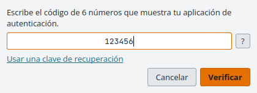

| Elemento | Qué hace | Límites |
|---|---|---|
| Campo del código | Escribe los 6 números de tu aplicación de autenticación. | Exactamente 6 dígitos. |
| **Usar una clave de recuperación** / **Usar el código de la aplicación** | Cambia entre el código de la aplicación y una clave de recuperación. Solo aparece si el servidor admite ambos. | La clave admite hasta 64 caracteres y no puede quedar vacía («Escribe la clave de recuperación.»). Cada clave sirve **una sola vez**. |
| **Verificar** | Envía el código. | Si falla: «El código no es correcto o ya venció. Espera al siguiente código e inténtalo de nuevo.» Puedes reintentar sin volver a escribir usuario y contraseña. |
| **Cancelar** | Cierra sin conectar. | |

ProxLaunch **no guarda** el código ni las claves de recuperación. Si el servidor exige otro método de 2FA (como
llaves de seguridad), verás «Este usuario exige un método de segundo factor que ProxLaunch no admite. Usa un API
Token.»

### Cuando se conecta

Entras a la ventana de trabajo. La barra superior muestra el perfil y el usuario, la versión de Proxmox y el tipo de
sitio (ver [el recorrido de la ventana](#recorrido-de-la-ventana)). La barra de estado dice «Conectado». ProxLaunch lee
entonces los nodos, almacenamientos y redes («Buscando nodos, almacenamientos y redes...»); el botón **Actualizar**
repite esa lectura.

Si usaste varios servidores y el primero no respondía, verás «Conectado a 192.0.2.11 (192.0.2.10 no respondió)». Es
normal.

Avisos que pueden aparecer arriba:

- «Con este usuario no podrás crear máquinas: falta el permiso VM.Allocate». El botón **Crear máquina** queda
  desactivado. Pide el permiso a tu administrador.
- «A tu usuario le faltan permisos recomendados (…). Algunas acciones podrían fallar.»
- «Topología desconocida (N nodos): a tu usuario le falta el permiso Sys.Audit en «/» para ver el clúster. Puedes
  seguir trabajando.»
- Un aviso si el servidor es más nuevo que la última versión que ProxLaunch ha probado. Puedes continuar.
- Con Proxmox VE 7 o anterior, ProxLaunch no puede usarse: «ProxLaunch requiere Proxmox VE 8.0 o superior».
- **Reintentar**: si algún nodo de un clúster no respondió, ver [Un nodo que no responde](#un-nodo-que-no-responde).

---

## Crear una máquina en modo básico

El **modo básico** es el que ves la primera vez. Muestra lo imprescindible y usa valores seguros para el resto. Pasa el
ratón por encima de un campo, o pulsa su botón «?», para leer una ayuda corta. Con los valores por defecto,
normalmente solo necesitas escribir el **nombre**.

### Recorrido de la ventana

![Ventana de trabajo conectada a un servidor individual en modo básico, de arriba abajo: barra superior «Oficina · ana@pve!lab», «Proxmox VE 9.2» y «Servidor individual»; botón «Actualizar» y «1 nodo(s) encontrados»; grupos «Perfil de máquina» (Servidor pequeño — De fábrica), «Lote» (cantidad 1), «Origen del sistema», «General» (VMID 101, nombre srv-web-01), «Firmware», «Cómputo», «Discos» y «Red». A la derecha el panel «Resumen» con el botón «Crear máquina» y el panel «Progreso». Abajo la barra de estado «Conectado».](img/13-trabajo-individual-basico.png)

| Zona | Qué hay |
|---|---|
| **Barra superior** | La marca, el perfil y el usuario de la sesión (`Oficina · ana@pve!lab`), la versión («Proxmox VE 9.2», con « (forzada)» si la forzaste) y el tipo de sitio: «Servidor individual», «Clúster «demo» — 3 nodos» o «Topología desconocida (N nodos)». Con **Ignorar verificación SSL** añade «⚠ Conexión sin verificar». |
| **Actualizar** | Vuelve a leer nodos, almacenamientos y redes. A su lado: «1 nodo(s) encontrados.» |
| **Perfil de máquina** | Rellena el formulario con un hardware ya preparado. Ver [Perfiles de máquina](#perfiles-de-máquina). |
| **Lote** | La **Cantidad de máquinas**. Con 1 (valor inicial) no ves más. Ver [Lotes](#crear-varias-máquinas-de-una-vez-lotes). |
| **Origen del sistema** | De dónde sale el sistema operativo. Ver [Origen](#elegir-el-origen-del-sistema-operativo). |
| **General, Firmware, Cómputo, Discos, Red** | El formulario de la máquina (siguientes apartados). |
| **Resumen** | Lo que se va a crear, en lenguaje llano, y el botón **Crear máquina**. |
| **Progreso** | Las etapas de la creación (ver [Progreso](#entender-el-progreso-y-los-resultados)). |
| **Barra de estado** | «Sin conexión», «Conectado», «Perfil «X» aplicado», «Se importaron N máquinas desde «f»», etc. |

El formulario es más alto que una pantalla normal: en la aplicación se **desplaza** con la rueda del ratón (las
capturas de este manual lo muestran entero).

### General

| Campo | Para qué sirve | Valores | Defecto | Límites |
|---|---|---|---|---|
| **Número de máquina (VMID)** | Identifica la máquina en todo el servidor. | Entero. | El siguiente libre del servidor (101 en la captura). | 100 a 999 999 999. Al terminar de escribir se comprueba que esté libre: «El número N ya lo usa otra máquina. Prueba con M». |
| **Nombre** | Nombre de la máquina. | Letras sin acentos, números y guiones; sin guion al principio ni al final; sin guion bajo (`_`). Admite puntos entre partes (nombre DNS). | Vacío (marcador «por ejemplo srv-web-01»). | Hasta 253 caracteres; cada parte entre puntos, hasta 63. |
| **Nodo destino** | Dónde se crea. **Solo aparece en un clúster.** | **Automático** o **Manual** (más una lista de nodos). | Automático. | En Automático ProxLaunch elige el nodo con más memoria y espacio libres y lo dice: «Nodo elegido: pve1 (más memoria y espacio libres)». Los nodos apagados salen como «Sin conexión» y no se pueden elegir. |

Debajo de esos campos, el grupo **General** trae las **opciones de la máquina** (encender al terminar, arrancar con el
servidor, notas, etiquetas y pool; en avanzado, también el orden de arranque y la protección contra borrado). Todas
vienen en su valor por defecto, que equivale al comportamiento de siempre, salvo **Añadir notas de origen**. Se explican
una por una en [Opciones de la máquina](#opciones-de-la-máquina).

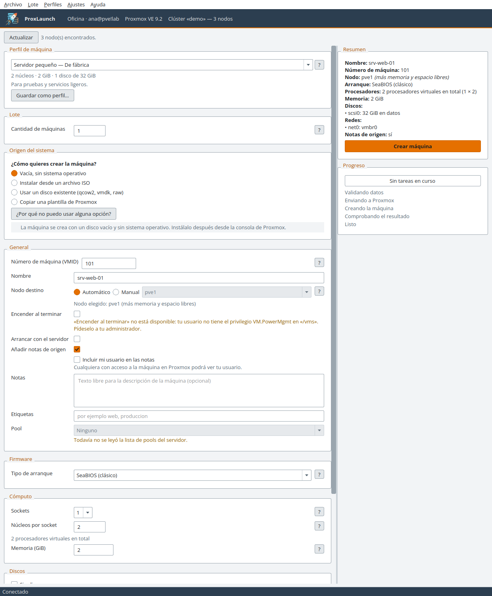

#### Un nodo que no responde

Si en un clúster un nodo no responde al leer el servidor, ProxLaunch sigue con los demás, lo marca «Sin conexión» y
muestra un aviso con el botón **Reintentar** (junto a **Actualizar**), que vuelve a leer **solo esos nodos**:

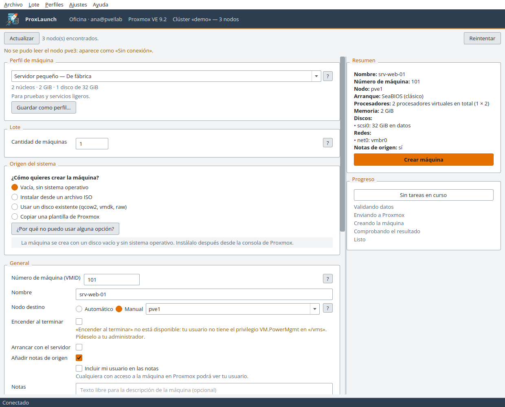

### Firmware

| Campo | Modo | Para qué sirve | Valores | Defecto |
|---|---|---|---|---|
| **Tipo de arranque** | Básico | El programa con el que arranca la máquina. | **SeaBIOS (clásico)**: sirve para casi todo. **UEFI (OVMF)**: lo piden algunos sistemas, como Windows 11. | SeaBIOS (clásico). |
| **Almacenamiento de UEFI** | Avanzado, solo con UEFI | Dónde se guarda la configuración de UEFI. | «Automático (el del primer disco)» o un almacenamiento. | Automático. |
| **TPM 2.0** | Avanzado | Añade un módulo TPM virtual (Windows 11 lo exige). | Casilla. | Desmarcada (el asistente de sistema operativo la marca en Windows). |
| **Agente de QEMU** | Avanzado | Permite al servidor hablar con el sistema invitado. | Casilla. | Desmarcada (el asistente la marca en Windows). |

### Cómputo

| Campo | Modo | Para qué sirve | Valores | Defecto | Límites |
|---|---|---|---|---|---|
| **Sockets** | Básico | Procesadores virtuales «físicos». | Lista. | 1 | 1 a 4. |
| **Núcleos por socket** | Básico | Núcleos de cada socket. Debajo ves el total («2 procesadores virtuales en total»). | Entero. | 2 | 1 a 128. |
| **Tipo de CPU** | Avanzado | Qué procesador «ve» la máquina. | `x86-64-v2-AES`, `x86-64-v2`, `x86-64-v3`, `x86-64-v4`, `host`, `kvm64`. | `x86-64-v2-AES` | `host` rinde más pero impide mover la máquina entre nodos con procesadores diferentes (muestra un aviso). |
| **Memoria (GiB)** | Básico | Memoria RAM. | Número; admite decimales con coma o punto (`0,5` = 512 MiB). | 2 | Mínimo 16 MiB. |
| **Ballooning** | Avanzado | Deja que el servidor recupere memoria que la máquina no usa. | **Predeterminado de Proxmox**, **Activado**, **Desactivado**. | Predeterminado de Proxmox. | |
| **Memoria mínima (GiB)** | Avanzado, con Ballooning **Activado** | La memoria que la máquina conserva siempre. | Número. | 1 | Entre 16 MiB y la memoria total. |

### Discos

| Campo | Modo | Para qué sirve | Valores | Defecto | Límites |
|---|---|---|---|---|---|
| **Sin disco** | Básico | Crea la máquina sin ningún disco (útil si lo añadirás o importarás después). | Casilla. | Desmarcada; se fuerza si el servidor no tiene almacenamiento apto. | |
| **Controlador SCSI** | Avanzado | El controlador de los discos SCSI. | `virtio-scsi-single` o `virtio-scsi-pci`. | `virtio-scsi-single` | Es el mejor y el único controlador SCSI que permite **IO Thread** (los discos VirtIO lo admiten siempre). |
| **Disco** | Básico | Nombre del dispositivo, asignado solo: `scsi0`, `virtio0`, `sata0`, `ide0`… | (solo lectura) | `scsi0` | Máximos por tipo de conexión: **SCSI 31, VirtIO 16, SATA 6, IDE 4**. |
| **Almacenamiento** | Básico | Dónde se guarda el disco. | Los del nodo con «tipo y espacio libre», por ejemplo «datos (dir, 1024 GiB libres)». | El de más espacio libre. | Obligatorio. Los inactivos salen como «— Inactivo» y los que ya no existen como «x (no existe)». |
| **Tamaño (GiB)** | Básico | Tamaño del disco. | Entero. | 32 | **1 a 65 536 GiB.** |
| **Conexión (bus)** | Avanzado | Tipo de conexión del disco virtual. | SCSI (recomendado), VirtIO (muy rápido; algunos sistemas necesitan controladores), SATA e IDE (los más compatibles y lentos). | SCSI | |
| **Formato** | Avanzado | Cómo se guarda. **raw** ocupa todo el espacio y es el más rápido; **qcow2** crece según se usa y permite instantáneas. | Automático, raw, qcow2. | Automático. | qcow2 solo en almacenamientos de tipo directorio, NFS o CIFS; en los demás aparece desactivado como «(automático, raw)». |
| **Discard** | Avanzado | Avisa al almacenamiento de qué espacio ya no se usa para que lo recupere. | Casilla. | Marcada. | Se desactiva si el bus no lo admite. |
| **SSD** | Avanzado | Hace que el sistema vea el disco como de estado sólido. | Casilla. | Marcada. | No disponible con VirtIO. |
| **IO Thread** | Avanzado | Dedica un hilo propio al disco; mejora el rendimiento con mucha actividad. | Casilla. | Marcada. | Solo con VirtIO, o con SCSI y `virtio-scsi-single`. |
| **Quitar** | Básico | Quita ese disco. | Botón. | | Siempre queda uno, salvo que marques **Sin disco**. |
| **Agregar disco** | Básico | Añade otro disco. | Botón. | | Respeta el máximo por tipo de conexión. |

Debajo de la tabla pueden aparecer avisos: por ejemplo, si un almacenamiento «solo ocupa el espacio a medida que se
usa» y los discos suman más de lo libre. Con el origen **Vacía, sin sistema operativo** (el predeterminado), el
disco se crea **vacío**: ProxLaunch **no instala ningún sistema operativo**.

### Red

| Campo | Modo | Para qué sirve | Valores | Defecto | Límites |
|---|---|---|---|---|---|
| **Interfaz** | Básico | Nombre de la tarjeta, asignado solo: `net0`, `net1`… | (solo lectura) | `net0` | **Máximo 32 interfaces.** |
| **Red (bridge)** | Básico | El «conmutador virtual» al que se conecta (lo habitual es `vmbr0`). | Los bridges del nodo. | `vmbr0` si existe; si no, el primero. Marcador «Elige una red». | Obligatorio. Los que ya no existen salen como «x (no existe)». Sin redes: «El nodo no tiene redes (bridges) disponibles» y no puedes crear. |
| **Tarjeta** | Avanzado | El tipo de tarjeta de red. | **VirtIO** (la más rápida) o **Intel E1000** (más compatible con sistemas antiguos). | VirtIO | |
| **VLAN** | Básico | Etiqueta de VLAN, si tu red la usa. | Entero o vacío. | Vacío («Sin VLAN»). | 1 a 4094. |
| **MTU** | Avanzado | Tamaño máximo de paquete de la tarjeta. Ver [MTU y límite de velocidad](#mtu-y-límite-de-velocidad-de-la-red). | **Heredar del bridge**, **Igual al bridge** o un número. | Heredar del bridge. | Número de 576 a 65520. Solo con tarjeta **VirtIO**. |
| **Límite (MB/s)** | Avanzado | Velocidad máxima de la tarjeta. | Número (admite decimales) o vacío («Sin límite»). | Vacío (sin límite). | Mayor que 0 y hasta 1 000 000 000. Vale con cualquier tarjeta. |
| **Quitar** / **Agregar interfaz** | Básico | Quita o añade una interfaz. | Botones. | | |

### Resumen y crear

A la derecha, el panel **Resumen** muestra lo que se va a crear: nombre, número, nodo, arranque, procesadores,
memoria, discos y redes, y debajo las [opciones de la máquina](#opciones-de-la-máquina): la línea **Notas de origen**
sale siempre, y el resto (**Notas**, **Encender al terminar**, **Arrancar con el servidor**, **Etiquetas**, **Pool**,
**Orden de arranque**, **Espera de arranque**, **Proteger contra borrado**) solo cuando difieren de su valor por defecto.

- Si algo está mal, el panel lo lista bajo «Para crear la máquina hay que corregir:», el botón **Crear máquina** queda
  desactivado y cada error aparece también junto a su campo:


- Si un valor oculto del modo avanzado no es el predeterminado, el resumen lo muestra bajo «Opciones avanzadas que se
  aplicarán (ocultas en modo básico)». Nada se aplica a escondidas.
- Pueden aparecer avisos que **no** bloquean: por ejemplo, si pides más núcleos o memoria de los que tiene el nodo.
- Con la **Cantidad de máquinas** en 2 o más, el botón pasa a llamarse **Ver resumen** (ver [Lotes](#crear-varias-máquinas-de-una-vez-lotes)).
- Cuando todo esté bien, pulsa **Crear máquina**. La máquina se crea **detenida**, salvo que hayas marcado **Encender al
  terminar**.

---

## Modo avanzado

Cámbialo en **Ajustes > Modo > Avanzado** (ver [Menús y ajustes](#menús-y-ajustes)). Al cambiar no pierdes lo que ya
escribiste, y ProxLaunch recuerda tu elección. Al volver a **Básico**, las opciones que cambiaste se **conservan**
(solo se ocultan) y el resumen te las sigue mostrando.

![Ventana de trabajo en modo avanzado con el origen «Vacía»: en Firmware aparecen «Tipo de arranque» UEFI (OVMF), «Almacenamiento de UEFI», «TPM 2.0» y «Agente de QEMU» marcados; en Cómputo, 2 sockets, 4 núcleos, tipo de CPU x86-64-v3, memoria 8 GiB, Ballooning «Activado» y «Memoria mínima (GiB)» 2; en Discos, «Controlador SCSI» y dos discos con las columnas de conexión, formato, Discard, SSD e IO Thread; en Red, dos interfaces con tarjeta y VLAN. En el grupo Lote aparece «Etiquetar las máquinas» y en Perfil de máquina el botón «Administrar perfiles...».](img/21-avanzado-formulario.png)

Lo que añade el modo avanzado está en las tablas de la sección anterior (columna **Modo** = Avanzado). Además:

- **Opciones de la máquina:** **Orden de arranque**, **Espera (s)** y **Proteger contra borrado** en el grupo
  **General**, y las columnas **MTU** y **Límite (MB/s)** en la tabla de red
  ([Opciones de la máquina](#opciones-de-la-máquina)).
- **Perfil de máquina:** el botón **Administrar perfiles...** y el menú **Perfiles > Administrar perfiles…**
  ([Perfiles](#perfiles-de-máquina)).
- **Lote:** separador, número inicial, relleno, VMID inicial, nodos elegidos, reparto y **Etiquetar las máquinas**
  ([Lotes](#crear-varias-máquinas-de-una-vez-lotes)).
- **Origen:** **Tipo de copia**, **Guardar la copia en**, procesadores (sockets) y tipo de CPU al clonar, y la casilla
  **Disco compatible (SATA)** ([Origen](#elegir-el-origen-del-sistema-operativo)).
- **Conexión:** **Ignorar verificación SSL**, **Forzar compatibilidad con la versión...**, listas de almacenamientos
  recordados y **Reemplazar la huella guardada**.
- **CSV:** las listas **Codificación** y **Separador** siempre visibles ([CSV](#importar-máquinas-desde-un-csv)).
- **Descargas:** la casilla **Comprobar el certificado del servidor web (recomendado)**
  ([Transferencias](#descargar-un-archivo-en-el-servidor)).

### Discos y red en detalle

La tabla de discos del modo avanzado muestra todas las columnas. Las casillas que no se pueden usar en una
combinación se **desactivan**, y al pasar el ratón ves el motivo. En la captura, el disco `virtio0` tiene **SSD**
desactivado (no se admite con VirtIO) y el disco `sata0` tiene **IO Thread** desactivado (necesita VirtIO o SCSI con
`virtio-scsi-single`):


La tabla de red añade la **Tarjeta** y la **VLAN** de cada interfaz:

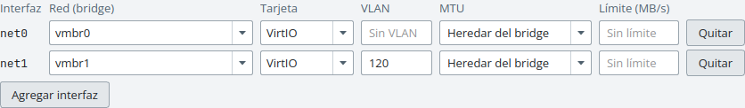

Si vuelves a modo básico, ProxLaunch vuelve a verificar siempre por huella, aunque el perfil de conexión tuviera
«Ignorar verificación SSL» activo.

### Cambiar el tema

**Ajustes > Tema** ofrece **Automático** (valor inicial: sigue el tema claro u oscuro de tu sistema, en vivo),
**Oscuro** y **Claro**. Si la detección falla (es frecuente en Linux), se usa el oscuro; elige a mano si lo necesitas.
El tema se recuerda entre sesiones.

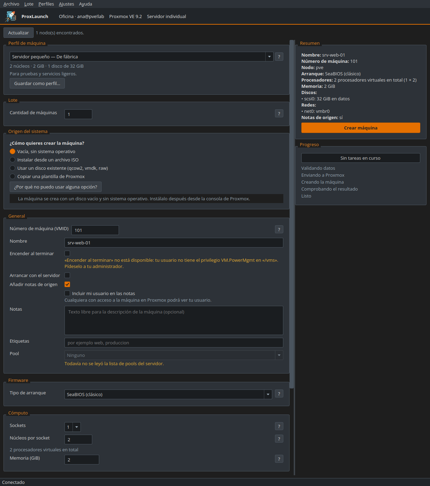

---

## Opciones de la máquina

Desde la versión 0.6, además del hardware, puedes decidir **cómo queda la máquina** al terminar de crearse: si se
enciende, si arranca con el servidor, qué notas y etiquetas lleva, en qué pool está, si está protegida contra borrado y
cómo se comporta su red (MTU y límite de velocidad). Estas opciones aparecen en el grupo **General** (y las de red, en la
tabla **Red**) y funcionan igual en una máquina suelta, en un [lote](#opciones-de-la-máquina-en-un-lote), en un
[CSV](#columnas-del-csv) y en un [lote guardado](#guardar-y-abrir-lotes).

Todas vienen con un valor por defecto que **reproduce el comportamiento de siempre** (la máquina se crea detenida, sin
notas propias, sin etiquetas extra, sin pool y sin protección), con una excepción: **Añadir notas de origen** viene
marcada.

En modo básico ves las que cambian lo que más se usa; el modo avanzado añade el orden de arranque, la protección y las
columnas de red. Con el modo básico, lo que hayas fijado en avanzado se sigue aplicando y el resumen lo lista bajo
«Opciones avanzadas que se aplicarán (ocultas en modo básico)».

![Ventana de trabajo en modo básico con todas las opciones de la máquina fijadas: en General, «Encender al terminar», «Arrancar con el servidor», «Añadir notas de origen» e «Incluir mi usuario en las notas» marcadas (con el aviso «Cualquiera con acceso a la máquina en Proxmox podrá ver tu usuario.»), el campo «Notas» con «Servidor web del equipo de ejemplo», «Etiquetas» con «web, produccion» y «Pool» con «produccion». En Red solo se ven la interfaz, el bridge y la VLAN. A la derecha, el panel Resumen con las líneas «Notas de origen: sí, con tu usuario», «Notas», «Encender al terminar», «Arrancar con el servidor», «Etiquetas», «Pool» y, bajo «Opciones avanzadas que se aplicarán (ocultas en modo básico)», el orden y la espera de arranque, la protección y el MTU y el límite de las dos redes.](img/61-opciones-general.png)

*Modo básico. Lo que se fijó en modo avanzado sigue aplicándose y el resumen lo muestra.*


*Modo avanzado: todas las opciones visibles.*

### Resumen de las opciones

| Opción | Modo | Defecto | Qué hace en Proxmox | Privilegio | ¿La guarda un perfil? | Columna CSV |
|---|---|---|---|---|---|---|
| **Encender al terminar** | Básico | Desmarcada | Enciende la máquina al final, con una orden aparte. | `VM.PowerMgmt` en `/vms` (**opcional**) | No | `encender` |
| **Arrancar con el servidor** | Básico | Desmarcada | `onboot=1`: se enciende sola cuando arranca el servidor. | `VM.Config.Options` | **Sí** | `arranque_auto` |
| **Orden de arranque** | Avanzado | Vacío | Parte `order` de `startup`. | `VM.Config.Options` | No | — |
| **Espera (s)** | Avanzado | Vacío | Parte `up` de `startup`. | `VM.Config.Options` | No | — |
| **Añadir notas de origen** | Básico | **Marcada** | Escribe un bloque con la versión, la fecha, el lote y el perfil en las notas (`description`). | `VM.Config.Options` (no en clones) | No | — (usa el formulario) |
| **Incluir mi usuario en las notas** | Básico | Desmarcada | Añade tu usuario al bloque anterior. | Igual que las notas | No | — (usa el formulario) |
| **Notas** | Básico | Vacío | Tu texto, en las notas de la máquina. | Igual que las notas | No | `notas` |
| **Etiquetas** | Básico | Vacío | Tus etiquetas, además de `proxlaunch` y `lote-…`. | `VM.Config.Options` | No | `etiquetas` |
| **Pool** | Básico | Ninguno | Crea la máquina dentro de un pool existente. | `VM.Allocate` (rol); `Pool.Audit` (**opcional**) para ver la lista | No | `pool` |
| **Proteger contra borrado** | Avanzado | Desmarcada | `protection=1`: Proxmox no deja eliminarla. | `VM.Config.Options` | No | `proteger` |
| **MTU** (por tarjeta) | Avanzado | Heredar del bridge | `mtu` en la tarjeta. Solo VirtIO. | `VM.Config.Network` | **Sí** | `mtu` (tarjeta 1) |
| **Límite (MB/s)** (por tarjeta) | Avanzado | Sin límite | `rate` en la tarjeta. | `VM.Config.Network` | **Sí** | `limite_red` (tarjeta 1) |

«Un perfil» guarda solo el hardware (y, de las opciones, las dos marcadas con **Sí**); ver
[Perfiles de máquina](#perfiles-de-máquina). Ninguna de las opciones nuevas depende de la versión de Proxmox: funcionan
de la 8.0 a la 9.2.

### Cuando una opción está desactivada

Si a tu usuario le falta el privilegio que una opción necesita, esa opción **no se oculta: queda desactivada** y debajo
se explica qué privilegio falta y en qué ruta. Si ya tenía un valor (por ejemplo, de un lote guardado), vuelve a su valor
por defecto y ProxLaunch lo dice: «Se restableció «Encender al terminar» a su valor por defecto.»

![Ventana de trabajo en modo básico con un usuario sin los privilegios opcionales: «Encender al terminar» desmarcada y desactivada, con el aviso ««Encender al terminar» no está disponible: tu usuario no tiene el privilegio VM.PowerMgmt en «/vms». Pídeselo a tu administrador.»; «Arrancar con el servidor» y «Añadir notas de origen» disponibles, y «Pool» desactivado en «Ninguno» con el aviso «No puedes ver la lista de pools: falta el privilegio Pool.Audit en «/pool». Eso no significa que no existan pools; pídeselo a tu administrador.» El Resumen solo muestra «Notas de origen: sí».](img/63-opciones-deshabilitadas.png)

Si ProxLaunch no consigue leer tus permisos, no desactiva nada: Proxmox decide al crear. Un privilegio concedido solo en
una máquina concreta (`/vms/<número>`) no basta para habilitar **Encender al terminar**, porque el número todavía no existe
al rellenar el formulario (ver [Privilegios opcionales](#privilegios-opcionales-no-forman-parte-del-rol)).

### Encender al terminar y arrancar con el servidor

**Encender al terminar** (defecto: desmarcada). Cuando la máquina termina de crearse **y de ajustarse** (por ejemplo,
cuando ya se ampliaron los discos), ProxLaunch envía una orden de encendido. Es siempre lo **último** que hace con la
máquina; la petición de creación nunca lleva el encendido. Necesita el privilegio opcional `VM.PowerMgmt` en `/vms`.

- Si la orden de encendido **falla**, la máquina queda **creada y apagada**, se marca como «Lista, con avisos» con el
  texto «Se creó, pero no se pudo encender. Enciéndela desde Proxmox si la necesitas.» y el lote **sigue** con las demás
  máquinas. Un fallo al encender nunca pausa el lote ni deshace nada.
- Si a la máquina le quedan **ajustes por aplicar**, o si se confirmó su creación después (con **Comprobar ahora**), **no se
  enciende** y el aviso dice: «No se encendió: quedaron ajustes por aplicar o su creación se confirmó después (al
  comprobarla). Revisa la máquina y, si hace falta, enciéndela desde Proxmox.»
- Mientras se enciende, la tabla del lote muestra «Ajustando la máquina».
- Los perfiles **no** guardan esta casilla: cada vez decides tú.

Ejemplo: para dejar listos 10 servidores web ya encendidos, marca **Encender al terminar** antes de **Ver resumen**; en la
[simulación](#simulación) verás al final de cada máquina la orden `POST …/status/start`.

**Arrancar con el servidor** (defecto: desmarcada). Hace que la máquina se encienda sola cada vez que arranca el servidor
Proxmox (`onboot=1`). Necesita `VM.Config.Options` (ya está en el rol). Con la casilla desmarcada no se envía nada. Un
perfil de máquina sí guarda esta casilla. En un clon se aplica en el ajuste posterior a la copia; si ese ajuste falla,
la máquina existe y ves «Se creó, pero falta aplicar el arranque con el servidor. Puedes reintentar los ajustes.»
(botón **Reintentar ajustes**).

**Orden de arranque** y **Espera (s)** (modo avanzado, defecto: vacíos). Fijan el orden y el retraso con que Proxmox
arranca las máquinas cuando arranca el servidor (`startup=order=N,up=S`). Son números enteros de 0 en adelante; un campo
vacío omite su parte y, con los dos vacíos, no se envía nada. Ejemplo: bases de datos con orden `1` y espera `60`, y
servidores de aplicación con orden `2`: primero arrancan las bases y, tras 60 segundos, las aplicaciones. Se pueden fijar
aunque **Arrancar con el servidor** esté desmarcada (ProxLaunch las envía igualmente y el resumen las muestra). Un valor
no válido da «El orden de arranque debe ser un número entero de 0 o más.» (o «La espera de arranque…»). Necesitan
`VM.Config.Options`.

### Notas de la máquina

Las notas son el texto que Proxmox muestra en la ficha de la máquina (su «descripción»). Hay tres controles:

| Control | Defecto | Qué hace |
|---|---|---|
| **Añadir notas de origen** | **Marcada** | Escribe un bloque automático que dice que la máquina la creó ProxLaunch. |
| **Incluir mi usuario en las notas** | Desmarcada | Añade tu usuario al bloque. Solo se puede marcar si **Añadir notas de origen** lo está. Aviso: «Cualquiera con acceso a la máquina en Proxmox podrá ver tu usuario.» |
| **Notas** | Vacío (marcador «Texto libre para la descripción de la máquina (opcional)») | Tu propio texto, de varias líneas. |

El bloque automático tiene este aspecto (las líneas sin dato se omiten; el perfil sale si usaste uno y el usuario solo si
marcaste la casilla):

```text
Creada con ProxLaunch 0.6.0

- Fecha: 2026-11-21T21:49:20+00:00
- Lote: a1b2c3d4
- Perfil: Servidor pequeño
- Usuario: ana@pve
```

La fecha va en formato ISO 8601, con segundos y zona horaria. El usuario es solo `usuario@realm`: nunca el secreto del
token ni el nombre del token. Los valores del bloque se escriben «escapados» para que un nombre de perfil con signos de
Markdown no se interprete como formato. Tu texto libre va **debajo** del bloque, separado por una línea en blanco; si
desmarcas **Añadir notas de origen**, solo va tu texto, y si además dejas **Notas** vacío no se envía nada.

Cosas que conviene saber:

- **Markdown.** Proxmox muestra las notas con formato Markdown. Tu texto libre se envía **tal cual**, sin escapar: si
  incluye enlaces o código HTML, el resumen del lote avisa: «Aviso: las notas contienen enlaces o código HTML. Revisa
  que sean de confianza antes de crear.»
- **Saltos de línea y caracteres.** Se envían solo saltos de línea simples. Los caracteres de control (salvo el salto de
  línea y el tabulador) y los de dirección de texto se **eliminan** con un aviso: «Las notas tienen caracteres de control
  (no imprimibles): se eliminarán al crear.» Los espacios y líneas en blanco **del final** no se conservan.
- **Un `%` seguido de dos cifras** (por ejemplo `%41`) se altera con un carácter invisible en servidores Proxmox
  anteriores a 8.3 (y cuando no se conoce la versión), porque esas versiones lo leen como un código de dirección web y
  corrompen el texto.
- **Límite.** Proxmox admite **8192 caracteres**. ProxLaunch cuenta el total (el bloque automático, tu texto y, en un
  clon, las notas de la plantilla): desde **7500** avisa («Las notas ocupan N de los 8192 caracteres que admite Proxmox:
  queda poco espacio.») y por encima de **8192** **bloquea** («Las notas ocupan N caracteres y Proxmox admite 8192:
  sobran M. Acórtalas.»). ProxLaunch cuenta **caracteres**; *no verificado:* si Proxmox 8.x cuenta caracteres o bytes. Con
  textos con acentos, `ñ` o emoji en esa versión podría rechazar notas que ProxLaunch da por buenas; en ese caso verás «Las
  notas superan los 8192 caracteres que admite Proxmox. Acórtalas y vuelve a intentarlo.»
- **Si el texto parece una credencial** (por ejemplo `usuario@realm!nombre=secreto`), ProxLaunch no lo guarda en lotes ni
  acepta esa celda en un CSV (ver [Seguridad de los archivos](#seguridad-de-los-archivos-csv)).
- **Clones.** Al copiar una plantilla, tus notas se añaden **debajo** de las notas de la plantilla, separadas por una
  línea en blanco; nunca las reemplazan. Si ProxLaunch no puede leer las notas de la plantilla, **no añade las suyas**
  para no pisarlas y avisa: «No se añadieron las notas de origen: no se pudo leer la descripción de la plantilla y así no
  se pisan sus notas.» Con **Añadir notas de origen** desmarcada y **Notas** vacío no se envía nada y Proxmox conserva las de
  la plantilla. En un clon las notas no necesitan `VM.Config.Options`.
- **Perfiles.** Un perfil no guarda las notas ni las casillas. Un lote guardado sí guarda las tres cosas.

Ejemplo: con **Notas** = `Servidor web del equipo de ejemplo` y las dos casillas marcadas, la descripción que recibe
Proxmox es el bloque anterior, una línea en blanco y esa frase. Es lo que enseña la [simulación](#simulación)
(captura 65).

### Etiquetas propias y política del centro de datos

El campo **Etiquetas** (defecto: vacío; marcador «por ejemplo web, produccion») te deja añadir tus propias
[etiquetas](#etiquetas-qué-son-y-para-qué-sirven). Se **suman** a las que ProxLaunch ya pone (`proxlaunch` y
`lote-<código>`): `tags` queda, por ejemplo, `proxlaunch;lote-a1b2c3d4;web;produccion` (primero las de ProxLaunch, después las
tuyas, sin repetir). Si desmarcas **Etiquetar las máquinas** (modo avanzado), solo se quitan las de ProxLaunch; las tuyas se
mantienen. Necesitan `VM.Config.Options`.

- **Cómo escribirlas.** Separadas por comas (también se acepta `;`); los espacios alrededor y las repetidas se quitan.
  Solo minúsculas, números, `_`, `-`, `+` y `.`, hasta 128 caracteres, empezando por una letra minúscula, un número o `_`.
  Una mayúscula **no se corrige sola**: se rechaza con «La etiqueta «Web» no es válida: usa minúsculas, números, «_», «-»,
  «+» y «.», sin espacios, y empieza por una letra, un número o «_» (máximo 128 caracteres).»
- **Perfiles.** Un perfil no guarda las etiquetas.
- **Clones.** Las etiquetas se aplican después de copiar la plantilla.

**La política del centro de datos.** En Proxmox, el administrador puede limitar qué etiquetas pueden poner los usuarios
(**Datacenter → Opciones → Etiquetas**). ProxLaunch lee esa configuración antes de crear (necesita `Sys.Audit` en `/`) y
comprueba **todas** las etiquetas que va a enviar: `proxlaunch`, `lote-…` y las tuyas. Esto también vale cuando no
escribes etiquetas propias. Un usuario con `Sys.Modify` en `/` (el rol Administrator) no tiene restricciones.

| Política del centro de datos | Qué se rechaza |
|---|---|
| Libre (la predeterminada, o sin configurar) | Solo las etiquetas **registradas** (`registered-tags`). |
| Ninguna (`none`) | Todas. |
| Lista (`list`) | Las que no estén en la lista de etiquetas permitidas a usuarios (`user-allow-list`) ni entre las ya existentes. |
| Existentes (`existing`) | Las que no existan ya en el centro de datos. |

Si alguna etiqueta no está permitida, la validación previa **bloquea** la creación (aparece como error en el resumen, el
botón **Crear** queda desactivado y **no se envía nada a Proxmox**) y el mensaje dice cuál autorizar:

- «La etiqueta «x» está registrada en el centro de datos y tu usuario no puede aplicarla (hace falta Sys.Modify en «/»).
  Pídele a tu administrador que la aplique o que la quite del registro.»
- «El centro de datos no deja a tu usuario poner etiquetas (política «none») y esta máquina llevaría «x». Pídele a tu
  administrador que la autorice.»
- «Tu administrador no ha autorizado la etiqueta «x». Pídele que la añada a las etiquetas permitidas del centro de datos.»

Detalles de la comprobación:

- **Comparación exacta.** ProxLaunch compara con las listas del centro de datos de forma exacta, **distinguiendo
  mayúsculas y minúsculas**: no se puede verificar cómo compara Proxmox, y así nunca deja pasar algo que Proxmox
  rechazaría.
- **En un clon** solo se evalúan las etiquetas **que añades** respecto a las que ya tiene la plantilla.
- **Con permisos desconocidos.** Si ProxLaunch no puede saber si tienes `Sys.Modify`, el rechazo pasa a ser solo un
  **aviso** (se añade «No se pudieron leer tus permisos, así que quizá Proxmox sí la acepte.») y no bloquea.
- **Si no se puede leer la política** (por ejemplo, falta `Sys.Audit`), solo avisa: «No se pudo leer la política de etiquetas
  del centro de datos, así que no se pudo comprobar si tus etiquetas están permitidas. Si Proxmox las rechaza, la máquina
  no se creará.»
- **En un lote por filas**, una etiqueta no permitida sale **una sola vez**, con la lista de filas afectadas.
- Si, aun así, Proxmox acepta la orden pero la tarea falla por una etiqueta, el lote se **pausa** como siempre
  («Seguir sin etiquetas»; ver [Pausas](#pausas-el-lote-se-detiene-y-te-pregunta)).

Qué hace el administrador: en **Datacenter → Opciones → Etiquetas** añade las etiquetas necesarias a la lista de etiquetas
permitidas a usuarios (`user-allow-list`) o, si estaban registradas (`registered-tags`), las aplica él o las quita del
registro. No hace falta darle `Sys.Modify` a ProxLaunch.

### Pool

Un **pool** de Proxmox agrupa máquinas, almacenamientos y otros recursos (por ejemplo, para repartir permisos por
departamento). La lista **Pool** (defecto: **Ninguno**, que no envía nada) te deja crear la máquina directamente dentro de
uno.

- Solo muestra los pools que **ya existen**: ProxLaunch no crea pools. Se admiten pools **anidados** (`padre/hijo`, hasta
  tres niveles). El nombre admite letras, números, `_`, `-` y `/`; si no, ves «El nombre del pool no es válido: usa letras,
  números, «_» y «-», y «/» para separar pools anidados (hasta 3 niveles).»
- **Qué privilegio hace falta.** Para **ver** la lista, `Pool.Audit` en `/pool` (opcional). Para **crear** en un pool no hace
  falta nada nuevo: basta `VM.Allocate` en la máquina (`/vms/<número>`) **o** en el pool (`/pool/<id>`). Si no lo tienes en
  ninguna de las dos rutas, la validación lo bloquea: «Para crear la máquina en el pool «x» falta el privilegio VM.Allocate en
  «/vms» o en «/pool/x».» `Pool.Allocate` no se pide nunca.
- **Estados de la lista:** con `Pool.Audit` y pools, aparecen **Ninguno** y los pools; con `Pool.Audit` pero sin pools,
  solo **Ninguno** y «No hay pools en este servidor.»; sin `Pool.Audit`, la lista está **desactivada** con «No puedes ver la
  lista de pools: falta el privilegio Pool.Audit en «/pool». Eso no significa que no existan pools; pídeselo a tu
  administrador.» (captura 63) —sin ese permiso Proxmox devuelve la lista vacía sin avisar, y por eso ProxLaunch usa tus
  permisos para distinguir ambos casos—; si no sabe si tienes el permiso, avisa «No sabemos si puedes ver la lista de
  pools…» pero deja elegir; y si falla la lectura, la lista queda desactivada con «No se pudo leer la lista de pools del
  servidor. Inténtalo de nuevo.»
- **Un pool que no existe.** Si un lote guardado o un CSV nombra un pool que este servidor no tiene, el formulario lo
  muestra como «x (no existe)» y la validación **bloquea**: «El pool «x» no existe en este servidor.» Si no se puede
  comprobar (no puedes ver la lista), solo avisa («No se pudo comprobar que el pool «x» exista…») y Proxmox decide al crear
  («El pool «x» no existe en Proxmox. No se creó la máquina.»). Al **cambiar de servidor**, un pool que el nuevo servidor no
  tiene vuelve a **Ninguno** con el aviso «Se restableció «Pool» a su valor por defecto. El servidor no tiene el pool «x».»
- **Clones y Deshacer.** En un clon, el pool va en la propia orden de copia. Al deshacer, la máquina sale sola del pool al
  borrarse.
- Un perfil no guarda el pool.

Ejemplo: elige `produccion` para que las 10 máquinas del lote queden en ese pool y hereden sus permisos.

### Proteger contra borrado

**Proteger contra borrado** (modo avanzado, defecto: desmarcada) crea la máquina con la protección activada
(`protection=1`): Proxmox **no deja eliminarla** hasta que alguien quite la protección. Útil para servidores de producción.
Necesita `VM.Config.Options`. En un clon se aplica en el ajuste posterior a la copia. Un perfil no la guarda.

**Efecto en Deshacer.** Una máquina protegida no se puede deshacer sin más: ver
[Deshacer](#deshacer) (con confirmación expresa se le quita la protección y se elimina).

### MTU y límite de velocidad de la red

En modo avanzado, cada tarjeta de la tabla **Red** tiene dos campos más (ver la captura 62). Necesitan `VM.Config.Network`
(ya está en el rol).

| Campo | Defecto | Valores | Efecto |
|---|---|---|---|
| **MTU** | **Heredar del bridge** | **Heredar del bridge** (no se envía), **Igual al bridge** (`mtu=1`) o un número de **576 a 65520** (se puede escribir) | Fija el tamaño máximo de paquete de la tarjeta. |
| **Límite (MB/s)** | Vacío («Sin límite») | Número mayor que 0 y hasta 1 000 000 000; admite decimales (`12.5`) | Limita la velocidad de la tarjeta (`rate`). |

- **El MTU solo vale con una tarjeta VirtIO.** Con otro modelo (por ejemplo Intel E1000) el campo queda desactivado y, si
  cambias de VirtIO a otro modelo, vuelve a **Heredar del bridge**: «El MTU solo se aplica a tarjetas VirtIO: con otra
  tarjeta queda en «Heredar».» Un valor fuera de rango da «El MTU de la tarjeta 1 debe ser «Igual al bridge» o un número entre
  576 y 65520.» El límite sí se admite con cualquier tarjeta; uno no válido da «El límite de velocidad de la tarjeta 1 debe
  ser un número mayor que 0 y no superior a 1 000 000 000 (en MB/s).»
- **Resultado.** Con MTU 1500 y límite 100 en la primera tarjeta, la tarjeta se envía como
  `virtio,bridge=vmbr0,mtu=1500,rate=100`. El resumen lo lista como «Red 1: MTU 1500» y «Red 1: límite 100 MB/s».
- **Clones.** La red se copia de la plantilla: estas dos opciones no se aplican.
- **Perfiles y CSV.** Un perfil **sí** guarda MTU y límite de cada tarjeta. En un CSV, `mtu` y `limite_red` se aplican a la
  **primera** tarjeta.

### Opciones de la máquina en un lote

En un [lote](#crear-varias-máquinas-de-una-vez-lotes) todas las máquinas reciben **las mismas opciones**, las del
formulario. En un [CSV](#columnas-del-csv) cada fila puede fijar las suyas con las columnas `encender`, `arranque_auto`,
`notas`, `etiquetas`, `pool`, `proteger`, `mtu` y `limite_red`; una celda vacía usa lo que tenga marcado el formulario al
importar. Las casillas de **Añadir notas de origen** y **Incluir mi usuario en las notas** valen para todo el lote: no
tienen columna.

![Resumen del lote «Vas a crear 5 máquinas»: tabla de srv-web-01 a srv-web-05, los totales y el espacio, y debajo las líneas «Notas de origen: sí, con tu usuario», «Notas: Servidor web del equipo de ejemplo (34 caracteres)», «Encender al terminar: sí», «Arrancar con el servidor: sí», «Etiquetas: web, produccion», «Pool: produccion», «Orden de arranque: 2», «Espera de arranque: 30 s» y «Proteger contra borrado: sí», seguidas del reparto y los botones «Volver al formulario», «Copiar resumen», «Simular» y «Crear 5 máquinas».](img/64-lote-resumen-opciones.png)

El resumen del lote lista las opciones que no están en su valor por defecto (**Notas de origen** sale siempre), con la
longitud de las notas entre paréntesis. En un [lote por filas](#lote-por-filas), si las filas no coinciden, la línea dice
«varía según la fila» (por ejemplo, «Etiquetas: varía según la fila») o «sí en N de M máquinas» (por ejemplo, «Encender al
terminar: sí en 2 de 5 máquinas»).

## Elegir el origen del sistema operativo

Arriba del formulario, en el grupo **Origen del sistema**, aparece la pregunta **¿Cómo quieres crear la máquina?**
con cuatro opciones. ProxLaunch **no enciende** la máquina en ninguna de ellas: la crea detenida y, si instalas desde
un ISO, tú terminas la instalación desde la consola de Proxmox.

![Grupo «Origen del sistema» con las cuatro opciones: «Vacía, sin sistema operativo» (marcada), «Instalar desde un archivo ISO», «Usar un disco existente (qcow2, vmdk, raw)» y «Copiar una plantilla de Proxmox», esta última desactivada con el motivo «Falta el permiso VM.Clone en «/vms/9000» para clonar la plantilla. Pídeselo a tu administrador.»; debajo, el botón «¿Por qué no puedo usar alguna opción?» y la nota «La máquina se crea con un disco vacío y sin sistema operativo. Instálalo después desde la consola de Proxmox.»](img/25-origen-selector-capacidades.png)

### Las cuatro opciones

| Opción | Cuándo usarla | Qué eliges después | Qué necesita el servidor |
|---|---|---|---|
| **Vacía, sin sistema operativo** (defecto) | La de siempre: «La máquina se crea con un disco vacío y sin sistema operativo. Instálalo después desde la consola de Proxmox.» | Nada. | Nada especial. |
| **Instalar desde un archivo ISO** | Quieres instalar un sistema desde cero. La máquina arranca desde el ISO. | **Elegir ISO…** y el **Sistema operativo**. | Un almacenamiento con contenido ISO; permiso `VM.Config.Disk` para fijar el orden de arranque. |
| **Usar un disco existente (qcow2, vmdk, raw)** | Ya tienes un disco con el sistema instalado. | **Elegir disco…** y, si quieres, **Ampliar el disco a**. | Proxmox 8.4 o superior y un almacenamiento de tipo directorio, NFS o CIFS con contenido «Import». |
| **Copiar una plantilla de Proxmox** | Tu administrador dejó una máquina ya instalada como modelo y quieres copias. | **Elegir plantilla…** y los **Ajustes de la copia (opcional)**. | Permiso `VM.Clone` sobre la plantilla. |

- Una opción que no se puede usar **no se oculta**: aparece desactivada con el motivo escrito debajo (como en la
  captura). Sin conexión, las tres últimas dicen «Conéctate a un servidor para ver si esta opción está disponible.»
- Si ya elegiste un archivo o una plantilla y cambias de opción, ProxLaunch pregunta (**Cambiar la forma de crear la
  máquina**): «Si cambias, se pierde lo que elegiste: …». Elige **Cambiar** o **Cancelar**.
- Mientras corre un lote o una creación, el selector queda bloqueado.

#### ¿Por qué no puedo usar alguna opción?

Ese botón (o **Ayuda > Qué puedo hacer en este servidor…**) abre una tabla con las nueve cosas que ProxLaunch puede
hacer, si están disponibles en *tu* servidor y por qué no:


| Elemento | Qué hace |
|---|---|
| Tabla | Una fila por vía: usar un ISO, subir un ISO, descargar un ISO desde una dirección web, importar un disco del servidor, subir una imagen de disco, descargar una imagen de disco, clonar una plantilla, fijar el orden de arranque y ampliar el disco. **Estado**: «Disponible», «Con aviso» o «No disponible». |
| **Qué pedirle a tu administrador** | Un texto listo para enviar con lo que falta (permisos, contenido «Import», plantillas). |
| **Copiar texto para el administrador** | Lo copia al portapapeles. |
| **Cerrar** | Cierra la ventana. |

### Instalar desde un archivo ISO

Un **ISO** es la imagen del disco de instalación de un sistema operativo, como el CD con el que se instalaría.

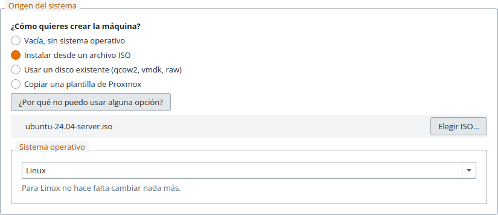

1. Pulsa **Elegir ISO…**. Se abre **Elegir un archivo ISO**.

![Ventana «Elegir un archivo ISO»: el texto «Estos son los archivos ISO que hay en el servidor. Si el tuyo no está, súbelo desde tu equipo o haz que el servidor lo descargue.», el campo «Filtrar por nombre», una tabla ordenable con Nombre, Almacenamiento, Nodo, Tamaño, Fecha y Nota (debian-12.iso, ubuntu-24.04-server.iso, virtio-win-0.1.271.iso con la nota «Drivers virtio-win para Windows» y windows-11-es.iso) y los botones «Subir desde mi equipo...», «Descargar en el servidor...», «Actualizar», «Cancelar» y «Elegir».](img/31-catalogo-iso.png)

2. Escribe en **Filtrar por nombre** para encontrar el tuyo. Las filas que no se pueden elegir quedan desactivadas con
   el motivo escrito. **Actualizar** vuelve a leer el servidor.
3. Si el ISO no está, usa **Subir desde mi equipo…** o **Descargar en el servidor…** (ver
   [Transferencias](#transferencias-subir-y-descargar-archivos)). Al terminar, el archivo nuevo queda elegido.
4. Elige el ISO y pulsa **Elegir** (también sirve un doble clic). Debajo del botón verás su nombre.
5. Elige el **Sistema operativo** (ver [El asistente de sistema operativo](#el-asistente-de-sistema-operativo)).
6. Pulsa **Crear máquina** como siempre.

| Elemento del catálogo | Para qué sirve |
|---|---|
| **Filtrar por nombre** | Reduce la tabla mientras escribes. |
| Tabla (Nombre, Almacenamiento, Nodo, Tamaño, Fecha, Nota) | Se ordena pulsando en la cabecera. Muestra hasta 500 archivos por almacenamiento. |
| **Subir desde mi equipo…** / **Descargar en el servidor…** | Traen un ISO nuevo (se desactivan con el motivo si falta permiso). |
| **Actualizar** | Vuelve a leer el catálogo. |
| **Cancelar** / **Elegir** | Cierra sin elegir / confirma el archivo seleccionado. |

La máquina se crea con el ISO puesto como CD y con el orden de arranque disco, CD y red. Fijar ese orden necesita el
permiso `VM.Config.Disk`: si no hay certeza de que lo tienes, ProxLaunch crea la máquina sin fijar el orden. En ese
caso pide a tu administrador que, en Proxmox, ponga el CD en el orden de arranque (pestaña «Opciones» → «Orden de
arranque»).

### El asistente de sistema operativo

En el grupo **Sistema operativo** eliges qué vas a instalar (**Elige el sistema operativo…**). El asistente ajusta la
máquina a ese sistema (arranque, TPM, controlador de discos, tarjeta de red) y **no toca** los núcleos, la memoria ni el
tamaño del disco. Antes de crear nada ves exactamente qué cambió, con el aviso «Para Windows 11 el asistente va a
cambiar:» y una lista «antes → después» (o «Para … no hace falta cambiar nada más.»).

| Sistema | Qué ajusta el asistente |
|---|---|
| **Linux** | Controlador `virtio-scsi-single` y tarjeta de red VirtIO. Respeta el tipo de arranque que tengas. |
| **Windows 11** | Arranque UEFI (OVMF) con tipo de máquina q35, **TPM** (obligatorio), agente de QEMU, controlador `virtio-scsi-single`, red VirtIO y el segundo CD de drivers. |
| **Windows Server 2022 / 2025** | Igual que Windows 11, pero el TPM no es obligatorio. |
| **Windows 10** y **Windows Server 2016 / 2019** | Arranque UEFI, agente de QEMU, controlador, red VirtIO y CD de drivers; sin TPM. |
| **Otro sistema** | No cambia nada más. |

![Grupo «Origen del sistema» con el ISO «windows-11-es.iso» y «Windows 11» elegido: la casilla «Disco compatible (SATA): no hace falta cargar un controlador al instalar», la lista «Para Windows 11 el asistente va a cambiar» (Arranque SeaBIOS → UEFI, TPM 2.0 no → sí, Agente de QEMU no → sí) y el grupo «Drivers de Windows (virtio-win)» con «Se usará el CD de drivers «virtio-win-0.1.271.iso»» y los botones «Elegir otro ISO de drivers...», «Descargarlo en el servidor», «Ya lo tengo en mi equipo» y la casilla «Crear sin los drivers».](img/27-origen-iso-windows-drivers.png)

Avisos que no bloquean (aparecen en el formulario):

- **Mínimos de Windows.** Windows 11: 2 núcleos, 4 GiB de memoria y 64 GiB de disco; los demás Windows: 1 núcleo, 2 GiB
  y 32 GiB.
- **Red Hat 10.** «Si vas a instalar RHEL 10 (o Rocky, Alma, CentOS Stream 10), necesita un procesador x86-64-v3. Elige
  ese tipo de CPU o «host».» Si el nombre del ISO parece de esa familia, el aviso lo dice.
- **Windows 11** sin UEFI o sin TPM: «Windows 11 exige arranque UEFI (OVMF).» / «Windows 11 exige un TPM 2.0.»

| Opción | Modo | Qué hace |
|---|---|---|
| **Sistema operativo** | Básico | Elige el asistente. «Elige el sistema operativo…» = sin asistente. |
| **Disco compatible (SATA): no hace falta cargar un controlador al instalar** | Avanzado, con un Windows | Pone el primer disco en SATA para que Windows lo vea sin drivers (más lento que SCSI). Desmarcada por defecto. |

> Los perfiles de fábrica **Windows 11 (escritorio)**, **Windows Server** y **Linux (Red Hat y otros)** dejan el
> hardware y el sistema operativo ya elegidos. Solo te queda elegir el ISO.

#### Windows y los drivers virtio-win

Windows no trae los controladores de los discos y la red virtuales de Proxmox. Por eso, al elegir un Windows,
ProxLaunch añade un **segundo CD** llamado **virtio-win** para cargarlos durante la instalación (grupo **Drivers de
Windows (virtio-win)**):

| Situación | Qué ves | Qué hace cada botón |
|---|---|---|
| Hay un ISO que empieza por `virtio-win` en el servidor | «Se usará el CD de drivers «virtio-win-0.1.271.iso».» (el nombre será el del archivo que tengas). | **Elegir otro ISO de drivers…** abre el catálogo de drivers. |
| No hay ninguno | «No hay ningún ISO de virtio-win en el servidor. Elige cómo conseguirlo.» | **Descargarlo en el servidor** hace que Proxmox lo descargue de una dirección fija y comprueba su huella SHA-256. **Ya lo tengo en mi equipo** lo sube desde tu equipo. |
| No quieres los drivers | Marca **Crear sin los drivers**: «La máquina se creará sin el CD de drivers.» y el aviso «Sin los drivers, Windows no verá el disco VirtIO ni la red.» | |

ProxLaunch conoce la versión **0.1.302** de virtio-win. Si eliges otro ISO de drivers puedes crear la máquina, pero antes
verás: «Se usará el CD de drivers «…», que no es la versión que conoce ProxLaunch. Comprueba que es de confianza antes de
crear la máquina.»

### Usar un disco existente (importar)

Crea la máquina con un disco que ya tiene un sistema instalado (qcow2, vmdk o raw), en lugar de empezar vacía.


**Qué necesita tu servidor:**

- Proxmox **8.4 o superior**. En 8.0 a 8.3 verás: «Tu Proxmox … no permite importar discos sin ser administrador del
  servidor. Puedes instalar desde un ISO o clonar una plantilla. Desde la versión 8.4 sí se puede importar.»
- Un almacenamiento de tipo **directorio, NFS o CIFS** con el contenido **«Import»** activado (lo activa un
  administrador en **Datacenter → Almacenamiento → Editar → Contenido**). Si no hay: «Para importar discos, pide a tu
  administrador que active el contenido «Import» en un almacenamiento de tipo directorio, NFS o CIFS.»

| Opción | Para qué sirve | Valores | Defecto | Límites |
|---|---|---|---|---|
| **Elegir disco…** | Abre **Elegir un disco existente** («Estos son los discos (qcow2, vmdk, raw) que hay en el servidor para importar.»), con **Subir desde mi equipo…** y **Descargar en el servidor…**. | Un archivo del catálogo. | Vacío. | |
| **Ampliar el disco a** | Agranda el primer disco al importarlo. | Entero en GiB. | «Tamaño del disco importado» (0 = no ampliar). | Hasta 1 000 000 GiB. Necesita `VM.Config.Disk`. |
| **Sistema operativo** | El asistente (opcional). | Igual que en ISO. | Sin asistente. | |

Nota de la ventana: «El primer disco de la máquina será la copia del disco importado.»

**Qué discos no se pueden importar.** ProxLaunch revisa el archivo antes de subirlo y te dice por qué no sirve: depende
de otro archivo (un disco base), está cifrado, está formado por varios archivos, es una **OVA** («Un archivo OVA no se
puede importar tal cual. Extrae el disco que lleva dentro y súbelo.»), tiene una versión no compatible o parece
incompleto. Las OVA y la migración desde VMware no están soportadas.

**En un lote**, cada máquina recibe su propia copia del disco, así que ocupa espacio propio: con muchas máquinas, el
espacio necesario se multiplica. Las importaciones se hacen de una en una por nodo y, como mucho, dos a la vez hacia el
mismo almacenamiento.

### Copiar una plantilla (clonar)

Una **plantilla de Proxmox** es una máquina ya instalada que se marcó como modelo. Al clonarla obtienes máquinas nuevas
con su mismo sistema, sin instalar nada. Los discos, la red y el tipo de arranque los da la plantilla: lo que tengas
en esas secciones del formulario se ignora.

1. Pulsa **Elegir plantilla…**. Se abre **Elegir una plantilla de Proxmox**:


2. Las plantillas que no se pueden usar aparecen desactivadas con el motivo («Falta el permiso VM.Clone», o «Bloqueada
   (…): espera a que termine lo que Proxmox está haciendo con ella»). Si no ves ninguna: «No veo ninguna plantilla con tu
   cuenta. Pide el permiso VM.Audit o crea la plantilla en Proxmox (clic derecho en la máquina → Convertir en plantilla).»
3. Elige una y pulsa **Elegir**.

![Grupo «Origen del sistema» con «Copiar una plantilla de Proxmox» marcada en modo básico: «plantilla-debian12 (VMID 9000)» con el botón «Elegir plantilla...», el texto «Rápido y ligero (recomendado): la copia comparte el disco con la plantilla y se crea en segundos. Si el almacenamiento no lo permite, Proxmox hace una copia independiente.», un aviso naranja «Se hará una copia independiente: tarda más y ocupa el espacio completo del disco.» y el grupo «Ajustes de la copia (opcional)» con Núcleos, Memoria (MiB) y Disco principal (GiB) en «Igual que la plantilla».](img/29-origen-clonar-basico.png)

En **modo avanzado** aparecen más opciones:


| Opción | Modo | Para qué sirve | Valores | Defecto | Límites |
|---|---|---|---|---|---|
| **Elegir plantilla…** | Básico | Abre el catálogo de plantillas. | Una plantilla elegible. | Vacío. | |
| **Tipo de copia** | Avanzado | Cómo se copia el disco. En básico no eliges: se usa «Rápido y ligero (recomendado)». | **Automático**, **Enlazado**, **Completo**. | Automático. | |
| **Guardar la copia en** | Avanzado, con copia **Completa** | Almacenamiento de destino. | «El de la plantilla» o un almacenamiento. | «El de la plantilla». | |
| **Procesadores (sockets)** | Avanzado | Cambia los sockets respecto a la plantilla. | Entero; 0 = «Igual que la plantilla (N)». | 0 | Máximo 64. |
| **Núcleos** | Básico | Cambia los núcleos. | Entero; 0 = igual. | 0 | Máximo 1024. |
| **Tipo de CPU** | Avanzado | Cambia el tipo de CPU. | Texto; vacío = «Igual que la plantilla (x86-64-v2-AES)». | Vacío. | Letras, números, `.`, `_` y `-`. |
| **Memoria (MiB)** | Básico | Cambia la memoria. **¡Ojo, aquí la unidad es MiB, no GiB!** | Entero en **MiB** (2048 MiB = 2 GiB); 0 = igual. | 0 | Máximo 16 000 000. |
| **Disco principal (GiB)** | Básico | Tamaño absoluto del disco principal. | Entero en GiB; 0 = igual. | 0 | Máximo 1 000 000. |

> **Atención con las unidades.** En el formulario normal la memoria va en **GiB**; en los **Ajustes de la copia** va
> en **MiB**. Si quieres una copia con 4 GiB, escribe `4096`. (En un CSV, en cambio, `memoria` se entiende en GiB si no
> pones unidad; ver [Columnas](#columnas-del-csv)).

Nota de la ventana: «El hardware, los discos y la red se copian de la plantilla. Arriba eliges solo lo que quieres
cambiar.»

**Tipo de copia: enlazada o completa.**

- **Rápido y ligero** (clon *enlazado*): la copia comparte el disco con la plantilla, se crea en segundos y casi no
  ocupa espacio, pero depende de ella. **No borres la plantilla mientras existan sus copias.** En algunos
  almacenamientos (por ejemplo `lvmthin`) Proxmox deja borrar una plantilla con copias enlazadas: ProxLaunch no promete
  ninguna protección, así que ten cuidado.
- **Copia independiente** (clon *completo*): duplica todo el disco. Tarda más y ocupa más, pero la máquina no depende de
  nada.

Antes de crear, ProxLaunch te dice cuál será: «Se hará una copia rápida y ligera. Las máquinas comparten el disco base con
la plantilla: no borres la plantilla mientras existan.» o «Se hará una copia independiente: tarda más y ocupa el espacio
completo del disco.»

**Cuántas a la vez.** En un lote, ProxLaunch crea como máximo **3 clones enlazados a la vez por nodo** (el tope se cuenta
en el **nodo de la plantilla**, aunque las máquinas nuevas vayan a otros nodos). Las copias completas se hacen de una en
una por nodo y, como mucho, dos a la vez hacia el mismo almacenamiento.

**Si un ajuste falla.** Si la copia se crea pero un ajuste no se pudo aplicar, ves «La máquina «x» se clonó, pero no se
pudo …. Puedes reintentar los ajustes o deshacer.» El botón **Reintentar ajustes** vuelve a aplicar solo las
etiquetas, los procesadores, la memoria o el tamaño del disco que faltaron; **no crea máquinas nuevas**. Si la memoria
nueva queda por debajo de la memoria mínima (ballooning) de la plantilla, ProxLaunch baja también ese mínimo para que
Proxmox lo acepte.

**Deshacer** una copia borra la máquina nueva, **nunca la plantilla**.

### Orígenes en lotes, perfiles y CSV

- **Lotes.** En un lote normal todas las máquinas usan el mismo origen (el mismo ISO, disco o plantilla). Ver
  [Lotes](#crear-varias-máquinas-de-una-vez-lotes).
- **Perfiles.** Los perfiles de fábrica **Windows 11 (escritorio)**, **Windows Server** y **Linux (Red Hat y otros)**
  traen el hardware y el sistema operativo para instalar desde un ISO (ver [Perfiles de fábrica](#perfiles-de-fábrica)).
- **Lotes guardados.** Recuerdan el origen y el **nombre** del ISO, del disco o de la plantilla (nunca direcciones web,
  rutas de tu equipo ni huellas). Al abrirlos, ProxLaunch comprueba que existan en este servidor; si no, aparece **Este
  lote no encaja en este servidor** (ver [Si el lote «no encaja»](#si-el-lote-no-encaja-en-este-servidor)).
- **CSV.** Cada fila puede tener su propio origen con las columnas `origen`, `fuente`, `so`, `virtio` y `modo_clon`
  (ver [Columnas del CSV](#columnas-del-csv)).

### Permisos para el administrador: alcance acotado

Esta parte es para quien administra Proxmox. Para usar ISOs, importar discos y clonar plantillas, el rol
`ProxLaunchCreador` lleva los 14 privilegios de [Permisos que hacen falta](#permisos-que-hacen-falta). Dónde se asignan
importa mucho, porque `VM.Clone` permite copiar el contenido de una máquina.

**Recomendado: asignación acotada.** La guía de ProxLaunch (**Ayuda > ¿Cómo creo un API Token?**) propone estas
asignaciones, en **Datacenter → Permisos**:

| Ruta | Rol | Propagar | Para qué |
|---|---|---|---|
| `/pool/plantillas-proxlaunch` | `ProxLaunchCreador` | Sí | Que `VM.Clone` valga **solo** para las plantillas de ese pool. |
| `/vms` | `ProxLaunchMaquinas` | Sí | Crear máquinas (el segundo rol, sin `VM.Clone`). |
| `/storage/<almacenamiento>` | `ProxLaunchCreador` | — | Solo en los que se usarán para ISOs, imágenes importadas y discos (`Datastore.AllocateTemplate` y `Datastore.AllocateSpace`). |
| `/nodes/<nodo>` | `ProxLaunchCreador` | — | Solo en los nodos que descargarán archivos desde una dirección web (`Sys.AccessNetwork`). |
| `/sdn/zones/localnetwork` | `ProxLaunchCreador` | — | Usar la red (`SDN.Use`). |
| `/` | `ProxLaunchCreador` | **No** | Solo para ver el estado de los nodos (`Sys.Audit`). |

En las filas con «—», la guía de ProxLaunch no indica nada especial sobre **Propagar**.

**Privilegios opcionales (versión 0.6).** Si quieres que los usuarios puedan **Encender al terminar** y que
**Deshacer** apague máquinas, añade `VM.PowerMgmt` al rol que asignas en `/vms` (en este esquema, `ProxLaunchMaquinas`).
Si quieres que puedan elegir un pool, asigna `Pool.Audit` en la ruta `/pool` (ver
[Privilegios opcionales](#privilegios-opcionales-no-forman-parte-del-rol)). Ninguno de los dos cambia el alcance del resto
de permisos.

Pasos:

1. En **Datacenter → Permisos → Pools** crea el pool `plantillas-proxlaunch` y añade **solo las plantillas que
   ProxLaunch podrá clonar**.
2. Crea el rol `ProxLaunchCreador` con los 14 privilegios y asígnalo en la ruta `/pool/plantillas-proxlaunch` con
   **Propagar**.
3. Crea un segundo rol, `ProxLaunchMaquinas`, con los privilegios de máquina del rol anterior **sin `VM.Clone`**, y
   asígnalo en `/vms` con **Propagar**:

   ```text
   VM.Allocate
   VM.Audit
   VM.Config.Options
   VM.Config.HWType
   VM.Config.CPU
   VM.Config.Memory
   VM.Config.Network
   VM.Config.Disk
   ```

4. Asigna `ProxLaunchCreador` en `/storage/<almacenamiento>`, `/nodes/<nodo>` y `/sdn/zones/localnetwork`, y en `/`
   **sin** marcar **Propagar**.

Con esto, `VM.Clone` solo vale dentro del pool: fuera de él, Proxmox responde 403 (acceso denegado).

**Alternativa simple.** Asignar el rol `ProxLaunchCreador` una sola vez en la ruta `/` con **Propagar**. Es más cómodo,
pero el permiso alcanza a todo el servidor: quien consiga el token podría **clonar cualquier máquina y leer sus
discos**, subir archivos a cualquier almacenamiento y hacer que los nodos descarguen direcciones web. Úsala solo en un
entorno de pruebas o si confías plenamente en quien guarde el token.

**Lo que la asignación acotada no limita.** `VM.Audit` **no queda limitado al pool**: el token ve todas las máquinas y
plantillas del servidor. Por eso las demás plantillas **pueden verse en la lista** (aparecen desactivadas con «Falta el
permiso VM.Clone»), pero ProxLaunch **no las clonará**: la planificación lo bloquea con «Falta el permiso VM.Clone en
«/vms/…» para clonar la plantilla.»

**Limpieza periódica (importante).** Algunos rechazos de una subida dejan archivos `/var/tmp/pveupload-*` en el nodo. El
rol **no puede borrarlos**, a propósito: no tiene `Datastore.Allocate`. Si se repiten subidas fallidas, esos archivos
pueden **llenar el sistema de archivos raíz** del nodo. ProxLaunch avisa cuando queda poco espacio en la raíz antes de
subir («…tiene poco espacio temporal…»), pero **el administrador debe borrar esos archivos de vez en cuando**, por
ejemplo revisando `/var/tmp` en cada nodo.

Para el resto, **Copiar texto para el administrador** (en **Qué puedo hacer en este servidor**) genera un mensaje listo
para enviar con los privilegios, las asignaciones y los pasos de «Import» y plantillas.

---

## Transferencias: subir y descargar archivos

Si el ISO o el disco que necesitas no está en el servidor, puedes **subirlo desde tu equipo** o hacer que **el servidor
lo descargue** de una dirección web. Los dos caminos se abren desde el catálogo (**Subir desde mi equipo…** y
**Descargar en el servidor…**), y también existen para discos importables y para el CD de drivers virtio-win.

> **Importante.** Lo que subes o descargas **queda en el servidor hasta que un administrador lo borre**: ProxLaunch no
> puede borrarlo, ni siquiera con un usuario administrador. Solo se hace **una transferencia a la vez**.

### Subir un archivo desde tu equipo

Se abre **Subir un ISO desde mi equipo** (o **Subir un disco desde mi equipo**, que acepta `.qcow2`, `.vmdk`, `.raw` y
`.img`; el de ISO acepta `.iso` e `.img`):


| Elemento | Para qué sirve | Notas |
|---|---|---|
| **Archivo del equipo** / **Elegir archivo…** | Eliges el archivo. ProxLaunch lo revisa (que de verdad parezca un ISO o un disco) y muestra nombre y tamaño. | Solo se muestra el nombre, nunca la ruta. |
| **Nombre en el servidor** | Cómo se llamará allí. ProxLaunch propone un nombre válido. | **Nunca sobrescribe.** Se activa tras inspeccionar el archivo. |
| **Usar el existente** / **Cambiar el nombre** | Aparecen si ya hay un archivo con ese nombre. | Ver la captura siguiente. |
| **Entiendo que la subida puede fallar** | Casilla que hay que marcar si el nodo tiene poco espacio temporal. | Aviso: «El nodo «pve1» tiene poco espacio temporal (… libres) para recibir un archivo de …. La subida podría fallar.» |
| **Subir** / **Reintentar** / **Cancelar** | Inicia, repite o cierra. Durante el envío el botón dice **Cancelar subida**. | |
| Progreso | Etapas **Calculando la huella del archivo**, **Enviando**, **Esperando al servidor** y **Verificando**, con velocidad y tiempo restante cuando se conocen (nunca inventa porcentajes). | |

Si ya existe un archivo con ese nombre:

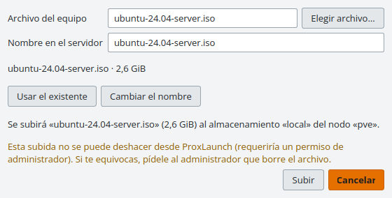

«Ya existe un archivo llamado «x» en «y». ProxLaunch no lo sobrescribe: usa el que ya está o elige otro nombre.»

**Verificación SHA-256.** Antes de enviar, ProxLaunch calcula la huella SHA-256 del archivo y la manda con él: el
servidor comprueba que lo recibido coincide. Al final, ProxLaunch verifica además que el archivo del servidor es el que
enviaste. Si algo no coincide verás «El archivo llegó dañado: la huella no coincide. No quedó guardado.» o «El servidor
dice que terminó, pero el archivo no coincide con el que enviaste. No lo uses.»

**Cancelar.** Mientras se envía, **Cancelar subida** devuelve «Se canceló. No se guardó ningún archivo.» o, si quedó algo
a medias, «Se canceló, pero el archivo parcial quedó guardado: pídele al administrador que lo borre.» La cancelación
**no siempre es inmediata**: puede tardar unos segundos mientras se conecta y mucho más si el servidor está terminando de
copiar (hasta unos 2 minutos); cerrar ProxLaunch en ese momento también puede tardar unos 6 segundos.

**Una a la vez.** Si ya hay una en curso: «Hay una transferencia en curso. Espera a que termine o cancélala.»

### Descargar un archivo en el servidor

Aquí el propio servidor de Proxmox descarga el archivo, sin pasar por tu equipo.

![Ventana «Descargar un ISO en el servidor»: «Dirección web» con https://deb.example.com/debian-12.iso y el botón «Comprobar», el campo «Huella» con el marcador «Opcional: huella (sha256, sha512...)», «Nombre en el servidor» debian-12.iso, la casilla marcada «Comprobar el certificado del servidor web (recomendado)», «El servidor ve: «deb.example.com/debian-12.iso» Nombre: debian-12.iso Tamaño: 628 MiB», los avisos de que la descarga la hace el servidor y de que la dirección quedará en el registro de tareas, y los botones «Descargar» y «Cancelar».](img/35-descarga-url.png)

| Elemento | Modo | Para qué sirve | Notas |
|---|---|---|---|
| **Dirección web** + **Comprobar** | Básico | El servidor consulta la dirección (sin abrirla en tu equipo) y dice qué ve: nombre, tamaño y tipo. | Lo normal es `https://`. Con `http://` avisa de que no se puede garantizar que no fue alterado y pide confirmar. También avisa si apunta a un equipo de la red interna o a un puerto distinto de 80 y 443. |
| **Huella** | Básico | Opcional, recomendada: Proxmox comprueba al terminar que lo descargado coincide y, si no, descarta el archivo. | Admite md5, sha1, sha224, sha256, sha384 y sha512; con un algoritmo antiguo (MD5, SHA-1) avisa y sugiere SHA-256 o SHA-512. |
| **Nombre en el servidor** | Básico | Nombre del archivo allí. | Se activa tras comprobar. |
| **Comprobar el certificado del servidor web (recomendado)** | Avanzado | Verifica el certificado de la web de origen. | Marcada por defecto; desmarcarla pide confirmación. |
| **Descargar** / **Cancelar** | Básico | Inicia o cierra. | Una vez empezada la descarga no se puede cancelar desde ProxLaunch. |

Textos fijos de la ventana: «La descarga la hace el servidor: una vez empezada, no se puede cancelar desde ProxLaunch.
Solo puedes dejar de esperar.» y «La dirección quedará en el registro de tareas del servidor.»

Descargar desde una dirección web necesita Proxmox **8.2 o superior** y el permiso `Sys.AccessNetwork` en el nodo. En
8.0 y 8.1 exige permisos de administrador y ProxLaunch te lo explica: «Descargar desde una dirección web exige permisos
de administrador en esta versión de Proxmox. Descarga el archivo en tu equipo y súbelo.»

### Dejar de esperar

Cuando ProxLaunch ya envió todo el archivo y el servidor lo está copiando, el botón cambia de **Cancelar subida** a
**Dejar de esperar**. Pulsarlo no detiene nada en el servidor; solo hace que ProxLaunch deje de esperar: «Dejaste de
esperar. El archivo ya se envió y el servidor sigue copiándolo: no se puede cancelar desde ProxLaunch y puede aparecer en
el catálogo cuando termine. Revísalo allí más tarde.» Con una descarga: «La descarga sigue en el servidor y no se puede
cancelar desde ProxLaunch. Cuando termine, abre el catálogo para ver el resultado.»

### El diálogo «Elegir almacenamiento»

En cada sitio los almacenamientos tienen nombres distintos. ProxLaunch **no se fija en el nombre**: mira qué contenido
admite cada uno (discos de máquinas, ISOs o discos para importar) y, si hay uno solo, lo usa sin preguntar. Si hay
**varios**, te pregunta **una vez por servidor** y lo recuerda.


| Elemento | Para qué sirve | Defecto |
|---|---|---|
| Tabla (Almacenamiento, Tipo, Espacio libre, Compartido, Nota) | Los candidatos. El de más espacio libre viene marcado «Más espacio libre». | Preseleccionado el de más espacio libre; el doble clic acepta. |
| **Recordar mi elección** | Guarda solo el **nombre** del almacenamiento en el perfil de conexión de este servidor. | Marcada. |
| **Usar este** / **Cancelar** | Acepta o cierra. | |
| **Elegir otro** / **Dejar de recordar** | Solo si el almacenamiento recordado ya no está disponible. | |

**Cuándo sale:** al elegir **Instalar desde un archivo ISO** o **Usar un disco existente**, si hay varios almacenamientos
para discos de máquinas y todavía no recordaste ninguno; y al subir o descargar un archivo, si hay varios para ese
contenido. **Cuándo NO sale:** al conectar, ni con el origen **Vacía, sin sistema operativo** (ahí ProxLaunch propone el
de más espacio libre).

**Si el que recordabas desaparece**, ProxLaunch no lo sustituye en silencio: «El almacenamiento «x» que usabas en este
servidor ya no está disponible o ya no admite imágenes ISO. Elige otro.» Puedes revisarlos cuando quieras en **Ajustes >
Almacenamientos recordados…** y en la ventana de conexión.

### Archivos subidos en esta sesión

**Archivo > Archivos subidos en esta sesión…** muestra lo que subiste o descargaste desde que abriste ProxLaunch:


Usa **Copiar lista** o **Guardar como .txt…** para enviársela a tu administrador. Si ya no los necesitas, pide que los
borren desde Proxmox (en el almacenamiento, sección «ISO Images» o «Import»). Sin transferencias, la lista dice que está
vacía.

---

## Entender el progreso y los resultados

Al pulsar **Crear máquina**, los campos del formulario se bloquean y el panel **Progreso** muestra las etapas, sin
porcentajes inventados:

1. Validando datos
2. Enviando a Proxmox
3. Creando la máquina
4. Comprobando el resultado
5. Listo

(Al clonar una plantilla aparece además **Ajustando la máquina**, antes de «Listo».) Cuando Proxmox acepta la orden
aparece el **Identificador de la tarea (UPID)** con el botón **Copiar UPID**: es útil si tienes que hablar con tu
administrador.


El botón **Ver detalles técnicos** (y **Ocultar detalles técnicos**) muestra el texto original de Proxmox, el código del
error y el registro de la tarea. Úsalo para pedir ayuda; no hace falta para el día a día.

### Los resultados posibles

| Resultado | Qué verás | Qué significa y qué hacer |
|---|---|---|
| **OK** | «Máquina srv-web-01 (101) creada en pve1» en verde; botones **Crear otra** y **Deshacer…**. | La máquina existe (ProxLaunch lo comprueba al terminar). **Crear otra** conserva la configuración, vacía el nombre y busca un número libre. |
| **Con avisos** | «Creada con avisos» y el registro de la tarea desplegado; **Crear otra** y **Deshacer…**. | Se creó, pero Proxmox dejó algún aviso. Léelo en los detalles técnicos. |
| **Error** | Un mensaje en español (ver [Solución de problemas](#mensajes-de-error-frecuentes)) y **Volver al formulario**. | No se creó. Corrige el problema y vuelve a intentarlo: tus datos siguen en el formulario. |
| **Parcial** | «La máquina quedó parcialmente creada; elimínala desde Proxmox». | Falló, pero quedó algo creado. Usa **Deshacer…** o elimínala desde Proxmox. |
| **Tiempo agotado** | «La tarea sigue en marcha en Proxmox, no sabemos si terminó». Botones **Seguir esperando**, **Comprobar ahora** y **Volver al formulario**. | Ver [Tiempo agotado](#tiempo-agotado). |
| **Conexión perdida** | «Se perdió la conexión mientras se creaba la máquina; la tarea puede haber terminado». Botones **Comprobar ahora** y **Volver al formulario**. | Se cortó la comunicación más de 60 segundos. Pulsa **Comprobar ahora**. Los cortes breves se recuperan solos. |
| **Envío incierto** | «No sabemos si Proxmox recibió la orden de crear la máquina. Pulsa «Comprobar» antes de intentarlo de nuevo.» Botones **Comprobar** y **Volver al formulario**. | La conexión falló justo al enviar. **No vuelvas a crear la máquina todavía.** Pulsa **Comprobar**. |
| **Cancelado** | «No se creó; puedes intentarlo de nuevo.» y **Volver al formulario**. | Es el resultado de **Comprobar** cuando la máquina no existe. Ya puedes crearla de nuevo con seguridad. |

Resultado correcto:


Un error con los detalles técnicos desplegados:


#### Tiempo agotado

ProxLaunch espera una tarea hasta **10 minutos** (algo más en los orígenes que copian discos grandes). Si pasa ese
tiempo, la tarea **sigue en marcha en Proxmox**: no es un fallo.

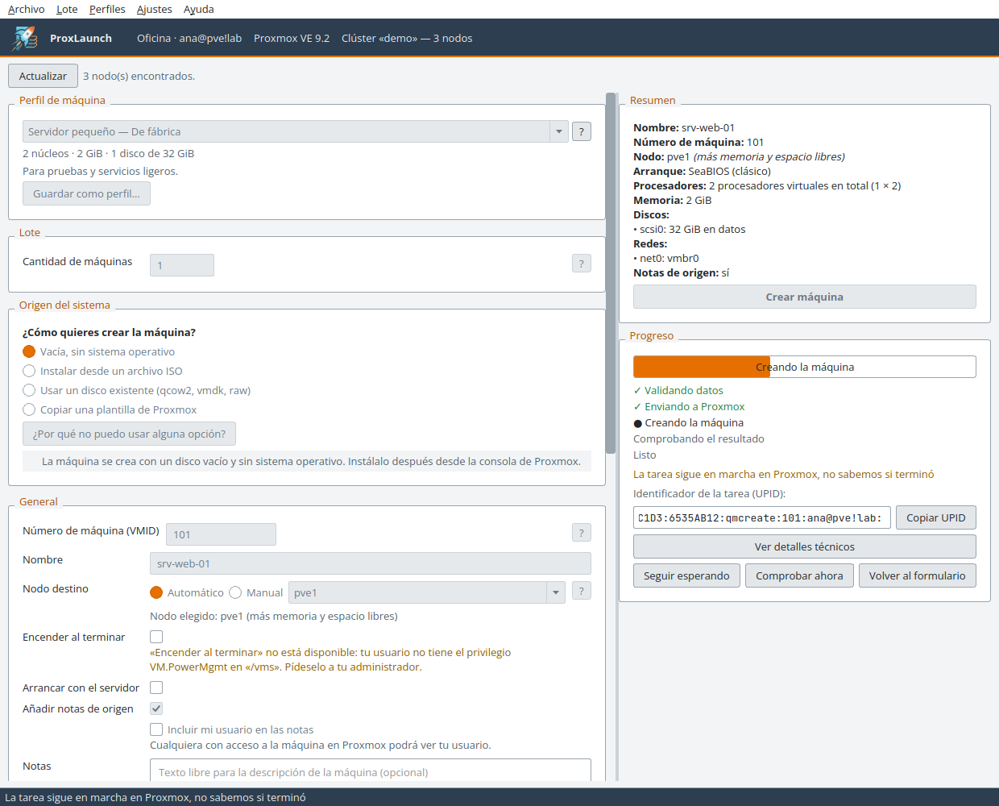

| Botón | Qué hace |
|---|---|
| **Seguir esperando** | Espera otro periodo. |
| **Comprobar ahora** | Pregunta **una vez** por el estado de esa tarea y actualiza el resultado. |
| **Volver al formulario** | Vuelve a editar. Si no sabes si se creó, avisa antes (ver abajo). |

#### Botones extra según el caso

| Botón | Cuándo aparece | Qué hace |
|---|---|---|
| **Crear sin etiquetas** | Con una sola máquina, si el servidor no permitió poner etiquetas (la tarea falló por eso). | Vuelve a crear la máquina **sin** las etiquetas `proxlaunch` y `lote-…`. Después, **Deshacer…** solo podrá eliminarla si el nombre coincide. Ver [Etiquetas](#etiquetas-qué-son-y-para-qué-sirven). |
| **Reintentar ajustes** | Al clonar, si la copia se creó pero falló un ajuste posterior (etiquetas, arranque con el servidor, protección contra borrado, procesadores, memoria o disco). | Reaplica **solo** esos ajustes; no crea máquinas nuevas. |
| **Deshacer…** | Tras **OK**, **Con avisos** o **Parcial**. | Elimina la máquina que acabas de crear, con confirmación (ver [Deshacer](#deshacer)). |

#### El botón «Comprobar»

Existe para evitar que crees la **misma máquina dos veces** cuando no sabes si la primera orden llegó.

- Sin identificador de tarea (envío incierto), **Comprobar** pregunta a Proxmox si la máquina ya existe y **no envía nada
  nuevo**. Tres respuestas posibles: «La máquina sí se creó. Verifica en Proxmox que quedó como esperabas.», «No se creó;
  puedes intentarlo de nuevo.» o «No se pudo comprobar si la máquina existe. Revisa la conexión e inténtalo de nuevo antes
  de volver a crearla.»
- Con identificador (tiempo agotado o conexión perdida), el botón se llama **Comprobar ahora** y consulta el estado de
  esa tarea.

Si pulsas **Volver al formulario** sin saber si la máquina se creó, ProxLaunch avisa: «Todavía no sabemos si se creó… Si
vuelves al formulario y la creas otra vez, podrías duplicarla. ¿Volver de todos modos?»

#### Si cierras ProxLaunch mientras se crea

Te pregunta: «Se está creando una máquina. Si cierras ProxLaunch, la tarea sigue ejecutándose en el servidor Proxmox,
pero ya no verás su resultado. ¿Cerrar de todos modos?» La tarea **no se detiene**. Al volver, revisa en Proxmox si la
máquina existe.

---

## Crear varias máquinas de una vez (lotes)

Un **lote** crea de 1 a 100 máquinas iguales con un solo clic. Todas comparten la configuración del formulario
(procesadores, memoria, discos, red...) y solo cambian el **nombre**, el **número** y, si tienes un clúster, el **nodo**.
Como en el resto de ProxLaunch, las máquinas se crean **detenidas** (salvo que marques **Encender al terminar**), y con el
disco **vacío** salvo que elijas otro [origen del sistema operativo](#elegir-el-origen-del-sistema-operativo) (en un lote
normal, todas usan el mismo). Las [opciones de la máquina](#opciones-de-la-máquina-en-un-lote) (encender, notas, etiquetas,
pool, protección…) valen para todas las del lote.

Si necesitas máquinas **distintas** entre sí, mira [Importar máquinas desde un CSV](#importar-máquinas-desde-un-csv) y
[Lote por filas](#lote-por-filas). Para repetir un lote otro día, [Guardar y abrir lotes](#guardar-y-abrir-lotes).

Un lote es más delicado que crear una sola máquina, así que ProxLaunch te enseña un resumen antes de enviar nada, te
deja **simular** primero y te permite **deshacer** lo que crea. Si algo no sale bien en una máquina, las demás siguen.

### Ejemplo: 10 servidores web iguales

1. En el grupo **Perfil de máquina** deja **Servidor pequeño** (2 núcleos, 2 GiB, un disco de 32 GiB).
2. En el grupo **Lote**, escribe **Cantidad de máquinas** `10` y **Prefijo** `srv-web`. La vista previa dirá «Se llamarán:
   srv-web-01, srv-web-02, srv-web-03 … srv-web-10».
3. Pulsa **Ver resumen** y revisa la tabla (10 filas, `srv-web-01` a `srv-web-10`, con sus VMID, nodo y almacenamiento).
4. (Recomendado la primera vez) Pulsa **Simular**: no crea nada.
5. Pulsa **Crear 10 máquinas** y sigue el progreso. Con 10 máquinas ProxLaunch no pide confirmación extra (la pide con
   **más de 10**).
6. Si no te convence el resultado, **Deshacer…** borra lo que creó el lote.

### Cantidad y nombres

El grupo **Lote** está encima del formulario. Con **Cantidad de máquinas** en `1` (valor inicial) no ves nada más. En
cuanto escribes **2 o más**, el bloque muestra el resto de los campos, el formulario deja de pedir el nombre, el número y el
nodo de una máquina (los fija el lote) y el botón **Crear máquina** pasa a llamarse **Ver resumen**.

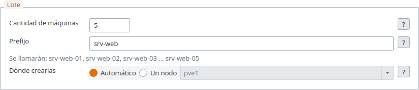

En modo avanzado y con un clúster el bloque ofrece todo esto:


| Campo | Modo | Para qué sirve | Valores | Defecto | Límites |
|---|---|---|---|---|---|
| **Cantidad de máquinas** | Básico | Cuántas crear. | Entero. | 1 | 1 a 100. Si pasas de 100: «El máximo por lote es 100 máquinas. Divide el trabajo en varios lotes.» ProxLaunch nunca recorta la cantidad por su cuenta. |
| **Prefijo** | Básico | El principio del nombre de todas. | Letras sin acentos, números, guiones y puntos (`[A-Za-z0-9.-]`). | Vacío. | Obligatorio: «Escribe un prefijo para los nombres.» |
| Vista previa | Básico | Cómo se llamarán. Muestra los tres primeros y el último («srv-web-01, srv-web-02, srv-web-03 … srv-web-10»); con cuatro o menos, todos. | — | — | Si el nombre no es válido ves el motivo en lugar de la vista previa. |
| **Separador** | Avanzado | Lo que va entre prefijo y número. | **Guion (-)** (`srv-01`) o **Ninguno** (`srv01`). | Guion (-) | |
| **Número inicial** | Avanzado | Con qué número empieza la numeración. | Entero. | 1 | 0 a 999 999. Con 5: `srv-05`, `srv-06`… |
| **Relleno (dígitos)** | Avanzado | Dígitos mínimos del número (ceros a la izquierda). | Entero. | 2 | 0 a 8. |
| **Número de máquina inicial (VMID)** | Avanzado | Primer VMID del lote. | Entero o vacío. | Vacío («automático»). | 100 a 999 999 999. |
| **Dónde crearlas** | Básico (solo clúster) | Nodo(s) de destino. | **Automático**, **Un nodo** (+ lista) o **Nodos elegidos** (+ casillas; solo avanzado). | Automático. | Los nodos apagados («Sin conexión») no se pueden elegir. |
| **Reparto** | Avanzado (con Automático o Nodos elegidos) | Cómo se reparten entre nodos. | **Equilibrado** o **Por turnos**. | Equilibrado. | |
| **Etiquetar las máquinas** | Avanzado | Pone las etiquetas `proxlaunch` y `lote-…`. | Casilla (con ayuda «?»). | Marcada. | Ver [Etiquetas](#etiquetas-qué-son-y-para-qué-sirven). |

**Relleno de ceros.** Si hacen falta más dígitos, **todos** los nombres usan los mismos para que se ordenen bien: un lote
de 120 con relleno 2 se llama `srv-web-001` … `srv-web-120`, no `srv-web-01` … `srv-web-120`.

Ejemplos de nombres resultantes:

| Prefijo | Separador | Número inicial | Relleno | Cantidad | Nombres |
|---|---|---|---|---|---|
| `srv-web` | Guion (-) | 1 | 2 | 10 | `srv-web-01` … `srv-web-10` |
| `srv` | Guion (-) | 5 | 2 | 3 | `srv-05`, `srv-06`, `srv-07` |
| `srv` | Ninguno | 1 | 2 | 3 | `srv01`, `srv02`, `srv03` |
| `srv-web` | Guion (-) | 1 | 2 | 120 | `srv-web-001` … `srv-web-120` |

### Números de máquina (VMID)

Cada máquina necesita un **número** propio en todo el servidor. En el lote:

- **Automático:** si dejas **Número de máquina inicial (VMID)** vacío, ProxLaunch toma el siguiente número libre del
  servidor y asigna los siguientes en orden.
- **Saltos:** si alguno de esos números ya lo usa otra máquina (aunque tú no puedas verla), ProxLaunch **lo salta** y te lo
  dice en el resumen: «Se saltaron los números 101 (ya los usa otra máquina).» Los números se agrupan en rangos
  (`101–103, 110`).
- **Manual** (solo modo avanzado): escribe un número inicial. Si está ocupado, el lote empieza en el siguiente libre. Si
  no hay suficientes libres: «No encontré N números de máquina libres a partir del X. Prueba con otro número inicial o con
  menos máquinas.»
- **Si alguien se te adelanta:** otra persona puede usar uno de tus números entre el resumen y el envío. Esa máquina **no
  se crea** («El número N lo usó otra persona mientras tanto. Esta máquina no se creó.») y el lote sigue con las demás.
  Luego puedes usar [Reintentar pendientes](#reintentar-pendientes).

### Dónde se crean

En un **servidor individual** no hay nada que elegir. En un **clúster**, **Dónde crearlas** ofrece:

| Opción | Qué hace |
|---|---|
| **Automático** | Reparte entre los nodos que pueden alojarlas (encendidos y con el almacenamiento y la red que pides). Es lo normal. |
| **Un nodo** | Todas van al nodo que elijas. Si no caben ahí, avisa; no las manda a otro por su cuenta. |
| **Nodos elegidos** (avanzado) | Marcas los nodos entre los que se reparte. |

Con **Automático** o **Nodos elegidos**, el **Reparto** puede ser **Equilibrado** (cada máquina va al nodo con más memoria
libre en ese momento, contando las que ya le tocaron) o **Por turnos** (una a cada nodo, en orden alfabético, y vuelta a
empezar; predecible, pero no mira la memoria libre). El resumen dice cuántas recibe cada nodo y por qué («Equilibrado:
más memoria libre», «lo elegiste tú», «es el único nodo disponible»...).

### Etiquetas: qué son y para qué sirven

Una **etiqueta** es una marca de texto que Proxmox muestra junto a la máquina. Por defecto ProxLaunch pone dos:

- `proxlaunch`: indica que la creó ProxLaunch. Es la misma en todos tus lotes.
- `lote-` seguido de un código (por ejemplo `lote-a1b2c3d4`): identifica **este** lote. El mismo código aparece en el
  informe.

Sirven para: **encontrar** en Proxmox lo que creó un lote; **demostrar que una máquina es del lote** cuando hubo un corte
y no se sabe si se creó; y **deshacer con seguridad** (ProxLaunch comprueba la etiqueta antes de borrar).

**Cómo desactivarlas.** En modo avanzado, la casilla **Etiquetar las máquinas** viene marcada. Si la desmarcas, las
máquinas se crean sin etiquetas. **Qué se pierde sin etiquetas:** ProxLaunch ya no puede demostrar de quién es una máquina
que apareció tras un corte (la deja como «Existe, sin confirmar de quién es» y no la ofrece para deshacer); «Deshacer…»
solo borra las que confirmó que creó él mismo, con el nombre y el número del lote; y te costará más encontrar el lote en
Proxmox.

**Cuándo conviene desactivarlas.** Si tu administrador restringió qué etiquetas pueden poner los usuarios, ProxLaunch
lo detecta **antes de crear** (si puede leer esa política) y la validación **bloquea** el lote diciendo qué etiqueta debe
autorizar el administrador (ver
[Etiquetas propias y política del centro de datos](#etiquetas-propias-y-política-del-centro-de-datos)). Si no pudo
comprobarlo y Proxmox acepta la orden pero la tarea falla con un error de permiso, ProxLaunch **pausa el lote** y te
ofrece **Seguir sin etiquetas** (ver [Pausas](#pausas-el-lote-se-detiene-y-te-pregunta)); con una sola máquina ofrece
**Crear sin etiquetas**. Esta restricción es poco habitual.

Además de estas dos, puedes añadir **tus propias etiquetas** en el campo **Etiquetas** (ver
[Etiquetas propias](#etiquetas-propias-y-política-del-centro-de-datos)).

### El resumen y la confirmación

Al pulsar **Ver resumen**, ProxLaunch consulta el servidor (no crea nada) y muestra:


| Elemento | Qué es |
|---|---|
| Tabla | Una fila por máquina: **N.º**, **Nombre**, **VMID**, **Nodo**, **Almacenamiento** y **Discos (GiB)**. En un [lote por filas](#lote-por-filas) añade **Procesadores**, **Memoria (GiB)** y **Sistema operativo**. |
| Totales, espacio y reparto | Cuánto pide el lote, cuánto hay libre en cada almacenamiento y cuántas máquinas recibe cada nodo; los números saltados. |
| Errores (✕) y avisos (⚠) | Siempre **antes** de los botones. |
| **Volver al formulario** | Vuelve a editar; cualquier cambio invalida el resumen. |
| **Copiar resumen** | Lo copia al portapapeles. |
| **Simular** | Hace todo menos crear (ver [Simulación](#simulación)). |
| **Crear N máquinas** | Envía el lote. |
| **Nodo de destino para el reintento** | Solo en un [reintento](#reintentar-pendientes): lista «Los mismos nodos de antes» y los nodos. |

Los **errores** impiden crear: **Crear N máquinas** queda desactivado y ves «Corrige los errores marcados para poder crear
las máquinas.» El más habitual es que no quepan los discos:


El botón **Reducir a N** baja la cantidad a las que caben y vuelve a generar el resumen. ProxLaunch nunca crea un lote a
medias por su cuenta.

Los **avisos** no bloquean. Los más frecuentes:

- **Nombre repetido:** «Ya existe una máquina llamada «srv-web-01» (número 105).» Proxmox permite dos máquinas con el
  mismo nombre, pero luego cuesta distinguirlas.
- **Memoria:** «En «pve2» pides 96 GiB de memoria y hay 64 GiB libres. Las máquinas se crean apagadas; el problema
  aparecerá al encenderlas.»
- **Memoria de un nodo desconocida** (falta `Sys.Audit`) y **permisos sin verificar**.
- **Espacio sobreasignado.** Algunos almacenamientos «solo ocupan el espacio a medida que se usa». Con ellos puedes pedir
  más discos de los que caben: «Estás pidiendo 300 GiB y solo hay 150 GiB libres en «local-lvm». Funciona mientras las
  máquinas no usen todo su disco; si se llena, todas las máquinas de ese almacenamiento pueden fallar.» Para continuar
  marca **Entiendo el riesgo de sobreasignar espacio** (no se recuerda). Si pides **más de 3 veces** lo que hay libre, ya
  es un error.

**Confirmar.** Pulsa **Crear N máquinas**. Con **más de 10 máquinas** ProxLaunch pregunta otra vez (**Confirmar el
envío**): «Se enviarán N máquinas a Proxmox. ¿Continuar?», con **Crear las máquinas** o **Cancelar**. Si desde el resumen
pasaron **más de 5 minutos**, vuelve a leer el servidor antes de enviar; si algo cambió, no envía y te enseña el resumen
nuevo.

### Simulación

**Simular** hace **todo lo que haría el lote de verdad, menos crear**: vuelve a leer el servidor, planifica y comprueba
todo (espacio, nombres, nodos, memoria, permisos...).


- Muestra el mismo resumen, marcado como «SIMULACIÓN — no se creó nada», y en detalles técnicos la orden exacta que se
  enviaría por cada máquina. No lleva claves ni cabeceras.
- **Informe de la simulación…** lo exporta (ver [Informe](#informe)).
- **Qué garantiza:** durante la simulación ProxLaunch solo **lee** del servidor. Puedes simular todas las veces que quieras,
  también con un usuario sin permiso para crear.
- **Qué no puede garantizar:** que Proxmox acepte cada máquina (por ejemplo, que otra persona use un número entre la
  simulación y el envío, que el espacio cambie, o que Proxmox rechace las etiquetas). Por eso, al pulsar **Crear de verdad
  estas N máquinas**, ProxLaunch vuelve a planificar y validar todo antes de enviar.
- **Con otra versión forzada** (modo avanzado) la simulación valida contra esa versión y lo indica. Si forzaste una versión
  **más nueva** que la del servidor, solo puedes simular.
- Con **una sola máquina** no hay resumen ni simulación: **Crear máquina** funciona como en el modo básico.

**Con las opciones de la máquina.** La simulación enseña también lo que cambian las [opciones](#opciones-de-la-máquina):
`tags` con tus etiquetas, `onboot`, `startup`, `description` (con las notas ya compuestas, el bloque automático y tu
texto), `pool` y `protection`, además de `mtu` y `rate` dentro de `net0`. Si marcaste **Encender al terminar**, la
última petición de cada máquina es `POST /nodes/<nodo>/qemu/<número>/status/start`, siempre después de todos los demás
ajustes:

![Resultado de «Simular» para 5 máquinas con las opciones fijadas: «SIMULACIÓN — no se creó nada», las líneas de opciones del resumen y, en los detalles técnicos desplegados, la petición de creación con net0, tags «proxlaunch;lote-a1b2c3d4;web;produccion», onboot 1, startup «order=2,up=30», description con el bloque «Creada con ProxLaunch 0.6.0», la fecha, el lote, el perfil y el usuario seguido de la nota, pool «produccion» y protection 1, y al final «POST /nodes/pve1/qemu/101/status/start». Botones «Volver al formulario», «Copiar resumen», «Informe de la simulación...», «Simular» y «Crear de verdad estas 5 máquinas».](img/65-simulacion-encender.png)

La simulación solo **lee** del servidor, también con estas opciones: no enciende ni protege nada.

### Mientras se crea: el progreso del lote

Al confirmar, el formulario se bloquea y aparece el progreso, con el título «Creando N máquinas»:


| Elemento | Qué hace |
|---|---|
| Barra | «7 de 20 terminadas · 1 con error · 2 en curso». Solo cuenta terminadas: no inventa porcentajes ni tiempos. Añade «N sin confirmar» y «N sin enviar» si los hay. |
| **Mostrar solo problemas** | Filtra la tabla. |
| Tabla (Estado, Nombre, VMID, Nodo, Detalle) | Una fila por máquina; el estado lleva siempre símbolo y texto. |
| Al seleccionar una fila | Aparece su **UPID** con **Copiar UPID** y sus detalles técnicos. |
| **Cancelar lote** | Ver [Cancelar y «Dejar de esperar»](#cancelar-y-dejar-de-esperar). |

ProxLaunch crea **una máquina a la vez por nodo** y hasta **4 nodos en paralelo**. No cierres la ventana mientras tanto
(ver [Cerrar ProxLaunch con un lote en curso](#cerrar-proxlaunch-con-un-lote-en-curso)).

### Estados de cada máquina

| Símbolo y estado | Qué significa | Qué hacer |
|---|---|---|
| ○ **Pendiente** | Está en la cola. | Esperar. |
| ● **Validando datos**, **Enviando a Proxmox**, **Creando la máquina**, **Comprobando el resultado**, **Ajustando la máquina** | Las etapas de una máquina. | Esperar. |
| ✓ **Lista** | Se creó y ProxLaunch lo comprobó. | Nada. Si dice «Se creó aunque Proxmox tardó en responder.», hubo un corte pero existe. |
| ⚠ **Lista, con avisos** | Se creó, pero Proxmox dejó algún aviso, o no se pudo **encender** («Se creó, pero no se pudo encender. Enciéndela desde Proxmox si la necesitas.») o falta un ajuste. | Lee los detalles técnicos o el aviso de la máquina. La máquina existe. Más avisos de encendido en [Encender al terminar](#encender-al-terminar-y-arrancar-con-el-servidor). |
| ✕ **Con error** | No se creó (el detalle dice por qué). | Corrige la causa y usa **Reintentar pendientes**. |
| ◐ **Quedó a medias** | Falló, pero quedó algo creado. | **Deshacer…** o bórrala en Proxmox. |
| ? **Sin confirmar (sigue en Proxmox)** | ProxLaunch esperó el tiempo máximo (10 minutos, o más si copiaba discos grandes) y la tarea sigue. No es un fallo. | **Comprobar ahora** más tarde. |
| ? **No sabemos si se creó** | Se cortó la conexión y no se sabe si Proxmox la creó. | **No la crees otra vez.** Pulsa **Comprobar ahora**. |
| – **No enviada** | Nunca salió hacia Proxmox, así que **no existe** («cancelaste el lote», «el lote se detuvo», «el nodo no respondió»…). | **Reintentar pendientes**. |
| – **No se creó** | Hubo un corte, pero ProxLaunch comprobó tres veces que no existe. | **Reintentar pendientes**. |
| ? **Existe, sin confirmar de quién es** | Existe, pero sin la etiqueta del lote. Podría ser de otra persona con el mismo número. | Verifícala en Proxmox. ProxLaunch no la borrará. |

**«No sabemos si se creó» y «Comprobar ahora».** ProxLaunch **nunca vuelve a enviar** una máquina que pudo haberse creado:
podría duplicarla. Antes de rendirse comprueba hasta tres veces (al instante, a los 5 y a los 15 segundos). Si sigue sin
saberlo, la deja así; al terminar el lote selecciona la fila y pulsa **Comprobar ahora**, o **Comprobar la dudosa** /
**Comprobar las N dudosas**. La comprobación **solo lee**.

### Pausas: el lote se detiene y te pregunta

A veces seguir enviando sería inútil o peligroso. ProxLaunch **pausa el lote** y abre un diálogo; si lo cierras sin
decidir, el botón **Decidir qué hacer…** vuelve a abrirlo.


| Título | Cuándo | Botones |
|---|---|---|
| **El lote se detuvo por un problema general** | Un error que afectaría a todas: sesión caducada, credenciales que dejaron de valer, cambió la huella, falta `VM.Allocate` o Proxmox no aceptó la etiqueta. Se detiene al **primer** caso. | **Reconectar…** (errores de sesión), **Seguir sin etiquetas** (etiqueta rechazada), **Reintentar**, **Cancelar lote**. |
| **El lote se detuvo: el mismo error se repite** | Fallaron **3 máquinas seguidas por la misma causa**. | **Continuar** (no vuelve a preguntar por esa causa en este lote), **Detener el lote**. |
| **El lote se detuvo: se perdió la conexión** | Conexión cortada más de 60 segundos. | **Comprobar y continuar**, **Cancelar lote**. |

El botón seguro (**Cancelar lote** o **Detener el lote**) es el que tiene el foco al abrirse.

- **Comprobar y continuar:** mira qué pasó con las máquinas sin confirmar y envía **solo las que faltaban**.
- **Reconectar…:** si vuelves a entrar al **mismo perfil**, el lote continúa; con otro servidor, el lote anterior queda
  cerrado.
- **Seguir sin etiquetas:** te pide confirmar; si aceptas con **Preparar el lote sin etiquetas**, se cancela este lote y se
  arma uno nuevo con lo que faltaba, cuyo resumen ves antes de crear nada.
- **Si un solo nodo deja de responder**, no se pausa todo: sus máquinas quedan «No enviada» y los demás nodos siguen.

### Cancelar y «Dejar de esperar»

**Cancelar lote** detiene los envíos. Si ya salió alguna máquina, pregunta (**Cancelar el lote**): «Las máquinas que ya se
enviaron seguirán creándose en Proxmox y se esperará su resultado. Las demás no se enviarán.» (**Cancelar el lote** o
**Seguir creando**). Las pendientes pasan a «No enviada». ProxLaunch **sigue esperando** las que ya estaban en marcha y
**no detiene ninguna tarea en Proxmox**; mientras espera, el botón pasa a **Dejar de esperar** (esas máquinas quedan como
«No sabemos si se creó»).

### Al terminar el lote

Cuando todas tienen resultado, el título pasa a «Lote terminado (N máquinas)»:


| Botón | Cuándo aparece |
|---|---|
| **Comprobar la dudosa** / **Comprobar las N dudosas**, **Comprobar ahora** | Hay máquinas «No sabemos si se creó» o «Sin confirmar». |
| **Deshacer…** | Siempre; se activa si hay algo que ProxLaunch pueda borrar. |
| **Reintentar pendientes** | Hay máquinas «No enviada», «No se creó» o «Con error». |
| **Reintentar ajustes** | Hay clones creados a los que les falta algún ajuste (etiquetas, arranque con el servidor, protección contra borrado, procesadores, memoria o disco). Solo reenvía esos ajustes; no crea máquinas. (No sale en la captura porque no hay clones.) |
| **Informe** | Siempre. |
| **Volver al formulario** | Siempre. Si hay máquinas sin confirmar avisa: «No sabemos si algunas máquinas se crearon. Si vuelves y repites el lote, podrías duplicarlas.» |

En **Archivo > Ver el último lote** puedes volver a ver el último lote mientras no abras otro.

### Reintentar pendientes

**Reintentar pendientes** arma un **lote nuevo** con las máquinas que **no se crearon** («No enviada», «No se creó» y «Con
error»), con sus mismos nombres y números, y pasa por el resumen y la confirmación como cualquier lote (también puedes
**Simular**). Tiene su propio código de etiqueta. En el resumen aparece **Nodo de destino para el reintento**: **Los
mismos nodos de antes** conserva el reparto; elegir un nodo lleva todas a ese. **Nunca** incluye máquinas que podrían
existir («Lista», «Quedó a medias», «No sabemos si se creó», «Sin confirmar», «Existe, sin confirmar de quién es»):
compruébalas primero.

### Deshacer

**Deshacer…** elimina de Proxmox las máquinas que creó **este lote** en **esta sesión**. Nunca ocurre solo y siempre pide
confirmación.

![Ventana «Deshacer lo creado por el lote»: «¿Qué quieres deshacer?» con «Todo lo que creó el lote» marcado y «Solo las incompletas»; una lista con casillas (srv-web-01 a srv-web-04 marcadas «Lista», srv-web-05 «Falló y no se creó nada.» y srv-web-06 «No se envió: no existe en Proxmox.», estas dos desactivadas), la nota «Los archivos que subiste (ISOs e imágenes de disco) y las plantillas no se eliminan...», el aviso rojo «Se eliminarán estas 4 máquinas y sus discos de Proxmox. Esta acción no se puede deshacer.» y los botones «Eliminar 4 máquinas» y «Cancelar» (con el foco).](img/53-lote-deshacer.png)

| Elemento | Qué hace |
|---|---|
| **Todo lo que creó el lote** (defecto) / **Solo las incompletas** | Alcance: las incompletas son las «a medias», las «Lista, con avisos» y las rescatadas tras un corte. |
| Lista con casillas | Las que ProxLaunch no puede borrar salen desactivadas con el motivo. |
| **Eliminar N máquinas** / **Cancelar** | Confirma / cierra. **Cancelar** tiene el foco. |

Mientras borra ves «Deshaciendo el lote» y una tabla con el estado de cada máquina (**Pendiente**, **Comprobando**,
**Eliminando**, **Eliminada**, **Ya no existía**, **No se pudo eliminar**, **No se tocó**, **No sabemos si se eliminó**,
**No se procesó**). **Detener lo que falta** interrumpe el resto.

**Qué borra:** la máquina y los discos que tiene asignados (incluido el de UEFI). **Qué NO borra nunca:** máquinas ajenas
(solo las del lote, con su nombre y número y, si usaste etiquetas, con la etiqueta); máquinas bloqueadas por una tarea de
Proxmox; discos sueltos; archivos subidos ni plantillas; ni lo que no está en el lote. Las máquinas **encendidas** o
**protegidas contra borrado** del lote solo se tocan con tu confirmación expresa (ver
[Deshacer con máquinas encendidas o protegidas](#deshacer-con-máquinas-encendidas-o-protegidas)); si no la das, se omiten
(«Apágala en Proxmox y vuelve a intentarlo»). **Hasta cuándo:** solo mientras ProxLaunch siga abierto y conectado al
**mismo servidor**.

### Deshacer con máquinas encendidas o protegidas

Desde la versión 0.6, una máquina del lote que está **encendida** (por ejemplo, porque usaste **Encender al terminar**) o
**protegida contra borrado** ya no bloquea el Deshacer: puedes pedirle a ProxLaunch que la **apague a la fuerza**, le
**quite la protección** y la elimine. Como esto puede hacer perder datos no guardados, **siempre hay una confirmación
expresa**:

1. Eliges qué deshacer en **Deshacer lo creado por el lote** y pulsas **Eliminar N máquinas**.
2. ProxLaunch **lee** el estado de las máquinas elegidas («Comprobando las máquinas antes de deshacer…»; solo consulta, no
   cambia nada). Si ninguna está encendida o protegida (ni hay omisiones ni máquinas ilegibles), sigue sin preguntar más,
   como antes. Si no puede hacer la comprobación, no elimina nada: «No se pudo comprobar el estado de las máquinas antes de
   deshacer. No se eliminó nada; inténtalo de nuevo.»
3. Si hay máquinas encendidas o protegidas, se abre **Confirmar Deshacer con apagado o desprotección**:

![Ventana «Confirmar Deshacer con apagado o desprotección»: «Se apagarán a la fuerza estas máquinas encendidas. Se perderán los datos que no estén guardados:» con srv-web-01 (VMID 101) y srv-web-02 (VMID 102); «Se quitará la protección contra borrado a estas máquinas:» con srv-web-02 (VMID 102) y srv-web-03 (VMID 103); el aviso «Si no se puede quitar la protección de una máquina, no se eliminará y, si estaba encendida, quedará apagada.»; «Se omitirán porque están encendidas y tu usuario no tiene el privilegio VM.PowerMgmt para apagarlas:» con srv-web-04 (VMID 104); el cierre «Después se eliminarán junto con las demás máquinas que elegiste. Solo se tocan máquinas creadas por este lote; esto no se puede deshacer.»; la casilla desmarcada «Entiendo que se apagarán o desprotegerán máquinas y que puedo perder datos»; la nota sobre «Eliminar sin apagar ni desproteger» y los botones «Apagar, desproteger y eliminar» (desactivado), «Eliminar sin apagar ni desproteger» y «Cancelar».](img/66-deshacer-confirmacion-forzada.png)

| Elemento | Qué hace |
|---|---|
| Listas «Se apagarán…» y «Se quitará la protección…» | Cada máquina por **nombre y número (VMID)**. Es la lista exacta de lo que se tocará: solo esas, y ninguna más. |
| «Se omitirán porque…» | Las que no se tocarán porque falta `VM.PowerMgmt` (para apagar) o `VM.Config.Options` (para quitar la protección). |
| «No se pudo comprobar el estado de estas máquinas…» | Las que ProxLaunch no pudo leer. Si están encendidas o protegidas se omitirán; si no, se eliminarán. |
| Casilla **Entiendo que se apagarán o desprotegerán máquinas y que puedo perder datos** | Viene **desmarcada**. Sin marcarla no se puede forzar. |
| **Apagar, desproteger y eliminar** | Apaga y desprotege **solo las máquinas confirmadas** (las de las listas) y elimina todo lo que elegiste. Desactivado hasta marcar la casilla. No aparece si no hay ninguna que forzar. |
| **Eliminar sin apagar ni desproteger** | Las encendidas y protegidas **se omiten** y se quedan en Proxmox; el resto se elimina como siempre. |
| **Cancelar** | Es el botón predeterminado (y el de **Esc**): no se hace nada. |

Qué pasa con cada máquina confirmada, en este orden: **se apaga a la fuerza** (equivale a quitarle la corriente), **se le
quita la protección** y **se elimina**. Antes de cada paso ProxLaunch vuelve a comprobar que sigue siendo una máquina del
lote y que no está bloqueada.

- **Solo las confirmadas.** Si una máquina cambió después de que la vieras en el diálogo (por ejemplo, alguien la encendió
  mientras leías), **no está en la lista confirmada** y se omite como sin confirmar.
- **Si algo falla, no se elimina.** Si no se puede apagar o quitar la protección, la máquina **no se elimina**, queda con su
  motivo («No se pudo apagar «x», así que no se eliminó. Apágala desde Proxmox y vuelve a intentarlo.» o «No se pudo quitar
  la protección de «x», así que no se eliminó. Quítala desde Proxmox y vuelve a intentarlo.») y Deshacer sigue con las demás. Si
  no se puede quitar la protección de una máquina que estaba encendida, queda **apagada** (se apaga antes).
- **Sin privilegio.** Sin `VM.PowerMgmt` una máquina encendida se omite: «“x” está encendida y no se pudo apagar: falta el
  privilegio VM.PowerMgmt. Apágala en Proxmox y vuelve a intentarlo.» Sin `VM.Config.Options` una protegida se omite: «“x”
  está protegida y no se pudo desproteger: falta el privilegio VM.Config.Options. Quita la protección en Proxmox y vuelve a
  intentarlo.»
- **Nunca se fuerza** una máquina que no es del lote (ajena) ni una **bloqueada** por una tarea de Proxmox.
- **Informe.** El informe del lote anota por máquina lo que se hizo («Hecho: apagada a la fuerza, desprotegida, eliminada.») o
  por qué se omitió.

### Informe

**Informe** abre una ventana con el resultado completo del lote, en texto plano:


- **Copiar informe** lo pone en el portapapeles. **Guardar informe…** lo guarda como `.txt` (UTF-8); el nombre sugerido es
  `informe-lote-<código>.txt` (`simulacion-<código>.txt` para una simulación). Dan **exactamente el mismo texto**.
- Contiene: código del lote, fecha, perfil, versión de Proxmox y tipo de sitio; **Resumen**; tabla de **Máquinas**; **Detalle
  de las máquinas con problemas**; **Configuración de las máquinas**; avisos del plan; sección **Deshacer** (si la hubo); y
  **Cómo encontrar estas máquinas en Proxmox** (etiquetas y rango de números).
- **No contiene:** la dirección ni la IP del servidor, tu usuario, claves, tokens, contraseñas o tickets (del UPID se
  oculta el usuario). Sí contiene nombres de máquinas, de nodos y de tu perfil: revísalo antes de enviarlo fuera de tu
  organización.
- Con un lote hecho, **Lote > Guardar el informe del lote como CSV…** lo guarda en una hoja de cálculo (ver
  [Formatos de archivo](#informe-del-lote-en-csv)).

### Cerrar ProxLaunch con un lote en curso

Si cierras con un lote en marcha (o deshaciendo), ProxLaunch pregunta (**Hay un lote en curso**): «Hay un lote en curso (X
de N terminadas). Si cierras, las tareas ya enviadas seguirán en Proxmox, pero ProxLaunch no enviará el resto ni podrá
deshacer lo creado.» Opciones: **Seguir en ProxLaunch** y **Cerrar de todos modos**. Si cierras: no se envía ninguna máquina
más; **las tareas ya enviadas no se detienen**; se guarda un **informe parcial** (`parcial-<código>.txt`) en la carpeta
`informes` de tus datos; y la próxima vez verás «El último lote se cerró sin terminar. Informe: <ruta>». El lote **no se
restaura**: revisa en Proxmox qué se creó (por la etiqueta `lote-<código>` o por el rango de números).

---

## Perfiles de máquina

Un **perfil de máquina** es una configuración de **hardware** ya preparada: procesadores, memoria, tipo de arranque,
discos y red. Al elegirlo, ProxLaunch rellena el formulario. Sirve para no volver a escribir lo mismo cada vez. **No es
una plantilla de Proxmox ni un perfil de conexión.**

- **Lo que un perfil aplica:** el tipo de arranque, los sockets y núcleos, el tipo de CPU, la memoria, el ballooning, los
  discos (tamaño, conexión, formato y opciones) y las redes (con el **MTU** y el **límite de velocidad** de cada
  tarjeta), y, de las [opciones de la máquina](#opciones-de-la-máquina), solo **Arrancar con el servidor**.
- **Lo que nunca toca:** el **nombre** de la máquina, su **número (VMID)**, el **nodo** y el bloque **Lote**. Un perfil
  tampoco elige el archivo ISO ni instala nada por sí solo, y **no guarda** **Encender al terminar**, las notas, las
  etiquetas, el pool, la protección contra borrado ni el orden y la espera de arranque: esas las decides cada vez.

El grupo **Perfil de máquina** está arriba del formulario, en modo básico y avanzado. Con un lote en marcha queda
desactivado.

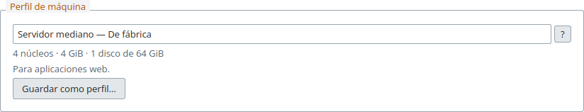

| Elemento | Modo | Qué hace |
|---|---|---|
| Lista de perfiles | Básico | **Personalizado** (solo un estado), los 9 de fábrica («Servidor pequeño — De fábrica») y los tuyos. Al abrir el formulario se aplica **Servidor pequeño**. |
| Resumen y descripción | Básico | Por ejemplo «4 núcleos · 4 GiB · 1 disco de 64 GiB». |
| «?» | Básico | Ayuda sobre qué es un perfil. |
| **Guardar como perfil…** | Básico | Abre [Guardar como perfil de máquina](#guardar-tu-propio-perfil). |
| **Guardar cambios en el perfil «X»** | Básico, solo con un perfil **tuyo** modificado | Reemplaza su hardware (pide confirmar). |
| **Administrar perfiles…** | Avanzado | Abre [Administrar perfiles](#administrar-perfiles-modo-avanzado). |
| **Avisos del perfil** + **Cerrar** | Básico | Panel con las pistas que no sirvieron. |
| **Compatibilidad del perfil** | Básico | Con ✕ lo que impide crear; con ⚠ lo que solo conviene saber. |

### Perfiles de fábrica

ProxLaunch trae nueve perfiles. **No se pueden modificar ni borrar**; si quieres una variante, duplícala. El **id** es
el que se escribe en la columna `perfil` de un CSV (no depende del idioma):

| Perfil | Id (para el CSV) | Para qué | Núcleos | Memoria | Disco |
|---|---|---|---|---|---|
| **Servidor pequeño** (el que se aplica al abrir) | `fabrica.servidor-pequeno` | Pruebas y servicios ligeros. | 2 | 2 GiB | 32 GiB |
| **Servidor mediano** | `fabrica.servidor-mediano` | Aplicaciones web. | 4 | 4 GiB | 64 GiB |
| **Base de datos** | `fabrica.base-de-datos` | Bases de datos. | 4 | 8 GiB | 100 GiB |
| **Servidor grande** | `fabrica.servidor-grande` | Cargas pesadas. | 8 | 16 GiB | 128 GiB |
| **Escritorio (hardware compatible)** | `fabrica.escritorio-compatible` | Sistemas sin controladores virtio: disco SATA, tarjeta Intel E1000 y arranque UEFI. | 4 | 4 GiB | 80 GiB |
| **Mínimo** | `fabrica.minimo` | Disco y red básicos, para probar. | 1 | 512 MiB | 8 GiB |
| **Windows 11 (escritorio)** | `fabrica.windows-11` | Instalar Windows 11: UEFI, TPM y agente de QEMU. El ISO se elige después. | 4 | 8 GiB | 64 GiB |
| **Windows Server** | `fabrica.windows-server` | Instalar Windows Server 2022 o 2025: UEFI, TPM y agente. El ISO se elige después. | 4 | 8 GiB | 80 GiB |
| **Linux (Red Hat y otros)** | `fabrica.linux-red-hat` | Instalar Linux, en especial Red Hat, Rocky o Alma. El ISO se elige después. | 2 | 4 GiB | 40 GiB |

Todos usan un solo socket y una interfaz de red. Los seis primeros crean un disco vacío; los tres últimos dejan marcado el
origen «Instalar desde un archivo ISO» **sin archivo**: tú lo eliges.

### Usar un perfil

1. En **Perfil de máquina**, abre la lista y elige uno.
2. El formulario se rellena con su hardware. La barra de estado dice «Perfil «Servidor mediano» aplicado». Tu nombre,
   número y nodo siguen como estaban.
3. Sigue como siempre: **Crear máquina**, o **Ver resumen** si es un lote.

**Qué pasa con las opciones de la máquina.** Al aplicar un perfil, **Arrancar con el servidor** toma el valor del perfil y
**Encender al terminar** vuelve a quedar **desmarcada** (el perfil nunca la guarda). Las notas, las etiquetas, el pool, el
orden y la espera de arranque y la protección contra borrado **se quedan como las tenías** en el formulario. El **MTU** y
el **límite de velocidad** de cada tarjeta sí vienen del perfil. Un perfil guardado con 0.5.1 se aplica con MTU «Heredar
del bridge», sin límite y con **Arrancar con el servidor** desmarcada.

**«(modificado)» y «Personalizado».** Si cambias cualquier dato de hardware después de elegir un perfil, la lista dice, por
ejemplo, «Servidor mediano — De fábrica (modificado)»: el perfil guardado no cambia. Si abres un lote guardado, o el perfil
que usabas se elimina, la lista muestra «Personalizado». **Si ya cambiaste cosas y eliges otro perfil**, ProxLaunch
pregunta (**Cambiar de perfil**: «Se reemplazarán los ajustes de hardware que cambiaste.»): **Reemplazar** o **Cancelar**.

**Almacenamiento y red del perfil (pistas).** Un perfil puede recordar en qué almacenamiento y bridge estaba cada disco e
interfaz. Son **pistas**: si existen en el nodo se usan; si no, ProxLaunch usa los predeterminados y te avisa. Nunca
inventa un almacenamiento.


### Guardar tu propio perfil

1. Deja el formulario como quieres el hardware.
2. Pulsa **Guardar como perfil…** o abre **Perfiles > Guardar como perfil de máquina…**.
3. Completa el diálogo y pulsa **Guardar perfil** («Perfil «X» guardado»).

![Ventana «Guardar como perfil de máquina»: «Se guardará el hardware actual del formulario: procesador, memoria, discos y redes (con su MTU y límite de velocidad), y si arranca con el servidor. No se guarda el nombre de la máquina, su número ni el nodo.», el resumen «4 núcleos · 4 GiB · 2 discos (132 GiB en total)», «Nombre del perfil» con «Servidor web», «Descripción (opcional)», la casilla marcada «Recordar los nombres de almacenamiento y red (solo sirven en servidores que los tengan)» y los botones «Guardar perfil» y «Cancelar».](img/41-guardar-perfil.png)

| Campo | Modo | Para qué sirve | Valores | Defecto | Límites |
|---|---|---|---|---|---|
| **Nombre del perfil** | Básico | Cómo se verá en la lista. | Texto. | «Mi perfil» (o «… (2)» si ya existe). | 1 a 60 caracteres; no puede repetir el de otro perfil (de fábrica o tuyo); no puede parecer un token. |
| **Descripción (opcional)** | Avanzado | Para qué sirve. | Texto. | Vacío. | Hasta 200 caracteres. |
| **Recordar los nombres de almacenamiento y red…** | Avanzado (en básico se usa el valor por defecto) | Guarda los nombres como pistas. También recuerda el origen (ISO, disco, plantilla) y el nombre del archivo. | Casilla. | Marcada. | Si la desmarcas, el perfil queda con origen «disco vacío» y sin pistas. |

Puedes tener hasta **100 perfiles propios**. Si el formulario tiene errores, el diálogo los lista («Corrige esto en el
formulario antes de guardar el perfil») y no te deja guardar. **Guardar como perfil…** no está disponible en un
[lote por filas](#lote-por-filas).

### Administrar perfiles (modo avanzado)

En **Ajustes > Modo > Avanzado**, **Perfiles > Administrar perfiles…** abre la gestión:

![Ventana «Administrar perfiles de máquina»: texto «Un perfil de máquina es un punto de partida con el hardware ya elegido (procesador, memoria, discos y red). No es una plantilla de Proxmox ni un perfil de conexión.», tabla con Nombre, Tipo y Resumen de los nueve perfiles «De fábrica» y «Servidor web de la oficina» (Propio, seleccionado), su descripción y los botones «Usar en el formulario», «Guardar el formulario como perfil...», «Duplicar...», «Renombrar...», «Eliminar...», «Importar...», «Exportar...» y «Cerrar».](img/42-administrar-perfiles.png)

| Botón | Qué hace |
|---|---|
| **Usar en el formulario** | Aplica el perfil elegido. |
| **Guardar el formulario como perfil…** | Lo mismo que **Guardar como perfil…**. |
| **Duplicar…** | Hace una copia editable; propone «Copia de X». Sirve para partir de uno de fábrica. |
| **Renombrar…** | Cambia nombre y descripción de un perfil tuyo. |
| **Eliminar…** | Pide confirmar («¿Eliminar el perfil «X»? Los lotes que ya guardaste no cambian.»). |
| **Importar…** / **Exportar…** | Ver más abajo. |
| **Cerrar** | Cierra. |

Con uno de fábrica, **Renombrar…** y **Eliminar…** están desactivados y la ventana explica: «Los perfiles de fábrica no se
pueden cambiar. Duplícalo para hacer tu propia versión.»

### Compartir perfiles: exportar e importar

**Exportar.** Elige uno o varios perfiles y pulsa **Exportar…**:


La casilla **Incluir los nombres de almacenamiento y red** viene **desmarcada** (esos nombres son de tu servidor y casi
nunca existen en el de otra persona). El archivo se llama, por ejemplo, `servidor-web.proxlaunch-perfiles.json`.

**Importar.** Pulsa **Importar…** y elige un archivo de perfiles. **Todavía no se guardó nada.**

![Ventana «Importar perfiles de máquina»: «El archivo tiene 3 perfiles. Se pueden importar 2.», «Todavía no se guardó nada.», tabla con Importar, Nombre, Resumen y Estado («✔ Nuevo» para «Servidor de bases de datos», «⚠ Nombre repetido: se conservan ambos» para «Servidor web de la oficina» y «✖ No válido» para «Servidor de pruebas»), el grupo «Este nombre ya existe» con «Conservar ambos (el importado se renombra)», «Reemplazar el perfil que ya tengo» y «Omitir este perfil», y los botones «Importar 2 perfiles» y «Cancelar».](img/44-importar-perfiles.png)

| Estado | Qué significa |
|---|---|
| ✔ Nuevo | Se importará tal cual. |
| ⚠ Nombre repetido: se conservan ambos | Ya tienes uno igual. En **Este nombre ya existe** eliges **Conservar ambos (el importado se renombra)** (lo normal), **Reemplazar el perfil que ya tengo** (solo con perfiles tuyos y con una confirmación más) u **Omitir este perfil**. Un perfil de fábrica nunca se reemplaza. |
| ✖ No válido | El archivo trae ese perfil dañado; no se puede marcar. |

Pulsa **Importar N perfiles**. Los importados son siempre perfiles **tuyos**. Límite: 100 perfiles. El formato del archivo
está en [Formatos de archivo](#perfiles-de-máquina-archivo-de-perfiles).

### Dónde se guardan

Tus perfiles van en `perfiles_maquina.json`, en la carpeta de configuración (ver
[Qué se guarda y dónde](#qué-se-guarda-y-dónde)). Si el archivo se dañó, ProxLaunch guarda una copia y empieza con la lista
vacía. Si lo creó una versión más nueva de ProxLaunch, tus perfiles se muestran pero no se pueden modificar.

---

## Guardar y abrir lotes

Un **lote guardado** es un archivo que recuerda cómo preparaste un lote, para repetirlo otro día o en otro servidor. Se
guarda como `.proxlaunch-lote.json`. Ejemplos listos para abrir: [`lote-homogeneo.proxlaunch-lote.json`](ejemplos/lote-homogeneo.proxlaunch-lote.json)
(3 servidores web iguales) y [`lote-por-filas.proxlaunch-lote.json`](ejemplos/lote-por-filas.proxlaunch-lote.json) (3 máquinas
distintas). Su estructura está en [Formatos de archivo](#lote-guardado-archivo-de-lote).

El menú es **Lote**:

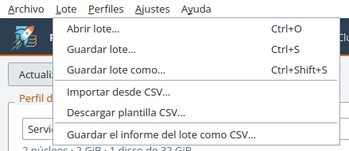

| Opción | Atajo | Qué hace | Cuándo está activa |
|---|---|---|---|
| **Abrir lote…** | Ctrl+O | Carga un lote guardado. | Con sesión lista y sin lote en curso. **Necesita estar conectado.** |
| **Guardar lote…** | Ctrl+S | Guarda el lote actual. | Con sesión lista (también con un lote en marcha). |
| **Guardar lote como…** | Ctrl+Shift+S | Guarda con otro nombre o en otro sitio. | Igual que la anterior. |
| **Importar desde CSV…** | | Ver [Importar desde CSV](#importar-máquinas-desde-un-csv). | Sin lote en curso; no exige conexión (la vista previa avisa). |
| **Descargar plantilla CSV…** | | Guarda un CSV de ejemplo. | Siempre. |
| **Guardar el informe del lote como CSV…** | | Guarda el resultado del último lote en CSV. | Con un lote de más de una máquina (en curso o terminado). |

### Qué se guarda

El lote es **autocontenido**: lleva la configuración de hardware (con los nombres de almacenamiento y red que usaste), la
cantidad, el patrón de nombres, el número de máquina inicial **solo si lo escribiste tú**, dónde crearlas, el reparto, si
etiquetar, el nombre del lote y la versión de Proxmox con la que lo guardaste. Desde la versión 0.6 guarda también las
[opciones de la máquina](#opciones-de-la-máquina): **Encender al terminar**, **Arrancar con el servidor**, orden y espera de
arranque, las casillas y el texto de las notas, las etiquetas propias, el pool, **Proteger contra borrado** y, por tarjeta,
el MTU y el límite de velocidad. En un [lote por filas](#lote-por-filas) guarda además cada fila (con lo que sobrescribe
de esas opciones).

> **Compatibilidad.** Si el lote usa alguna de esas opciones, se guarda en el **formato 3** y **ProxLaunch 0.5.1 no lo
> abre** (dice que lo creó una versión más nueva). Un lote que no usa ninguna se sigue guardando en el formato 1 o 2, que
> 0.5.1 sí abre. Ver [Compatibilidad con versiones anteriores](#compatibilidad-con-versiones-anteriores). Ejemplo listo para
> abrir: [`lote-con-opciones.proxlaunch-lote.json`](ejemplos/lote-con-opciones.proxlaunch-lote.json).

**No se guarda nunca:** datos de conexión (servidor, usuario, token, contraseña), el resumen, los números ya reservados,
el código del lote ni la casilla de sobreasignar espacio. Si algún texto que escribiste parece una credencial
(`usuario@realm!token=...`), ProxLaunch **no guarda** y te dice en qué campo (sin mostrar el valor).

### Guardar

1. Prepara el lote (también vale con **1** máquina).
2. **Lote > Guardar lote…**. Se abre **Guardar lote**:


| Campo | Para qué sirve | Valores | Defecto | Límites |
|---|---|---|---|---|
| **Nombre del lote** | El nombre que lleva dentro el archivo. | Texto (marcador «Por ejemplo: Servidores web de pruebas»). | Un nombre sugerido. | 1 a 60 caracteres; no puede parecer una credencial. |
| Aviso «El lote tiene problemas…» | Solo si el lote tiene errores: se guarda como borrador. | — | — | Excepción: un campo numérico con texto que no es un número impide guardar. |
| **Guardar como un archivo nuevo…** / **Sobrescribir el archivo «x»** | Solo aparecen si el lote viene de un archivo que abriste o guardaste. | Radios. | Archivo nuevo. | Sobrescribir pide confirmar. |
| **Elegir dónde guardar…** / **Cancelar** | Elige la carpeta (ProxLaunch sugiere la carpeta `lotes` de tus datos) / cierra. | | | |

Al terminar verás «Lote guardado en «archivo.json»».

### Abrir

1. Conéctate a un servidor. **Lote > Abrir lote…** y elige el archivo (si hay [cambios sin guardar](#cambios-sin-guardar),
   antes te pregunta).
2. ProxLaunch lee y comprueba **todo el archivo** antes de tocar nada. Si algo falla, el formulario **no cambia** y ves el
   motivo con la lista de campos. Si va bien: «Lote «X» cargado».
3. El formulario y el bloque **Lote** quedan rellenados. **No se crea nada**: revisa y pulsa **Ver resumen**.

El selector **Perfil de máquina** queda en «Personalizado». ProxLaunch **no vigila ni vuelve a leer** el archivo: si lo
cambias con otro programa, ábrelo de nuevo.

**Avisos del archivo.** Un panel que puedes cerrar con **Cerrar** te cuenta lo que no se usó: campos desconocidos, datos que
parecen una credencial («El archivo traía datos que parecen una credencial. No se usaron. Si eran reales, cámbialas.») o
que el lote se guardó con una versión de Proxmox más nueva.

**Lotes guardados con versiones anteriores.** ProxLaunch 0.6 abre los lotes de las versiones 1 y 2 del formato. Los abre con
las opciones nuevas en su valor por defecto (sin encender, sin notas propias, sin etiquetas extra, sin pool, sin protección,
MTU «Heredar» y sin límite), de modo que se crean **igual que antes**. En particular, **Añadir notas de origen** queda
**desmarcada** al abrir un lote antiguo, aunque en un formulario nuevo venga marcada.

**Un pool que ya no existe.** Si el lote nombra un pool que este servidor no tiene, el pool se muestra como «x (no existe)» y
la validación lo bloquea hasta que elijas otro o «Ninguno» (ver [Pool](#pool)).

### Si el lote «no encaja» en este servidor

Un lote guardado en otro servidor puede nombrar un almacenamiento, una red o un nodo que **este** servidor no tiene.
ProxLaunch **nunca los cambia por su cuenta**:


| Botón | Qué hace |
|---|---|
| **Usar otro…** | Abre **Usar otro valor** con lo que sí hay en el servidor («Almacenamiento que reemplaza a «datos»:»). Lo eliges y se cambia en todo el lote. |
| **Pasar a Automático** | Solo para nodos: deja que ProxLaunch elija el nodo. |

En un [lote por filas](#lote-por-filas) cada renglón añade a cuántas máquinas afecta («Afecta a 3 máquinas (n.º 2, 5, 7).»).
Mientras tanto, en las tablas el valor aparece como «viejo (no existe)» y no puedes seguir. Si el lote usa **Nodos
elegidos** y alguno no existe, desmarca ese nodo (en modo avanzado) o usa **Pasar a Automático**.

---

## Importar máquinas desde un CSV

Con **Lote > Importar desde CSV…** creas un lote con **una máquina por cada fila** de una hoja de cálculo. Cada fila
puede tener su propia configuración; el resultado es un [lote por filas](#lote-por-filas). **Nada se crea** al importar:
después hay un resumen que debes confirmar, como en cualquier lote.

> **Archivos de ejemplo** (carpeta [`ejemplos/`](ejemplos/LEEME.md)):
> [`mvs-minimo.csv`](ejemplos/mvs-minimo.csv) · [`mvs-mixtas.csv`](ejemplos/mvs-mixtas.csv) ·
> [`mvs-multidisco-cluster.csv`](ejemplos/mvs-multidisco-cluster.csv) · [`mvs-con-errores.csv`](ejemplos/mvs-con-errores.csv) ·
> [`mvs-escrito-a-mano.csv`](ejemplos/mvs-escrito-a-mano.csv) · [`mvs-opciones.csv`](ejemplos/mvs-opciones.csv)

### Paso a paso

1. (Opcional) **Lote > Descargar plantilla CSV…**: elige el separador (**; (Excel en español)** o **, (Excel en inglés)**) y
   dónde guardarla (`plantilla-proxlaunch.csv`).
2. Ábrela en Excel o LibreOffice Calc, cambia los datos y guarda como **CSV UTF-8**.
3. **Lote > Importar desde CSV…** y elige tu archivo (si hay [cambios sin guardar](#cambios-sin-guardar), antes te
   pregunta).
4. Revisa la **vista previa** y pulsa **Continuar**.
5. Aparece el [lote por filas](#lote-por-filas): pulsa **Ver resumen**.

### El CSV más sencillo: tres servidores

El archivo [`mvs-minimo.csv`](ejemplos/mvs-minimo.csv) solo tiene nombre, núcleos, memoria y disco:

```text
"nombre";"cpu";"memoria";"disco"
"srv-01";"2";"4";"40"
"srv-02";"2";"4";"40"
"srv-03";"4";"8";"80"
```

Se abre en una hoja de cálculo así:

| nombre | cpu | memoria | disco |
|---|---|---|---|
| srv-01 | 2 | 4 | 40 |
| srv-02 | 2 | 4 | 40 |
| srv-03 | 4 | 8 | 80 |

Todo lo que no escribes (red, almacenamiento, firmware…) sale del **Perfil base** del diálogo (por defecto, **Servidor
pequeño**) y el origen es disco vacío. Los CSV **no necesitan** las comillas ni la plantilla de la aplicación: el archivo
[`mvs-escrito-a-mano.csv`](ejemplos/mvs-escrito-a-mano.csv) es texto simple, sin comillas, con `;` y con la columna `red`:

```text
nombre;cpu;memoria;disco;red
lab-01;2;4;40;vmbr0
lab-02;2;4;40;vmbr0
lab-03;4;8;80;vmbr0
```

### Reglas generales del formato

- **Una fila = una máquina.** La primera fila no vacía es el **encabezado**. Las filas vacías no cuentan.
- **Separador de columnas:** `;`, `,`, **tabulador** y `|` (barra vertical). Se detecta solo; también vale una primera línea
  `sep=;`. Los CSV que escribe ProxLaunch usan `;` por defecto.
- **Codificación:** UTF-8 (con o sin marca BOM), UTF-16, Windows-1252 e ISO-8859-1. Se detecta sola.
- **Nombres de columna:** no distinguen mayúsculas ni acentos, y espacio, guion y guion bajo valen igual (`disco_2` =
  `disco2`; `Tipo CPU` = `tipo-cpu` = `tipo_cpu`). Las columnas desconocidas se **ignoran con un aviso**.
- **Celda vacía** = «usa el valor del perfil» (en `nodo` y `vmid`, «que elija ProxLaunch»).
- **Qué manda cuando hay varios valores** (de menor a mayor): los valores normales de ProxLaunch, luego el **perfil**
  (el de la columna `perfil`, o el **Perfil base** si la celda está vacía) y por último las **columnas del archivo**. Si una
  fila dice `memoria` = 8 y su perfil trae 4 GiB, se crea con 8 GiB.
- **Límites:** hasta **100 filas** (sin contar el encabezado ni las vacías), **60 columnas**, **256 caracteres por celda**
  (la columna `notas` admite hasta **8192**) y **1 MiB** por archivo. Si te pasas, ProxLaunch no recorta: te pide dividir el
  archivo.
- **Numeración de filas:** como en Excel; el encabezado es la fila 1, así que tu primera máquina es la **fila 2**.
- **Credenciales:** una columna cuyo nombre parece una credencial (`token`, `password`, `contraseña`, `secreto`, `ticket`,
  `csrf`, `apikey`, `credencial`) se ignora **sin leer sus celdas**.
- **Error de todo el archivo:** una columna repetida («La columna «cpu» aparece dos veces.»), datos en una columna sin
  encabezado o la falta de `nombre`.

### Columnas del CSV

Solo **`nombre`** es obligatoria. Las demás son opcionales.

| Columna (alias) | Obligatoria | Valores admitidos | Unidades | Ejemplo | Notas |
|---|---|---|---|---|---|
| `nombre` (`name`, `hostname`) | **Sí** | Nombre DNS: letras sin acentos, números y guiones; sin `_` ni guion al inicio o final. | — | `web-01` | Un nombre que empieza por `ejemplo-` da un aviso («Parece una fila de ejemplo de la plantilla.»). |
| `perfil` (`profile`) | No | Nombre visible del perfil (sin importar mayúsculas ni acentos) o su id. | — | `fabrica.servidor-mediano` | Los ids están en [Perfiles de fábrica](#perfiles-de-fábrica). Si no existe o es ambiguo: error. Vacío = perfil base. |
| `vmid` (`id`) | No | Entero de 100 a 999 999 999. | — | `210` | Vacío = automático. No se puede repetir en el archivo. |
| `nodo` (`node`) | No | Nombre de un nodo en línea. | — | `pve1` | Solo en clúster. Vacío = reparto automático. |
| `cpu` (`cores`, `nucleos`) | No | Entero de 1 a 128. | Núcleos **por socket** | `4` | En un clon es un ajuste de núcleos. |
| `sockets` (`zocalos`) | No | Entero de 1 a 4. | — | `1` | Uso avanzado. |
| `memoria` (`ram`, `memoria_gib`, `memoria_mib`) | No | Número con unidad opcional. | **GiB** si no pones unidad (o **MiB** si la columna se llama `memoria_mib`); admite `M`, `MiB`, `MB`, `G`, `GiB`, `GB`, `T`, `TiB`, `TB`. | `16 GiB`, `4096 MiB`, `4` | Debe dar un número entero de MiB. En un clon es un ajuste sobre la plantilla. |
| `disco` (`disco1`, `disco_gib`, `tamano_disco`) | No | GiB enteros desde 1; `0`, `ninguno`, `ninguna`, `sin disco` o `sin_disco` = sin disco. | **GiB** si no pones unidad (admite `MiB`, `GiB`, `TiB`). | `40`, `200 GiB` | Con origen `importar` significa «ampliar el disco a»; con `clonar`, el tamaño del disco principal. |
| `almacenamiento` (`storage`, `almacenamiento1`) | No | Id de un almacenamiento con contenido de discos. | — | `local-lvm` | Vacío = el del perfil o el de más espacio libre. |
| `disco2` … `disco8`, `almacenamiento2` … `almacenamiento8` | No | Igual que `disco` y `almacenamiento`. | GiB | `500`, `datos` | Hasta **8 discos**. Un almacenamiento sin tamaño en un disco que no existe es un error. |
| `red` (`bridge`, `red1`) | No | Nombre de un bridge. | — | `vmbr0` | |
| `vlan` (`vlan1`) | No | Entero de 1 a 4094. | — | `20` | |
| `modelo_red` (`tarjeta_red`) | No | `virtio` o `e1000`. | — | `virtio` | Uso avanzado. |
| `firmware` (`bios`) | No | `seabios` (o `bios`); `ovmf` (o `uefi`). | — | `uefi` | |
| `tipo_cpu` (`cpu_tipo`) | No | Letras, números, `.`, `_` y `-`. | — | `x86-64-v3` | Uso avanzado. |
| `origen` (`source`) | No | `vacio` (o `disco vacio`), `iso`, `importar` (`imagen`, `importar disco`), `clonar` (`plantilla`, `clonar plantilla`). | — | `iso` | Vacío = el origen del perfil. Escribe `vacio` explícitamente si el perfil sugiere un ISO. |
| `fuente` (`origen_archivo`, `iso`, `plantilla`, `imagen`) | **Sí, con `iso`, `importar` o `clonar`** | **Nombre** del ISO (`.iso`, `.img`), de la imagen (`.qcow2`, `.raw`, `.vmdk`) o de la plantilla; también un volid `almacenamiento:iso/archivo.iso`. | — | `ubuntu-24.04-server.iso` | **Nunca una dirección web ni una ruta de tu equipo.** Para descargar un archivo al servidor usa «Descargar en el servidor» dentro de la aplicación. |
| `so` (`sistema`) | No | `linux`, `windows 10`, `windows 11`, `windows server 2016/2019`, `windows server 2022/2025`, `otro`. | — | `windows 11` | Solo con `iso` o `importar`. Aplica el asistente (UEFI, TPM, agente de QEMU, drivers). Con `iso` es necesaria si el perfil no define el sistema. |
| `virtio` (`drivers`) | No | `si` o `no` (también `yes`, `true`, `1`, `false`, `0`). | — | `si` | Solo Windows con `iso`. Vacío = detectar el ISO de virtio-win. |
| `modo_clon` (`clon`) | No | `auto`, `enlazado` o `completo`. | — | `enlazado` | Solo con `clonar`. Vacío = `auto`. |
| `encender` (`start`) | No | `si` o `no` (también `yes`, `true`, `1`, `false`, `0`). | — | `si` | Enciende la máquina al terminar. Vacío = lo que marque el formulario. Ver [abajo](#columnas-de-opciones-de-la-máquina). |
| `arranque_auto` (`onboot`) | No | `si` o `no`. | — | `si` | La máquina arranca con el servidor. Vacío = el formulario. |
| `notas` (`notes`) | No | Texto libre, hasta 8192 caracteres. | — | `Servidor web de la oficina` | Notas de la máquina. Una celda entre comillas puede llevar saltos de línea. Vacío = el formulario. |
| `etiquetas` (`tags`) | No | Etiquetas separadas por `,` o `;`. | — | `web,produccion` | Se suman a `proxlaunch` y `lote-…`. Vacío = las del formulario. |
| `pool` | No | Nombre de un pool existente (admite `padre/hijo`); `ninguno`, `ninguna`, `sin pool` o `none` = sin pool. | — | `produccion` | Vacío = el pool del formulario. |
| `proteger` (`protection`) | No | `si` o `no`. | — | `si` | Protege contra borrado. Vacío = el formulario. |
| `mtu` | No | `heredar` (`inherit`), `igual` (`same`, `bridge`) o un entero de 576 a 65520. | — | `1500` | Solo VirtIO; **primera tarjeta**. Uso avanzado. |
| `limite_red` (`rate`) | No | Número mayor que 0 (admite decimales). | **MB/s** (sin unidad escrita) | `100`, `12.5` | **Primera tarjeta**. Uso avanzado. |

**Equivalencias que enseñan los ejemplos:**

- `origen=importar`: el `disco` de la fila es el tamaño al que se amplía el disco importado.
- `origen=clonar`: `cpu` y `memoria` son ajustes sobre la plantilla; si los dejas vacíos, la copia queda igual que la
  plantilla.
- `origen=iso` con `so=windows 11` y `virtio=si`: instala Windows 11 con el ISO de drivers virtio-win detectado.

#### Columnas de opciones de la máquina

Las ocho columnas nuevas (`encender`, `arranque_auto`, `notas`, `etiquetas`, `pool`, `proteger`, `mtu` y `limite_red`)
sirven para fijar, **fila por fila**, las [opciones de la máquina](#opciones-de-la-máquina). Cómo se comportan:

- **Celda vacía = lo del formulario.** Si dejas la celda vacía (o no pones la columna), la fila usa lo que tengas marcado en
  el formulario al importar. Una celda vacía **no** significa «no»: para anular algo del formulario escribe `no` (o
  `ninguno` en `pool`, o `heredar` en `mtu`).
- **Sí y no.** En `encender`, `arranque_auto` y `proteger` valen `si`, `yes`, `true` y `1` (sí) y `no`, `false` y `0` (no),
  con o sin acento y sin distinguir mayúsculas. Otro valor (`quizá`) da error en esa celda, con el nombre de la columna y el
  valor.
- **Etiquetas.** Separadas por `,` o `;` (pon la celda entre comillas si el separador del archivo es la coma). Con la celda
  vacía, la fila lleva las etiquetas del formulario; si la fila escribe etiquetas, **sustituyen** a las del formulario (las
  de ProxLaunch, `proxlaunch` y `lote-…`, se mantienen siempre).
- **Notas.** Hasta 8192 caracteres por celda. No hay columna para las casillas **Añadir notas de origen** ni **Incluir mi
  usuario en las notas**: se usa lo que marque el formulario para todo el lote. Si la celda parece contener un API Token o
  caracteres no admitidos, la fila da error y el valor no se muestra.
- **Pool.** Un nombre de pool, `ninguno` para no usar pool aunque el formulario tenga uno, o vacío (el del formulario).
- **MTU y límite de red.** Solo afectan a la **primera tarjeta** de la máquina. `mtu` acepta `heredar`, `igual` (igual al
  bridge) o un número de 576 a 65520, y solo vale con tarjeta VirtIO (con `modelo_red` = `e1000` da error). `limite_red` va en
  MB/s, sin escribir la unidad. En un clon, estas dos columnas no se aplican (la red es de la plantilla).
- **Un perfil con «Arrancar con el servidor».** Si la fila elige un perfil (columna `perfil`) que lo tiene marcado y
  `arranque_auto` está vacía, la fila arranca con el servidor.
- **Qué se valida cuándo.** La vista previa comprueba el formato (sí/no, etiquetas, rangos de MTU y límite, pool bien
  escrito). Lo que depende del servidor (si el pool existe, si tus privilegios alcanzan, si las etiquetas están permitidas)
  se comprueba al pulsar **Ver resumen**: por ejemplo, una fila con `encender` = `si` sin el privilegio `VM.PowerMgmt` se
  bloquea y el mensaje nombra el privilegio que falta.
- **Plantilla y archivos antiguos.** La plantilla CSV de la aplicación ya incluye estas columnas. Un CSV de 0.5.1 (sin
  ellas) se lee igual que antes.

Ejemplo: [`mvs-opciones.csv`](ejemplos/mvs-opciones.csv), con cuatro máquinas. Como texto:

```text
"nombre";"perfil";"cpu";"memoria";"disco";"almacenamiento";"red";"encender";"arranque_auto";"notas";"etiquetas";"pool";"proteger";"mtu";"limite_red"
"web-01";"fabrica.servidor-mediano";"";"";"";"local-lvm";"vmbr0";"si";"si";"Servidor web de la oficina";"web,produccion";"produccion";"si";"1500";"100"
"web-02";"fabrica.servidor-mediano";"";"";"";"local-lvm";"vmbr0";"";"";"";"";"";"";"";""
"bd-01";"fabrica.base-de-datos";"";"";"";"local-lvm";"vmbr0";"no";"si";"Base de datos principal";"bd;produccion";"ninguno";"si";"igual";""
"lab-01";"fabrica.minimo";"";"";"";"local-lvm";"vmbr0";"no";"no";"";"laboratorio";"";"no";"heredar";"12.5"
```

En una hoja de cálculo (a la derecha del bridge `vmbr0` empiezan las columnas de opciones):

| nombre | perfil | almacenamiento | red | encender | arranque_auto | notas | etiquetas | pool | proteger | mtu | limite_red |
|---|---|---|---|---|---|---|---|---|---|---|---|
| web-01 | fabrica.servidor-mediano | local-lvm | vmbr0 | si | si | Servidor web de la oficina | web,produccion | produccion | si | 1500 | 100 |
| web-02 | fabrica.servidor-mediano | local-lvm | vmbr0 | | | | | | | | |
| bd-01 | fabrica.base-de-datos | local-lvm | vmbr0 | no | si | Base de datos principal | bd;produccion | ninguno | si | igual | |
| lab-01 | fabrica.minimo | local-lvm | vmbr0 | no | no | | laboratorio | | no | heredar | 12.5 |

(La hoja omite las columnas vacías `cpu`, `memoria` y `disco` para caber.) Lo que enseña cada fila: `web-01` lo fija todo;
`web-02` no fija nada y hereda lo del formulario; `bd-01` separa las etiquetas con `;`, no usa pool aunque el formulario
tenga uno y pone el MTU «igual al bridge»; `lab-01` escribe `no` en lugar de dejar la celda vacía, anula el MTU del perfil
con `heredar` y limita la tarjeta a 12.5 MB/s.

#### Unidades y números

| Dato | Qué puedes escribir | Notas |
|---|---|---|
| `memoria` | `8` (se entiende **GiB**), `4 GiB`, `512 MiB`, `1 TiB`; también `M`, `G`, `T`, `MB`, `GB`, `TB` | `MB`, `GB` y `TB` se toman como `MiB`, `GiB` y `TiB` (1 GB = 1024 MiB) y ProxLaunch lo avisa. Debe dar una cantidad entera de MiB (`0,5` = 512 MiB vale; `0,3` no). |
| `disco`, `disco2`… | `100` (se entiende **GiB**), `500 GiB`, `1 TiB`, `2048 MiB` | Debe dar un número entero de GiB, de 1 en adelante. |
| `cpu`, `sockets`, `vmid`, `vlan` | `2` o `2.0` | `2.5` no vale. |
| decimales | `0,5` o `0.5` | Con coma se avisa («se usó la coma como separador decimal»). |
| miles | **no los uses** | `1.000` o `1,000` es ambiguo: «¿Quisiste decir mil o uno? Escribe 1000 o 1.» |

Una unidad escrita en la celda manda sobre el nombre de la columna. No se admiten signos, exponentes, hexadecimales ni
`NaN`. Si una memoria pasa de 1024 GiB (o de la memoria libre del nodo que más tiene), ProxLaunch avisa «Pides 4096 GiB de
memoria. ¿Querías MiB?» pero no lo bloquea.

### Ejemplo con orígenes mezclados

[`mvs-mixtas.csv`](ejemplos/mvs-mixtas.csv) crea 7 máquinas con distinto origen: disco vacío, ISO de Linux, ISO de Windows 11,
disco importado y dos clones.

```text
"nombre";"perfil";"cpu";"memoria";"disco";"almacenamiento";"red";"vlan";"nodo";"vmid";"origen";"fuente";"so";"virtio";"modo_clon"
"web-01";"fabrica.servidor-mediano";"";"";"";"local-lvm";"vmbr0";"";"";"";"vacio";"";"";"";""
"db-01";"fabrica.base-de-datos";"";"16 GiB";"200 GiB";"local-lvm";"vmbr1";"20";"pve1";"210";"vacio";"";"";"";""
"ubuntu-01";"";"2";"4 GiB";"40 GiB";"";"vmbr0";"";"";"";"iso";"ubuntu-24.04-server.iso";"linux";"";""
"win11-01";"fabrica.windows-11";"4";"8 GiB";"80 GiB";"";"vmbr0";"";"";"";"iso";"windows-11-es.iso";"windows 11";"si";""
"debian-img-01";"";"2";"2 GiB";"60 GiB";"";"vmbr0";"";"";"";"importar";"debian-12-generic.qcow2";"linux";"";""
"clon-01";"";"2";"4 GiB";"";"";"";"";"";"";"clonar";"plantilla-debian12";"";"";"enlazado"
"clon-02";"";"";"";"";"";"";"";"";"";"clonar";"plantilla-ubuntu";"";"";"auto"
```

En una hoja de cálculo:

| nombre | perfil | cpu | memoria | disco | almacenamiento | red | vlan | nodo | vmid | origen | fuente | so | virtio | modo_clon |
|---|---|---|---|---|---|---|---|---|---|---|---|---|---|---|
| web-01 | fabrica.servidor-mediano | | | | local-lvm | vmbr0 | | | | vacio | | | | |
| db-01 | fabrica.base-de-datos | | 16 GiB | 200 GiB | local-lvm | vmbr1 | 20 | pve1 | 210 | vacio | | | | |
| ubuntu-01 | | 2 | 4 GiB | 40 GiB | | vmbr0 | | | | iso | ubuntu-24.04-server.iso | linux | | |
| win11-01 | fabrica.windows-11 | 4 | 8 GiB | 80 GiB | | vmbr0 | | | | iso | windows-11-es.iso | windows 11 | si | |
| debian-img-01 | | 2 | 2 GiB | 60 GiB | | vmbr0 | | | | importar | debian-12-generic.qcow2 | linux | | |
| clon-01 | | 2 | 4 GiB | | | | | | | clonar | plantilla-debian12 | | | enlazado |
| clon-02 | | | | | | | | | | clonar | plantilla-ubuntu | | | auto |

Lo que enseña cada fila: `web-01` toma el hardware del perfil y solo fija almacenamiento y red; `db-01` fija además
VLAN, nodo y VMID; `ubuntu-01` instala desde un ISO; `win11-01` instala Windows 11 con drivers virtio-win;
`debian-img-01` importa un disco y lo **amplía a 60 GiB** (`disco`); `clon-01` clona con 2 núcleos y 4 GiB y `clon-02`
clona sin ajustes (queda igual que la plantilla). Sustituye `local-lvm`, `vmbr0`, `pve1`, los nombres de ISO, imagen y
plantilla por los de tu servidor.

### Ejemplo con dos discos en un clúster

[`mvs-multidisco-cluster.csv`](ejemplos/mvs-multidisco-cluster.csv): dos bases de datos con un segundo disco de 500 GiB en
`datos`, VLAN 30 y un nodo por fila, más un servidor de aplicación.

```text
"nombre";"perfil";"cpu";"memoria";"disco";"almacenamiento";"disco2";"almacenamiento2";"red";"vlan";"nodo"
"bd-01";"fabrica.base-de-datos";"8";"32 GiB";"100 GiB";"local-lvm";"500 GiB";"datos";"vmbr1";"30";"pve1"
"bd-02";"fabrica.base-de-datos";"8";"32 GiB";"100 GiB";"local-lvm";"500 GiB";"datos";"vmbr1";"30";"pve2"
"app-01";"fabrica.servidor-mediano";"";"";"";"";"";"";"vmbr0";"";"pve1"
```

### La vista previa

Al elegir el archivo se abre **Importar desde CSV**. Con [`mvs-mixtas.csv`](ejemplos/mvs-mixtas.csv) se ve así:

![Ventana «Importar desde CSV» con el archivo mvs-mixtas.csv: los textos «Cada fila del archivo es una máquina. Aquí solo se revisa: no se crea nada hasta que confirmes el resumen del lote.», los botones «Elegir otro archivo...» y «Descargar plantilla...», el «Perfil base» «Servidor pequeño», la línea «Codificación UTF-8 (BOM) · separador «;» · 7 filas: 6 correctas, 1 con aviso, 0 con error», una tabla de siete filas (Incluir, Fila, Nombre, Perfil, VMID, Nodo, Núcleos, Memoria, Disco, Almacenamiento, Red y Estado) casi todas «✔ Correcta» y la de win11-01 «⚠ Con aviso», el panel de detalle de la fila 2 y los botones «Descargar filas con error...» (desactivado), «Cancelar» y «Continuar».](img/57-csv-vista-previa-ok.png)

| Elemento | Modo | Qué hace |
|---|---|---|
| Nombre del archivo | Básico | Solo el nombre, nunca la ruta. |
| **Elegir otro archivo…** / **Descargar plantilla…** | Básico | Cambia de archivo / guarda la plantilla. |
| **Perfil base** (+ «?») | Básico | Aporta lo que el CSV no dice. Por defecto el perfil que tengas aplicado, o «Servidor pequeño». Si lo cambias, todo se revisa de nuevo. |
| **Codificación** | Avanzado | **Detectar**, **UTF-8 (BOM)**, **UTF-8**, **UTF-16**, **Windows-1252**, **ISO-8859-1**. Relee el archivo. |
| **Separador** | Avanzado, o cuando hay duda | **Detectar**, `;`, `,`, **Tabulador** y `\|`. Relee el archivo. |
| Línea de resumen | Básico | «Codificación UTF-8 (BOM) · separador «;» · 7 filas: 6 correctas, 1 con aviso, 0 con error». |
| **Mostrar solo problemas** / **Copiar errores** | Básico | Oculta las correctas / copia la lista de errores. |
| Tabla | Básico | **Incluir**, **Fila**, **Nombre**, **Perfil**, **VMID**, **Nodo**, **Núcleos**, **Memoria**, **Disco**, **Almacenamiento**, **Red** y **Estado** («✔ Correcta», «⚠ Con aviso», «✖ Con error»). La casilla **Incluir** deja fuera filas; las filas con error no se pueden marcar. |
| Detalle | Básico | Al seleccionar una fila: sus problemas y el **Valor del archivo** de cada celda. Muestra los primeros cinco problemas y «y N más». |
| **Descargar filas con error…** | Básico | Guarda `tu-archivo-errores.csv` con **solo** las filas con error, tus mismas columnas más `fila_original`, `columna` y `problema`. Corrígelo y vuelve a importarlo: esas tres columnas se ignoran. |
| **Cancelar** | Básico | Cierra sin importar. |
| **Continuar** | Básico | Sigue al lote por filas. Si hay errores cambia a **Importar solo la fila correcta** / **Importar solo las N filas correctas**, o dice «No hay filas correctas para importar». |

**Separador ambiguo.** Si ProxLaunch no puede decidir entre dos separadores, usa `,` y avisa: «No se pudo saber qué
separador usa el archivo. Elige uno en la lista «Separador».» En modo básico la lista **Separador** aparece solo cuando hay
duda; si ves símbolos raros, guarda el archivo como **CSV UTF-8**.

**Sin conexión.** Puedes abrir la vista previa sin conexión, pero solo se comprueba lo que no depende del servidor y
aparece «Sin conexión: aún no se comprobó contra el servidor. Conéctate a un servidor para poder continuar.»; **Continuar**
queda desactivado.

### Validación: un archivo con errores a propósito

[`mvs-con-errores.csv`](ejemplos/mvs-con-errores.csv) tiene 8 filas de datos (filas 2 a 9 en la numeración de Excel) y está
hecho para practicar:

```text
"nombre";"perfil";"cpu";"memoria";"disco";"vmid";"origen";"fuente";"so"
"ejemplo-web";"fabrica.servidor-mediano";"2";"4";"40";"";"vacio";"";""
"";"fabrica.servidor-mediano";"2";"4";"40";"";"vacio";"";""
"srv_malo";"fabrica.servidor-mediano";"2";"4";"40";"";"vacio";"";""
"web-dup";"fabrica.servidor-mediano";"2";"4";"40";"150";"vacio";"";""
"web-dup";"fabrica.servidor-mediano";"2";"4 GB";"40";"150";"vacio";"";""
"mem-mal";"fabrica.servidor-mediano";"2";"abc";"40";"";"vacio";"";""
"sin-perfil";"fabrica.no-existe";"2";"4";"40";"";"vacio";"";""
"iso-url";"";"2";"4";"40";"";"iso";"https://example.com/a.iso";"linux"
```

![Ventana «Importar desde CSV» con mvs-con-errores.csv en modo avanzado: «Perfil base», «Codificación» y «Separador» (con «?»), tres avisos naranjas sobre unidades («En la columna «memoria» había números sin unidad: se entendieron como GiB.», lo mismo para «disco» y «En la columna «memoria», «GB» se tomó como GiB (1 GB = 1024 MiB).»), la línea «8 filas: 0 correctas, 1 con aviso, 7 con error», la casilla marcada «Mostrar solo problemas», la tabla con las filas marcadas ⚠ o ✖ (VMID 150 repetido, nombre «srv_malo», «abc» en memoria, «fabrica.no-existe» en perfil), el detalle de la fila 2 y los botones «Descargar filas con error...», «Corregir el archivo» (principal) e «Importar solo la fila correcta».](img/58-csv-vista-previa-errores.png)

La vista previa indica **0 correctas, 1 con aviso y 7 con error**: la fila 2 solo tiene un aviso y se puede importar; las
otras 7 no. Los tres **avisos de todo el archivo** (no impiden importar) son los de unidades sin escribir y «GB»
tomado como GiB. Estos son los **11 problemas** por fila, con el texto exacto de la aplicación:

| Fila | Resultado | Texto |
|---|---|---|
| 2 | Aviso (se puede importar) | Fila 2, columna «nombre»: Parece una fila de ejemplo de la plantilla. |
| 3 | Error | Fila 3, columna «nombre»: Falta el nombre. |
| 4 | Error | Fila 4, columna «nombre»: El nombre solo puede tener letras sin acentos, números y guiones, y no puede empezar ni terminar con guion. |
| 5 | Error | Fila 5, columna «nombre»: Las filas 5, 6 tienen el mismo nombre «web-dup». |
| 5 | Error | Fila 5, columna «vmid»: Las filas 5, 6 tienen el mismo número de máquina «150». |
| 6 | Error | Fila 6, columna «nombre»: Las filas 5, 6 tienen el mismo nombre «web-dup». |
| 6 | Error | Fila 6, columna «vmid»: Las filas 5, 6 tienen el mismo número de máquina «150». |
| 7 | Error | Fila 7, columna «memoria»: «abc» no es un número. Escribe, por ejemplo, 4 GiB. |
| 8 | Error | Fila 8, columna «perfil»: No existe el perfil «fabrica.no-existe». Perfiles disponibles: … |
| 9 | Error | Fila 9, columna «fuente»: Aquí va el nombre de un archivo del servidor, no una dirección web. Para descargar usa «Descargar en el servidor». |
| 9 | Error | Fila 9, columna «fuente»: Elige un ISO. |

(La lista de «Perfiles disponibles» varía según tu versión y tus perfiles propios.) Qué practicar:

1. Marca **Mostrar solo problemas** para ver solo las filas con ⚠ o ✖; selecciona una para leer su detalle.
2. **Copiar errores** o **Descargar filas con error…** para llevarte la lista.
3. Pulsa **Corregir el archivo** (cierra la vista previa sin cambiar nada) y arregla el CSV; o bien
   **Importar solo la fila correcta** (en general, **Importar solo las N filas correctas**): ProxLaunch lista las filas que
   se quedarían fuera («Se importarán 8 de 10 filas del archivo. No se importarán estas filas: …») y te pide confirmar con
   **Importar esas filas** o **Cancelar**.

Al terminar verás «Se importaron N máquinas desde «archivo.csv»» y el [lote por filas](#lote-por-filas).

### Seguridad de los archivos CSV

- ProxLaunch **solo lee** tu CSV; nunca lo modifica.
- Las celdas se tratan como texto: nunca se ejecuta una fórmula ni se abre un enlace.
- Los CSV que **escribe** ProxLaunch (plantilla, filas con error, informe) llevan todas las celdas entre comillas, en UTF-8
  con marca (BOM), y si una celda empieza por `=`, `+`, `-` o `@` se le antepone un apóstrofo (`'`) para que Excel no la
  tome por una fórmula. Al reimportar un archivo así, ese apóstrofo se quita una vez.

---

## Lote por filas

Un **lote por filas** es un lote en el que **cada máquina tiene su propia configuración**. Nace al
[importar un CSV](#importar-máquinas-desde-un-csv) o al abrir un lote que se guardó así. Es un solo lote: un resumen, una
confirmación, un informe y un **Deshacer…**.

![Ventana de trabajo con un lote por filas: el título «7 máquinas desde el archivo «mvs-mixtas.csv»», las notas «Cada máquina trae su propia configuración. Para cambiar algo, corrige el archivo e impórtalo de nuevo, o quita las filas que no quieras.» y «En las máquinas clonadas, los procesadores, la memoria y los discos salen de la plantilla: aquí solo ves lo que pediste cambiar y «—» significa «igual que la plantilla».», una tabla con Fila, Nombre, VMID, Nodo, Procesadores, Memoria (GiB), Discos (GiB), Almacenamiento, Red y Sistema operativo (por ejemplo «Disco vacío», «ISO: ubuntu-24.04-server.iso (Lin…», «Disco importado: debian-12-gene…» y «Clon: plantilla-debian12 (Enlazado…»), el botón «Ver resumen» y los botones «Salir del lote por filas», «Quitar las filas seleccionadas», «Revisar filas...» y «Guardar lote...». A la derecha, el panel Progreso. La barra de estado dice «Se importaron 7 máquinas desde «mvs-mixtas.csv»».](img/59-lote-por-filas.png)

El formulario y el selector de perfil desaparecen y en su lugar hay una tabla de solo lectura. El bloque **Lote** oculta la
cantidad, el prefijo y el destino (cada fila trae lo suyo) y deja, en modo avanzado, el reparto, el número de máquina
inicial para las filas sin número y **Etiquetar las máquinas**.

| Columna de la tabla | Qué muestra |
|---|---|
| **Fila** | El número de fila de tu archivo (la primera máquina es la 2). |
| **Nombre**, **VMID**, **Nodo** | Lo que pediste; «Automático» si lo dejaste vacío. |
| **Procesadores**, **Memoria (GiB)**, **Discos (GiB)** | El hardware de cada máquina. En un clon, «—» significa «igual que la plantilla». |
| **Almacenamiento**, **Red** | Destino del primer disco y de la primera interfaz. |
| **Sistema operativo** | El origen de la fila: «Disco vacío», «ISO: nombre (sistema)», «Disco importado: nombre» o «Clon: plantilla (modo)». |

| Botón | Qué hace |
|---|---|
| **Ver resumen** | Prepara el resumen. Si hay errores en las filas queda desactivado: «Corrige los errores marcados para poder ver el resumen.» |
| **Revisar filas…** | Solo si viene de un CSV: reabre la vista previa, comprobada de nuevo contra el servidor actual. |
| **Guardar lote…** | Guarda el lote por filas (ver [Guardar y abrir lotes](#guardar-y-abrir-lotes)). |
| **Quitar las filas seleccionadas** | Saca del lote las filas que marques. Tu CSV no cambia. Si quitas todas, vuelves al formulario. |
| **Salir del lote por filas** | Vuelve al formulario normal. Con [cambios sin guardar](#cambios-sin-guardar), pregunta antes. |

No hay forma de editar una fila dentro de la aplicación: corrige el CSV e impórtalo otra vez.

### El resumen de un lote por filas

Es el resumen de siempre ([El resumen y la confirmación](#el-resumen-y-la-confirmación)), con estas diferencias:

- La tabla muestra **Fila**, **Procesadores**, **Memoria (GiB)** y **Sistema operativo**, y los errores dicen «Fila 4: …».
- Si importaste solo una parte del archivo: «Se van a crear 8 de las 10 filas del archivo.»
- **No caben todas.** En lugar de **Reducir a N**, dice qué filas sobran («No caben las filas: 3, 7.») y ofrece **Quitar las
  filas que no caben**.
- **Un número de máquina ocupado.** «Fila 4: el número 150 ya lo usa otra máquina.» ProxLaunch **no lo cambia solo**:
  pulsa **Asignar automáticamente** (por fila, o **Asignar automáticamente a las N filas**).
- **Un nodo que no sirve.** «Fila 3: «pve2» está sin conexión.»

Después, como siempre: **Simular** y **Crear N máquinas**. **Reintentar pendientes** conserva la configuración, el nombre,
el número y el nodo de cada fila.

---

## Cambios sin guardar

ProxLaunch no quiere que pierdas un lote por descuido. Si hay un lote **cargado, importado o editado** y todavía no lo
guardaste (o cambiaste algo desde que lo guardaste), antes de continuar te pregunta:

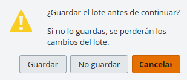

| Botón | Qué hace |
|---|---|
| **Guardar** | Abre **Guardar lote**; al terminar, sigue con lo que ibas a hacer. |
| **No guardar** | Sigue y descarta los cambios. |
| **Cancelar** | No hace nada; sigues donde estabas. Tiene el foco: pulsar Intro sin mirar no pierde nada. |

Pregunta al **cerrar ProxLaunch**, en **Archivo > Cerrar sesión**, **Lote > Abrir lote…**, **Lote > Importar desde CSV…**,
al **cambiar de servidor** (**Archivo > Conectar...**) y al **Salir del lote por filas**. También cuenta si lo único que
hiciste fue cambiar el formulario o el bloque **Lote** a mano. Si cierras con un lote **en marcha**, solo ves el aviso de
[cerrar con un lote en curso](#cerrar-proxlaunch-con-un-lote-en-curso).

---

## Menús y ajustes

La barra de menús tiene cinco menús. Los de **Lote** y el detalle de cada opción están en
[Guardar y abrir lotes](#guardar-y-abrir-lotes).

### Archivo

| Opción | Atajo | Qué hace |
|---|---|---|
| **Conectar...** | Ctrl+K | Abre **Conectar con Proxmox**. |
| **Cerrar sesión** | | Cierra la sesión actual (con [cambios sin guardar](#cambios-sin-guardar), pregunta). |
| **Ver el último lote** | | Vuelve a mostrar el último lote. Desactivada hasta que haya uno. |
| **Archivos subidos en esta sesión…** | | Ver [Archivos subidos](#archivos-subidos-en-esta-sesión). |
| **Salir** | Atajo estándar de salir | Cierra ProxLaunch. |

### Lote

**Abrir lote…**, **Guardar lote…**, **Guardar lote como…**, **Importar desde CSV…**, **Descargar plantilla CSV…** y
**Guardar el informe del lote como CSV…**: ver la tabla de [Guardar y abrir lotes](#guardar-y-abrir-lotes).

### Perfiles

| Opción | Qué hace | Cuándo está activa |
|---|---|---|
| **Guardar como perfil de máquina…** | Guarda el hardware del formulario. | Con sesión lista, sin lote en curso y fuera de un lote por filas. |
| **Administrar perfiles…** | Abre la gestión de perfiles. | **Solo se muestra en modo avanzado.** |

### Ajustes

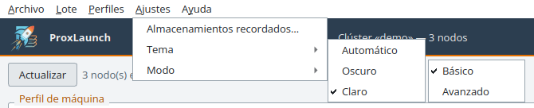

| Opción | Qué hace | Valores | Defecto |
|---|---|---|---|
| **Almacenamientos recordados…** | Revisa los almacenamientos recordados de este servidor. | — | Activa solo si hay un almacenamiento recordado que ya no está disponible. |
| **Tema** | Colores de la aplicación. | **Automático** (sigue al sistema), **Oscuro**, **Claro**. | Automático. |
| **Modo** | Cuánto detalle muestran los formularios. | **Básico**, **Avanzado**. | Básico. |

Tema y modo se guardan y se recuerdan en la siguiente sesión (archivo `preferencias.json`).

### Ayuda

| Opción | Qué hace |
|---|---|
| **Qué puedo hacer en este servidor…** | Abre la tabla de capacidades (ver [¿Por qué no puedo usar alguna opción?](#por-qué-no-puedo-usar-alguna-opción)). Activa con sesión lista. |
| **¿Cómo creo un API Token?** | Abre la guía del token ([Cómo se prepara](#cómo-se-prepara-pasos-para-el-administrador)). |
| **Acerca de ProxLaunch** | Abre la ventana de información. |


**Acerca de ProxLaunch** muestra la versión, que la aplicación es compatible con Proxmox VE (ProxLaunch es un proyecto
independiente; Proxmox es una marca de Proxmox Server Solutions GmbH), la nota de que las máquinas que crea llevan la
etiqueta `proxlaunch` (y otra `lote-…` si se crean en un lote) y la **licencia de cada fuente** incluida (Open Sans y
JetBrains Mono): elige una en la lista para leer su texto.

---

## Referencia de ventanas y menús

Un índice rápido para quien busca «¿qué hace esta ventana?». Cada fila lleva a la sección donde se explican todas sus
opciones.

### Ventanas y diálogos

| Ventana o diálogo | Cómo se abre | Captura | Para qué sirve | Sección |
|---|---|---|---|---|
| Ventana principal sin conexión | Al iniciar | [01](img/01-bienvenida.png) | Bienvenida y botón **Conectar...** | [Primer inicio](#la-ventana-de-bienvenida) |
| Ventana de trabajo | Tras conectar | [13](img/13-trabajo-individual-basico.png), [14](img/14-trabajo-cluster-nodo.png) | Formulario, resumen y progreso | [Modo básico](#crear-una-máquina-en-modo-básico) |
| **Conectar con Proxmox** | **Archivo > Conectar...** (`Ctrl+K`) | [04](img/04-conexion-token.png) a [07](img/07-conexion-validacion.png) | Datos del servidor, token o contraseña, perfiles de conexión | [Los datos de conexión](#los-datos-de-conexión) |
| **Confiar en este servidor** | Primera conexión a un servidor | [08](img/08-huella-primera-vez.png) | Aceptar la huella del certificado | [La huella](#la-huella-del-certificado-confianza-en-el-primer-uso) |
| **El certificado del servidor cambió** | Si la huella no coincide | [09](img/09-huella-cambiada.png) | Avisar de un posible cambio o suplantación | [Si aparece…](#si-aparece-el-certificado-del-servidor-cambió) |
| **Código de verificación** | Cuenta con 2FA | [10](img/10-2fa-codigo.png) | Segundo factor | [2FA](#si-el-servidor-pide-un-código-segundo-factor-2fa) |
| **¿Cómo creo un API Token?** | **Ayuda** o enlace en la conexión | [11](img/11-guia-token.png) | Pasos y privilegios para el administrador | [Cómo se prepara](#cómo-se-prepara-pasos-para-el-administrador) |
| **Acerca de ProxLaunch** | **Ayuda > Acerca de ProxLaunch** | [12](img/12-acerca-de.png) | Versión, marca y licencias | [Ayuda](#ayuda) |
| **Qué puedo hacer en este servidor** | **Ayuda** o «¿Por qué no puedo usar alguna opción?» | [37](img/37-capacidades-servidor.png) | Capacidades y permisos que faltan | [Origen](#por-qué-no-puedo-usar-alguna-opción) |
| **Elegir un archivo ISO** (y disco o drivers) | **Elegir ISO…** / **Elegir disco…** | [31](img/31-catalogo-iso.png) | Escoger un archivo del servidor | [ISO](#instalar-desde-un-archivo-iso) |
| **Elegir una plantilla de Proxmox** | **Elegir plantilla…** | [32](img/32-catalogo-plantillas.png) | Escoger una plantilla | [Clonar](#copiar-una-plantilla-clonar) |
| **Subir un ISO desde mi equipo** | Desde el catálogo | [33](img/33-subida-iso-lista.png), [34](img/34-subida-ya-existe.png) | Enviar un archivo al servidor | [Subir](#subir-un-archivo-desde-tu-equipo) |
| **Descargar un ISO en el servidor** | Desde el catálogo | [35](img/35-descarga-url.png) | Que el servidor descargue de una web | [Descargar](#descargar-un-archivo-en-el-servidor) |
| **Elegir almacenamiento** | Al haber varios candidatos | [36](img/36-elegir-storage.png) | Recordar el almacenamiento por servidor | [Elegir almacenamiento](#el-diálogo-elegir-almacenamiento) |
| **Archivos subidos en esta sesión** | **Archivo > Archivos subidos en esta sesión…** | [38](img/38-archivos-subidos-sesion.png) | Lista para el administrador | [Archivos subidos](#archivos-subidos-en-esta-sesión) |
| **Guardar como perfil de máquina** | **Guardar como perfil…** | [41](img/41-guardar-perfil.png) | Guardar el hardware del formulario | [Guardar tu propio perfil](#guardar-tu-propio-perfil) |
| **Administrar perfiles de máquina** | **Perfiles > Administrar perfiles…** (avanzado) | [42](img/42-administrar-perfiles.png) | Usar, duplicar, renombrar, eliminar, importar y exportar | [Administrar](#administrar-perfiles-modo-avanzado) |
| **Exportar perfiles** / **Importar perfiles de máquina** | Desde Administrar perfiles | [43](img/43-exportar-perfiles.png), [44](img/44-importar-perfiles.png) | Compartir perfiles | [Compartir](#compartir-perfiles-exportar-e-importar) |
| Resumen del lote | **Ver resumen** | [47](img/47-lote-resumen.png) a [49](img/49-lote-simulacion.png) | Revisar, simular y confirmar | [Resumen](#el-resumen-y-la-confirmación) |
| Progreso del lote | **Crear N máquinas** | [50](img/50-lote-progreso-en-curso.png), [52](img/52-lote-progreso-terminado.png) | Seguir cada máquina | [Progreso del lote](#mientras-se-crea-el-progreso-del-lote) |
| **El lote se detuvo…** | Error global o repetido | [51](img/51-lote-pausa.png) | Decidir cómo seguir | [Pausas](#pausas-el-lote-se-detiene-y-te-pregunta) |
| **Deshacer lo creado por el lote** | **Deshacer…** | [53](img/53-lote-deshacer.png) | Borrar lo que creó el lote | [Deshacer](#deshacer) |
| **Informe del lote** | **Informe** | [54](img/54-lote-informe.png) | Resultado en texto | [Informe](#informe) |
| **Guardar lote** | **Lote > Guardar lote…** | [55](img/55-guardar-lote.png) | Guardar un lote | [Guardar](#guardar) |
| **Este lote no encaja en este servidor** | Al abrir un lote | [56](img/56-lote-no-encaja.png) | Sustituir valores que no existen | [No encaja](#si-el-lote-no-encaja-en-este-servidor) |
| **Importar desde CSV** | **Lote > Importar desde CSV…** | [57](img/57-csv-vista-previa-ok.png), [58](img/58-csv-vista-previa-errores.png) | Vista previa y validación | [Vista previa](#la-vista-previa) |
| Lote por filas | Tras importar | [59](img/59-lote-por-filas.png) | Máquinas con configuración propia | [Lote por filas](#lote-por-filas) |
| **Cambios sin guardar** | Al cerrar, abrir o importar | [60](img/60-cambios-sin-guardar.png) | Evitar perder un lote | [Cambios sin guardar](#cambios-sin-guardar) |
| Opciones de la máquina (básico y avanzado) | Ventana de trabajo | [61](img/61-opciones-general.png), [62](img/62-opciones-avanzadas.png) | Encender, arrancar con el servidor, notas, etiquetas, pool, protección, MTU y límite | [Opciones de la máquina](#opciones-de-la-máquina) |
| Opciones desactivadas por falta de privilegio | Usuario sin `VM.PowerMgmt` o `Pool.Audit` | [63](img/63-opciones-deshabilitadas.png) | Ver qué privilegio falta | [Cuando una opción está desactivada](#cuando-una-opción-está-desactivada) |
| Resumen de lote con opciones | **Ver resumen** | [64](img/64-lote-resumen-opciones.png) | Revisar las opciones de todo el lote | [Opciones en un lote](#opciones-de-la-máquina-en-un-lote) |
| Simulación con encendido | **Simular** | [65](img/65-simulacion-encender.png) | Ver `description`, `tags`, `startup` y el encendido final | [Simulación](#simulación) |
| **Confirmar Deshacer con apagado o desprotección** | **Deshacer…** con máquinas encendidas o protegidas | [66](img/66-deshacer-confirmacion-forzada.png) | Confirmar el apagado a la fuerza y la desprotección | [Deshacer](#deshacer-con-máquinas-encendidas-o-protegidas) |
| Privilegios opcionales en la guía del token | **Ayuda > ¿Cómo creo un API Token?** | [67](img/67-guia-privilegios-opcionales.png) | `VM.PowerMgmt`, `Pool.Audit` y lo que no se pide | [Privilegios opcionales](#privilegios-opcionales-no-forman-parte-del-rol) |

### Menús

| Menú | Capturas | Opciones | Sección |
|---|---|---|---|
| **Archivo** | — | Conectar..., Cerrar sesión, Ver el último lote, Archivos subidos en esta sesión…, Salir | [Archivo](#archivo) |
| **Lote** | [02](img/02-menu-lote.png) | Abrir lote…, Guardar lote…, Guardar lote como…, Importar desde CSV…, Descargar plantilla CSV…, Guardar el informe del lote como CSV… | [Guardar y abrir lotes](#guardar-y-abrir-lotes) |
| **Perfiles** | — | Guardar como perfil de máquina…, Administrar perfiles… (solo avanzado) | [Perfiles](#perfiles) |
| **Ajustes** | [03](img/03-menu-ajustes.png) | Almacenamientos recordados…, Tema, Modo | [Ajustes](#ajustes) |
| **Ayuda** | [12](img/12-acerca-de.png) | Qué puedo hacer en este servidor…, ¿Cómo creo un API Token?, Acerca de ProxLaunch | [Ayuda](#ayuda) |

### Cajas de confirmación

| Título de la caja | Cuándo aparece | Botones |
|---|---|---|
| Cambios sin guardar | Con un lote sin guardar | **Guardar**, **No guardar**, **Cancelar** (foco) |
| Cambiar de perfil | Eliges otro perfil con cambios hechos | **Reemplazar**, **Cancelar** |
| Cambiar la forma de crear la máquina | Cambias de origen con archivo o plantilla elegidos | **Cambiar**, **Cancelar** |
| Confirmar el envío | Lote de más de 10 máquinas | **Crear las máquinas**, **Cancelar** |
| Cancelar el lote | Cancelas con máquinas ya enviadas | **Cancelar el lote**, **Seguir creando** |
| Seguir sin etiquetas | Eliges **Seguir sin etiquetas** en una pausa | **Preparar el lote sin etiquetas** y cancelar |
| Confirmar Deshacer con apagado o desprotección | Al deshacer, hay máquinas del lote encendidas o protegidas | **Apagar, desproteger y eliminar** (desactivado hasta marcar la casilla), **Eliminar sin apagar ni desproteger**, **Cancelar** (predeterminado) |
| Hay un lote en curso | Cierras con un lote en marcha | **Seguir en ProxLaunch**, **Cerrar de todos modos** |
| Todavía no sabemos si se creó | **Volver al formulario** con una máquina dudosa | **Sí** / **No** («¿Volver de todos modos?») |
| Reemplazar la huella guardada, Conexión sin verificar, Eliminar perfil | En la conexión (avanzado) | **Sí** / **No** (por defecto, **No**) |

---

## Formatos de archivo

ProxLaunch trabaja con **cuatro** tipos de archivo. Solo los tres primeros sirven para crear máquinas; el cuarto es interno
y no se comparte. Los ejemplos están en la carpeta [`ejemplos/`](ejemplos/LEEME.md).

| # | Archivo | Extensión sugerida | Cómo se importa | Cómo se exporta | ¿Sirve para crear MVs? | Ejemplo |
|---|---|---|---|---|---|---|
| 1 | CSV de máquinas | `.csv` (filtro `*.csv *.txt`) | **Lote > Importar desde CSV…** | **Lote > Descargar plantilla CSV…** (plantilla) | **Sí:** una fila = una MV (lote por filas) | [`mvs-*.csv`](ejemplos/LEEME.md#qué-es-cada-archivo) |
| 2 | Lote guardado | `.proxlaunch-lote.json` | **Lote > Abrir lote…** (`Ctrl+O`) | **Lote > Guardar lote…** (`Ctrl+S`) | **Sí:** lote homogéneo o por filas | [`lote-homogeneo`](ejemplos/lote-homogeneo.proxlaunch-lote.json), [`lote-por-filas`](ejemplos/lote-por-filas.proxlaunch-lote.json) |
| 3 | Perfiles de máquina | `.proxlaunch-perfiles.json` | **Administrar perfiles… > Importar…** | **Administrar perfiles… > Exportar…** | **Indirecto:** aporta hardware; no crea nada por sí solo | [`perfiles-ejemplo`](ejemplos/perfiles-ejemplo.proxlaunch-perfiles.json) |
| 4 | Perfiles de conexión | `perfiles.json` (carpeta de configuración) | **No hay importar** | **No hay exportar** | **No** (solo servidor y credenciales) | — |

> **Los perfiles de conexión no se exportan ni se importan.** Para usar un servidor en otro equipo hay que crear su perfil
> de nuevo (el token o la contraseña nunca viajan en archivos).

**Límites comunes:** CSV hasta 1 MiB, 60 columnas, 256 caracteres por celda (8192 en la columna `notas`) y 100 filas; lote
guardado hasta 1 MiB; archivo de perfiles hasta 256 KiB y 100 perfiles (también 100 perfiles propios en total); nombre de
perfil o de lote hasta 60 caracteres; descripción hasta 200; versión máxima de formato legible: 3. Las cadenas que parecen
credenciales se descartan y avisan. Un lote guardado de 100 máquinas con notas muy largas en cada fila puede acercarse al
límite de 1 MiB: si lo supera, ProxLaunch no lo guarda y lo dice. Un archivo creado por una versión más nueva de ProxLaunch no se abre: «Este archivo lo creó una versión más nueva
de ProxLaunch. Actualiza la aplicación para abrirlo.»

### CSV de máquinas

Reglas, [columnas](#columnas-del-csv), unidades y [validación](#validación-un-archivo-con-errores-a-propósito) están en
[Importar máquinas desde un CSV](#importar-máquinas-desde-un-csv). La plantilla que descarga ProxLaunch tiene las columnas
más usadas (en 0.6, también las de [opciones de la máquina](#columnas-de-opciones-de-la-máquina)) y cinco filas de ejemplo
(dos con disco vacío y una por cada origen: ISO, disco existente y plantilla). Sus nombres empiezan por `ejemplo-`; si las
importas tal cual, ProxLaunch avisa «Parece una fila de ejemplo de la plantilla.» Las dos primeras filas muestran algunas
opciones (`arranque_auto`, `notas`, `etiquetas`, `pool`, `mtu`, `limite_red`…); las demás las dejan vacías. El texto del
archivo (separador `;`; ProxLaunch escribe **todas las celdas entre comillas**, en UTF-8 con BOM):

```text
"nombre";"perfil";"cpu";"memoria";"disco";"almacenamiento";"red";"vlan";"nodo";"vmid";"origen";"fuente";"so";"virtio";"modo_clon";"encender";"arranque_auto";"notas";"etiquetas";"pool";"proteger";"mtu";"limite_red"
"ejemplo-01";"fabrica.servidor-mediano";"";"8";"100";"local-lvm";"vmbr0";"";"";"";"vacio";"";"";"";"";"";"si";"Servidor de ejemplo";"web,prod";"";"";"";""
"ejemplo-02";"";"2";"4 GiB";"40";"";"vmbr1";"20";"pve2";"250";"vacio";"";"";"";"";"no";"";"";"";"ninguno";"no";"heredar";"50"
"ejemplo-03";"";"2";"4";"32";"";"";"";"";"";"iso";"ejemplo-instalador.iso";"linux";"";"";"";"";"";"";"";"";"";""
"ejemplo-04";"";"2";"4";"40";"";"";"";"";"";"importar";"ejemplo-disco.qcow2";"";"";"";"";"";"";"";"";"";"";""
"ejemplo-05";"";"4";"8";"80";"";"";"";"";"";"clonar";"ejemplo-plantilla";"";"";"auto";"";"";"";"";"";"";"";""
```

#### Informe del lote en CSV

**Lote > Guardar el informe del lote como CSV…** guarda el resultado del último lote con estas columnas (sin direcciones, sin
UPID y sin identificadores de tarea):

| Columna | Contenido |
|---|---|
| `numero` | Número de la máquina en el lote. |
| `nombre`, `vmid`, `nodo` | Nombre, número de máquina y nodo. |
| `desenlace` | Resultado (por ejemplo, creada, con error, sin confirmar). |
| `resultado` | El mensaje en lenguaje llano. |
| `codigo_error` | Código del error, si lo hubo. |
| `duracion_s` | Segundos que tardó, si se conocen. |
| `origen`, `fuente`, `modo_clon`, `ajustes` | De dónde sale el sistema operativo (nombre del archivo o plantilla; nunca URL ni ruta), el modo de clon y los ajustes del clon. |

### Lote guardado (archivo de lote)

Es un JSON de texto con la clave `"formato": "proxlaunch.lote"`. Lo normal es abrirlo, ajustarlo y volver a guardarlo desde
la aplicación; **no lo edites a mano** salvo que sepas lo que haces. Hay dos tipos (`"tipo"`): `homogeneo` (máquinas
iguales, con cantidad y patrón de nombres) y `por_filas` (una configuración por máquina).

Fragmento real de [`lote-homogeneo.proxlaunch-lote.json`](ejemplos/lote-homogeneo.proxlaunch-lote.json) (3 servidores web
iguales):

```json
{
  "app_version": "0.5.0",
  "formato": "proxlaunch.lote",
  "homogeneo": {
    "cantidad": 3,
    "config": {
      "cores": 2,
      "memoria_mib": 2048,
      "firmware": "seabios",
      "origen": "disco_vacio",
      "discos": [{ "bus": "scsi", "storage": "local-lvm", "tamano_gib": 32 }],
      "redes": [{ "bridge": "vmbr0", "modelo": "virtio", "vlan": null }]
    },
    "destino": { "algoritmo": "equilibrado", "modo": "automatico", "nodos": [] },
    "etiquetar": true,
    "patron": { "inicio": 1, "prefijo": "srv-web", "relleno": 2, "separador": "-" },
    "vmid_inicial": null
  },
  "nombre": "Servidores web de prueba",
  "tipo": "homogeneo",
  "version_formato": 1,
  "version_proxmox": "9.2"
}
```

(El fragmento omite varias claves del archivo real para abreviar: `ballooning`, `con_disco`, `controlador_scsi`, `sockets`,
`storage_efi`, `tipo_cpu` y, en cada disco, `discard`, `formato`, `iothread` y `ssd`. Abre el archivo de ejemplo para verlo
completo.)

| Clave | Qué es | Unidad o valores |
|---|---|---|
| `formato`, `version_formato`, `app_version` | Tipo de archivo y versión del formato (1, 2 o 3) y de ProxLaunch que lo guardó. | `proxlaunch.lote` |
| `nombre` | Nombre del lote (el de **Guardar lote**). | Hasta 60 caracteres. |
| `tipo` | `homogeneo` o `por_filas`. | |
| `version_proxmox` | Versión de Proxmox con la que se guardó. | Texto, por ejemplo `9.2`. |
| `homogeneo.cantidad` | Número de máquinas. | 1 a 100. |
| `homogeneo.patron` | `prefijo`, `separador`, `inicio` (número inicial) y `relleno` (dígitos). | Igual que el bloque **Lote**. |
| `homogeneo.vmid_inicial` | VMID inicial, solo si lo escribiste. | Entero o `null` (automático). |
| `homogeneo.destino` | `modo` (`automatico`…), `algoritmo` (`equilibrado`…) y `nodos`. | |
| `homogeneo.etiquetar` | Si pone las etiquetas del lote. | `true` / `false` |
| `config` | El hardware: `cores`, `sockets`, `memoria_mib`, `firmware`, `tipo_cpu`, `discos`, `redes`, `origen`… | **Ojo:** la memoria va en **MiB** (`2048`) y los discos en GiB (`tamano_gib`). |
| `config.origen` | De dónde sale el sistema. | En los ejemplos: `disco_vacio`, `iso`, `clonar_plantilla`. El ISO o la plantilla van en `detalle_origen` (solo el **nombre**, nunca URL ni ruta). |
| `config.encender`, `config.arranque_auto`, `config.proteger` | Las casillas **Encender al terminar**, **Arrancar con el servidor** y **Proteger contra borrado**. *(Formato 3.)* | `true`. Solo se escriben si valen `true`. |
| `config.arranque_orden`, `config.arranque_espera` | **Orden de arranque** y **Espera (s)**. *(Formato 3.)* | Enteros de 0 en adelante. |
| `config.notas_origen`, `config.notas_usuario`, `config.notas` | **Añadir notas de origen**, **Incluir mi usuario en las notas** y el texto de **Notas**. | `true` / `true` / texto de hasta 8192 caracteres. `notas_usuario` y `notas` piden el formato 3; `notas_origen` sola **no** lo sube (se escribe igualmente). |
| `config.etiquetas_usuario`, `config.pool` | Las etiquetas propias y el pool. *(Formato 3.)* | Lista de textos / nombre del pool (`padre/hijo` admitido). |
| `config.redes[].mtu`, `config.redes[].limite_mb` | MTU y límite de velocidad de cada tarjeta. *(Formato 3.)* | `1` (igual al bridge) o 576 a 65520 / número de MB/s mayor que 0. |
| `homogeneo.opciones` (o `por_filas.opciones`) | Las opciones que valen para todo el lote. | Mismas claves que arriba (sin las de arranque ni las de red). |
| `por_filas.filas[].opciones` | Lo que **una fila** sobrescribe de las opciones del lote. | `encender`, `arranque_auto`, `notas`, `etiquetas_usuario`, `pool` y `proteger`; lo que no aparece, se hereda. |

El lote **por filas** ([`lote-por-filas.proxlaunch-lote.json`](ejemplos/lote-por-filas.proxlaunch-lote.json)) usa la clave
`por_filas` con `destino.algoritmo`, `etiquetar`, `vmid_inicial` y una lista `filas`; cada fila tiene `nombre`, `vmid`,
`nodo` (`null` = automático), `origen` (en el ejemplo, el número de fila del CSV del que salió: 2, 4 y 7) y su propia
`config`. Es el resultado de importar filas de [`mvs-mixtas.csv`](ejemplos/mvs-mixtas.csv). Fragmento de una fila de ese
lote (la que instala un ISO de Linux):

```json
{
  "config": {
    "cores": 2,
    "memoria_mib": 4096,
    "origen": "iso",
    "tipo_so": "linux",
    "detalle_origen": {
      "drivers": null,
      "iso": { "nombre": "ubuntu-24.04-server.iso", "volid": null },
      "sin_drivers": false
    }
  },
  "nodo": null,
  "nombre": "ubuntu-01",
  "origen": 4,
  "vmid": null
}
```

(De nuevo, abreviado: la `config` real también trae discos, redes, firmware y demás.)

**Qué NO contiene un lote guardado:** servidor, usuario, token, contraseña, el resumen, los números ya reservados ni el
código del lote.

### Perfiles de máquina (archivo de perfiles)

JSON con la clave `"formato": "proxlaunch.perfiles"`, una lista `perfiles` y `version_formato`. Cada perfil tiene `nombre`
(hasta 60 caracteres), `descripcion` (hasta 200) y su `config` de hardware. Los nombres de almacenamiento y de red se
guardan como **pistas** (`storage_preferido`, `bridge_preferido`, `storage_efi_preferido`): son `null` si al exportar no
marcaste **Incluir los nombres de almacenamiento y red**. Fragmento real de
[`perfiles-ejemplo.proxlaunch-perfiles.json`](ejemplos/perfiles-ejemplo.proxlaunch-perfiles.json) (el primero de los dos
perfiles, un servidor web sencillo):

```json
{
  "app_version": "0.5.0",
  "formato": "proxlaunch.perfiles",
  "perfiles": [
    {
      "config": {
        "cores": 4,
        "sockets": 1,
        "memoria_mib": 4096,
        "firmware": "seabios",
        "origen": "disco_vacio",
        "discos": [{ "bus": "scsi", "storage_preferido": null, "tamano_gib": 50 }],
        "redes": [{ "bridge_preferido": null, "modelo": "virtio", "vlan": null }]
      },
      "descripcion": "Servidor web con 4 núcleos, 4 GiB y 50 GiB de disco.",
      "nombre": "Servidor web de la oficina"
    }
  ],
  "version_formato": 2
}
```

(Abreviado; el segundo perfil del archivo es un escritorio Windows 11 con ISO sugerido `windows-11-es.iso` y las pistas
`local-lvm`, `local` y `vmbr0`.) Para usarlo: **Perfiles > Administrar perfiles… > Importar…** (modo avanzado). Un perfil
importado no crea nada: aporta el hardware que luego eliges en el selector de perfil o en la columna `perfil` de un CSV.

### Perfiles de conexión

Se guardan solo en `perfiles.json` de la carpeta de configuración del usuario, sin secretos. **No hay forma de exportarlos
ni importarlos**; para llevar un servidor a otro equipo se crea de nuevo su perfil en **Conectar con Proxmox**.

### Compatibilidad con versiones anteriores

Los lotes guardados y los archivos de perfiles llevan un número de versión del formato (`version_formato`). Desde ProxLaunch
0.6 la versión más alta es la **3**.

| Archivo | ¿Lo abre 0.6.0? | ¿Lo abre 0.5.1? |
|---|---|---|
| Lote o perfiles de versión **1** o **2** (de 0.5.x o anteriores) | Sí. Las opciones nuevas toman su valor por defecto y se crea **igual que antes**. | Sí. |
| Lote o perfiles de versión **3** (usan alguna opción nueva) | Sí. | **No**: «Este archivo lo creó una versión más nueva de ProxLaunch. Actualiza la aplicación para abrirlo.» |
| CSV de 0.5.1 (sin columnas de opciones) | Sí, se lee igual que antes. | — |
| CSV con columnas de opciones | Sí. | Las abre, pero **ignora** las columnas que no conoce con un aviso, de modo que las opciones no se aplican. |

- **Cuándo se escribe la versión 3.** ProxLaunch 0.6 escribe un lote o un perfil en versión 3 **solo si usa alguna opción
  nueva** (por ejemplo, un lote con **Encender al terminar**, notas propias, etiquetas, pool, protección, MTU o límite; o un
  perfil con **Arrancar con el servidor** o con MTU o límite en alguna tarjeta). Si no usa ninguna, lo escribe en la
  versión más baja posible (1 o 2), igual que antes, y 0.5.1 lo sigue abriendo. Los perfiles de fábrica no cambian.
- **La casilla «Añadir notas de origen».** Viene marcada por defecto, pero **por sí sola no sube el formato**: se guarda en el
  archivo, y un lote que solo la usa sigue siendo de versión 1 o 2. 0.5.1 lo abre y, al no conocer ese dato, lo ignora y
  muestra el aviso de campos desconocidos («Se ignoró 1 campo que ProxLaunch no conoce.»).
- **Abrir un archivo antiguo no lo modifica.** Los archivos de terceros solo se leen. Si lo vuelves a guardar con 0.6, se
  escribe con la versión que le corresponda según lo que use.
- **Un archivo de una versión futura** (más de 3) se rechaza con el mismo mensaje de «versión más nueva».
- **Perfiles exportados** con alguna opción nueva (versión 3) tampoco se pueden importar en 0.5.1; los demás sí.

---

## Solución de problemas

### Mensajes de error frecuentes

Los textos de la columna «Mensaje» son los que muestra ProxLaunch. El mensaje original de Proxmox está en «Ver detalles
técnicos». Los errores de creación salen en el panel [Progreso](#los-resultados-posibles) (captura 19); los de archivos y CSV,
junto al campo o en la vista previa (captura 58).

| Mensaje | Qué significa | Qué hacer |
|---|---|---|
| Las credenciales no son válidas. Revisa el usuario, el token o la contraseña. | Proxmox rechazó la entrada. Por seguridad no dice si falló el usuario o la contraseña. | Revisa mayúsculas, el realm y que el token esté completo. |
| No se pudo contactar con el servidor (192.0.2.10:8006) | No hubo respuesta a tiempo (10 s por servidor). | Revisa la IP, el puerto, tu red o VPN. Prueba con otro servidor del perfil. |
| No se pudo contactar con ninguno de los servidores del perfil: … | Ninguno responde. Cada línea dice el motivo. | Revisa red y VPN; pregunta si el servidor está encendido. |
| El certificado del servidor cambió… | La huella ya no coincide con la guardada. | Ver [Si aparece «El certificado del servidor cambió»](#si-aparece-el-certificado-del-servidor-cambió). |
| Primero hay que confiar en el certificado del servidor (…). | Intentaste conectar sin aceptar la huella. | Vuelve a **Probar y conectar** y acepta la huella si coincide. |
| El token debe tener el formato usuario@realm!nombre=secreto. | El token está incompleto o tiene espacios. | Pégalo completo, sin espacios ni saltos de línea. |
| Escribe solo el nombre o la IP del servidor. | El servidor tiene un formato no válido. | Usa solo una IP o un nombre. |
| El código no es correcto o ya venció. … | Código de 2FA incorrecto o caducado. | Espera al siguiente código; revisa la hora de tu equipo. |
| Este usuario exige un método de segundo factor que ProxLaunch no admite. Usa un API Token. | El usuario usa llaves de seguridad u otro método no admitido. | Conecta con un API Token. |
| Tu sesión expiró. Vuelve a iniciar sesión. | La sesión caducó (por ejemplo, tras suspender el equipo). | Se abre la ventana de conexión; entra de nuevo. **No pierdes lo escrito.** |
| ProxLaunch requiere Proxmox VE 8.0 o superior (el servidor tiene 7.4) | Versión no compatible. | Pide actualizar Proxmox o usa otro servidor. |
| Tu usuario no tiene permiso para realizar esta acción. Falta VM.Allocate en /vms/100. … | Falta un permiso (el mensaje dice cuál y dónde). | Pídelo a tu administrador ([Permisos](#permisos-que-hacen-falta)). |
| El número 100 ya lo usa otra máquina. Prueba con 101 | El VMID está ocupado. | Usa el sugerido o escribe otro. |
| No hay espacio suficiente en «local-lvm» para crear el disco. Libera espacio o elige otro almacenamiento. | El almacenamiento se llenó. | Reduce el tamaño, elige otro almacenamiento o libera espacio. |
| El disco pide 200 GiB y «local-lvm» solo tiene 150 GiB libres. | Antes de enviar, ProxLaunch ve que no cabe. | Reduce el tamaño o cambia de almacenamiento. |
| Ningún nodo tiene N GiB libres en un almacenamiento para discos… | En Automático ningún nodo tiene sitio. | Reduce los discos o libera espacio. |
| El nodo pve2 no está disponible | El nodo elegido cayó antes de enviar. No se creó nada. | Elige otro nodo o pulsa **Actualizar**. |
| «x» ya no existe en el nodo. Actualiza y elige de nuevo. | Un almacenamiento o red desapareció. | Pulsa **Actualizar** y vuelve a elegir. |
| Este servidor no tiene almacenamiento para discos de máquinas virtuales | No hay dónde guardar discos. | Marca **Sin disco** o pide que habiliten un almacenamiento. |
| Proxmox no entendió el valor de … / Proxmox rechazó el valor de … | Proxmox no aceptó un parámetro. | Corrige el campo indicado o copia los **detalles técnicos** para tu administrador. |
| Proxmox no devolvió el identificador de la tarea | La respuesta llegó sin UPID. | Pulsa **Actualizar** y comprueba en Proxmox si la máquina existe antes de repetir. |
| Proxmox dijo que la tarea terminó, pero la máquina N no aparece en el nodo X. | Raro: terminó, pero la máquina no se ve. | Revisa en Proxmox y en los detalles técnicos. |
| Proxmox respondió con un error que no conocemos | Un error que ProxLaunch no sabe traducir. | Abre **Ver detalles técnicos**, copia el texto y compártelo con tu administrador. |
| No se pudo leer el nodo X: aparece como «Sin conexión». | Falló la lectura de un nodo; los demás siguen. | Pulsa **Reintentar** (junto a **Actualizar**). |
| No hay un llavero disponible en este equipo; las credenciales no se guardarán | Marcaste «Recordar credenciales» pero no hay llavero. | La conexión continúa; tendrás que escribir el secreto cada vez. |

#### Mensajes de archivos, perfiles y CSV

En todos, **tu archivo original no se modifica** y, si falla al abrir o importar, el formulario queda como estaba.

| Mensaje | Qué significa | Qué hacer |
|---|---|---|
| No se pudo leer el archivo. Si está abierto en otro programa (como Excel), ciérralo o guarda una copia. | El archivo no existe, no tienes permiso o otro programa lo tiene bloqueado. | Cierra Excel u otro programa, o trabaja con una copia. Revisa la ruta y los permisos. |
| No se puede abrir este archivo: es demasiado grande (límite 1 MiB). / …no es un archivo normal. / …tiene demasiados elementos (máximo 100). | Superó el tamaño permitido o trae más de 100 perfiles. | Divide el contenido en varios archivos. |
| Este archivo no es un archivo de ProxLaunch del tipo que buscas. | Elegiste un archivo de otro tipo (por ejemplo, un lote donde se esperaban perfiles). | Usa la opción que corresponde: perfiles en **Administrar perfiles… > Importar…**, lotes en **Lote > Abrir lote…**, CSV en **Lote > Importar desde CSV…**. |
| Este archivo lo creó una versión más nueva de ProxLaunch. Actualiza la aplicación para abrirlo. | El formato es más nuevo que esta versión. | Actualiza ProxLaunch. |
| El archivo está dañado o tiene datos no válidos: … | Falta un dato, tiene un valor que no corresponde o no es JSON válido. Se muestran hasta 10 campos y «y N más». | Corrige esos campos o vuelve a guardar el archivo desde ProxLaunch. |
| El archivo tiene 130 filas; el máximo por lote es 100. Divide el archivo en partes. | El CSV supera los límites (filas, columnas o celdas). | Divide el CSV en archivos de hasta 100 filas, 60 columnas y 256 caracteres por celda (8192 en `notas`). |
| No pude leer el archivo CSV (fila 12). Guárdalo como «CSV UTF-8» desde Excel. / Hay unas comillas sin cerrar en la fila 12… | Caracteres ilegibles o comillas sin cerrar. | En Excel: **Guardar como > CSV UTF-8**. Revisa la fila indicada. |
| El archivo no tiene máquinas. | El CSV solo tiene encabezado. | Añade filas. |
| Falta la columna «nombre». Columnas reconocidas: … / La columna «cpu» aparece dos veces. / Hay datos en columnas que no tienen encabezado (columnas 7). | El encabezado no sirve. | Añade o renombra `nombre`, quita las repetidas o ponle encabezado a la columna con datos. Ver [Columnas](#columnas-del-csv). |
| «abc» no es un número. Escribe, por ejemplo, 4 GiB. (y variantes) | Una celda no se puede leer como número o unidad. | Corrígela. Ver [Unidades y números](#unidades-y-números). |
| ¿Quisiste decir mil o uno? Escribe 1000 o 1. | Número con separador de miles (`1.000`). | Escríbelo sin separador. |
| No existe el perfil «x». Perfiles disponibles: … / Hay más de un perfil llamado «x». Escribe el nombre exacto. | La columna `perfil` nombra uno que no existe o está repetido. | Escribe el nombre como está en la lista o su id (`fabrica.servidor-mediano`). |
| Las filas 3, 9 tienen el mismo nombre «web-01». / …el mismo número de máquina «150». | Nombres o números repetidos entre filas. | Cambia uno; ambas filas quedan con error hasta entonces. |
| Fila 5: «pve2» está sin conexión. / El nodo no existe en este servidor. / Ningún nodo del servidor puede alojar esta máquina. | La fila nombra un nodo, almacenamiento o red que este servidor no tiene. | Corrige la celda o déjala vacía. |
| No se pudo guardar el archivo: … No se cambió nada. | No se pudo escribir (sin espacio, sin permiso, abierto en otro programa, ruta larga…). El anterior sigue intacto. | Libera espacio, elige otra carpeta o cierra el programa que lo tiene abierto. |
| No se guardó: el campo «…» parece contener una credencial (usuario@realm!token). Bórrala y vuelve a guardar. | Un texto tiene la forma de un API Token. | Borra ese texto y guarda de nuevo. |
| Los perfiles de fábrica no se pueden cambiar. Duplícalo para hacer tu propia versión. | Intentaste modificar un perfil de fábrica. | Usa **Duplicar…**. |
| Tus perfiles se crearon con una versión más nueva de ProxLaunch; no se pueden modificar. | Tu `perfiles_maquina.json` es de una versión más nueva. | Actualiza ProxLaunch. |
| Este lote no encaja en este servidor: … | El lote nombra un almacenamiento, red o nodo que este servidor no tiene. | Ver [Si el lote «no encaja»](#si-el-lote-no-encaja-en-este-servidor). |
| Escribe un nombre de 1 a 60 caracteres. / Ya existe un perfil con ese nombre. / Llegaste al máximo de 100 perfiles. Elimina alguno para crear otro. / Parece un token de acceso. No lo escribas aquí. | El nombre del perfil o del lote no es válido. | Elige otro nombre o elimina un perfil que no uses. |

También verás avisos (⚠) que no impiden seguir: «Se ignoró 1 campo que ProxLaunch no conoce.», «El archivo traía datos que
parecen una credencial. No se usaron. Si eran reales, cámbialas.», «En la columna «memoria» había números sin unidad: se
entendieron como GiB.» y «En la columna «disco», «GB» se tomó como GiB (1 GB = 1024 MiB).»

#### Mensajes de las opciones de la máquina

Los textos entre «x» o «N» cambian en cada caso. Los privilegios y las rutas se explican en
[Privilegios opcionales](#privilegios-opcionales-no-forman-parte-del-rol).

| Mensaje | Qué significa | Qué hacer |
|---|---|---|
| «Encender al terminar» no está disponible: tu usuario no tiene el privilegio VM.PowerMgmt en «/vms». Pídeselo a tu administrador. | Falta el privilegio opcional para encender. La casilla queda desactivada. | Pide `VM.PowerMgmt` en `/vms`, o deja la casilla y enciende la máquina desde Proxmox. |
| Se creó, pero no se pudo encender. Enciéndela desde Proxmox si la necesitas. | La máquina existe, pero falló la orden de encendido. | Enciéndela desde Proxmox. No hay nada que deshacer. |
| No se encendió: quedaron ajustes por aplicar o su creación se confirmó después (al comprobarla). … | No se encendió por prudencia. | Revisa la máquina y, si hace falta, enciéndela desde Proxmox. |
| Se creó, pero falta aplicar el arranque con el servidor / la protección contra borrado. Puedes reintentar los ajustes. | En un clon, el ajuste posterior falló. | Pulsa **Reintentar ajustes**. |
| La etiqueta «x» no es válida: usa minúsculas, números, «_», «-», «+» y «.», sin espacios, y empieza por una letra, un número o «_» (máximo 128 caracteres). | Una etiqueta propia no cumple las reglas. | Corrígela (por ejemplo, `Web` → `web`). |
| La etiqueta «x» está registrada en el centro de datos y tu usuario no puede aplicarla (hace falta Sys.Modify en «/»). … / El centro de datos no deja a tu usuario poner etiquetas (política «none»)… / Tu administrador no ha autorizado la etiqueta «x». … | La política de etiquetas del centro de datos no permite esa etiqueta a tu usuario. No se envía nada. | Pide al administrador que la autorice (ver [Etiquetas](#etiquetas-propias-y-política-del-centro-de-datos)) o quítala. |
| No se pudo leer la política de etiquetas del centro de datos, así que no se pudo comprobar si tus etiquetas están permitidas. … | Aviso: ProxLaunch no pudo leer la política (por ejemplo, falta `Sys.Audit`). No bloquea. | Sigue; si Proxmox rechaza las etiquetas, la máquina no se creará. |
| Las notas ocupan N de los 8192 caracteres que admite Proxmox: queda poco espacio. | Aviso a partir de 7500 caracteres. | Acorta las notas si puedes. |
| Las notas ocupan N caracteres y Proxmox admite 8192: sobran M. Acórtalas. / Las notas superan los 8192 caracteres que admite Proxmox. … | Las notas son demasiado largas. | Acórtalas. |
| Las notas tienen caracteres de control (no imprimibles): se eliminarán al crear. | Aviso: el texto trae caracteres invisibles. | Revísalo; no bloquea. |
| No se añadieron las notas de origen: no se pudo leer la descripción de la plantilla y así no se pisan sus notas. | En un clon, ProxLaunch no pudo leer las notas de la plantilla. | Añade tus notas desde Proxmox si las necesitas. |
| No puedes ver la lista de pools: falta el privilegio Pool.Audit en «/pool». … | Sin `Pool.Audit`, el desplegable **Pool** está desactivado. | Pide `Pool.Audit` en `/pool`. |
| No sabemos si puedes ver la lista de pools … / No se pudo leer la lista de pools del servidor. Inténtalo de nuevo. | No se pudieron comprobar los permisos o falló la lectura. | Reintenta con **Actualizar**. |
| El pool «x» no existe en este servidor. / … no existe en Proxmox. No se creó la máquina. | El pool ya no existe. | Elige otro pool o «Ninguno». |
| Para crear la máquina en el pool «x» falta el privilegio VM.Allocate en «/vms» o en «/pool/x». | No tienes `VM.Allocate` ni en la máquina ni en el pool. | Pide el privilegio en una de las dos rutas. |
| El MTU de la tarjeta N debe ser «Igual al bridge» o un número entre 576 y 65520. / El MTU de la tarjeta N solo se aplica a tarjetas VirtIO. … | MTU fuera de rango o con una tarjeta que no es VirtIO. | Corrige el valor o elige VirtIO. |
| El límite de velocidad de la tarjeta N debe ser un número mayor que 0 y no superior a 1 000 000 000 (en MB/s). | Límite no válido. | Corrígelo o déjalo vacío. |
| «x» está encendida y no se pudo apagar: falta el privilegio VM.PowerMgmt. … / «x» está protegida y no se pudo desproteger: falta el privilegio VM.Config.Options. … | En Deshacer, falta el privilegio para apagar o desproteger esa máquina; se omite. | Apágala o quítale la protección desde Proxmox, o pide el privilegio. |
| No se pudo apagar «x», así que no se eliminó. … / No se pudo quitar la protección de «x», así que no se eliminó. … | Falló un paso previo al borrado. | Hazlo desde Proxmox y vuelve a intentarlo. |

#### Mensajes del origen del sistema operativo

Los puntos suspensivos (…) son datos que cambian en cada caso.

| Mensaje | Qué significa | Qué hacer |
|---|---|---|
| Tu Proxmox … no permite importar discos sin ser administrador del servidor. … Desde la versión 8.4 sí se puede importar. | El servidor es Proxmox 8.0 a 8.3. | Instala desde un ISO, clona una plantilla o actualiza a 8.4 o superior. |
| Para importar discos, pide a tu administrador que active el contenido «Import» en un almacenamiento de tipo directorio, NFS o CIFS. | No hay almacenamiento con contenido «Import». | Pide al administrador que lo active. Puedes copiar el texto desde **Qué puedo hacer en este servidor**. |
| Falta el permiso Sys.AccessNetwork en el nodo «…» para descargar desde una dirección web. … | Tu cuenta no puede hacer que el servidor descargue de Internet. | Pide el permiso o usa **Subir desde mi equipo…**. |
| Descargar desde una dirección web exige permisos de administrador en esta versión de Proxmox. … | Proxmox 8.0 o 8.1. | Sube el archivo desde tu equipo. |
| Falta el permiso … en «…» para …. | Falta un privilegio del rol en esa ruta. | Ver [Permisos](#permisos-que-hacen-falta). |
| Para guardar el disco importado necesitas el permiso Datastore.AllocateSpace en «…». | La cuenta no puede crear discos allí. | Pide el permiso o elige otro almacenamiento. |
| No puedes ver los archivos de «…»: falta el permiso Datastore.Audit o Datastore.AllocateSpace. | El catálogo de ese almacenamiento no se puede leer. | Pide el permiso o elige otro almacenamiento. |
| El almacenamiento «…» que usabas en este servidor ya no está disponible o ya no admite …. Elige otro. | El recordado desapareció. | **Elegir otro** o **Dejar de recordar**. |
| Ningún almacenamiento activo de este servidor guarda …. | No hay dónde guardar ese contenido. | Pide al administrador que lo active. |
| Ya existe un archivo llamado «…» en «…». ProxLaunch no lo sobrescribe: usa el que ya está o elige otro nombre. | Ya hay un archivo con ese nombre. | **Usar el existente** o **Cambiar el nombre**. |
| El archivo pesa … y «…» solo tiene … libres. | No cabe en el almacenamiento. | Libera espacio o elige otro. |
| El nodo «…» tiene poco espacio temporal (… libres) para recibir un archivo de …. La subida podría fallar. | Poco espacio en la raíz del nodo. | Marca **Entiendo que la subida puede fallar** solo si aceptas el riesgo; mejor pide liberar espacio. |
| Hay una transferencia en curso. Espera a que termine o cancélala. | Solo se hace una a la vez. | Espera o cancela la actual. |
| El archivo cambió mientras se subía. Vuelve a intentarlo. | El archivo de tu equipo se modificó. | Súbelo de nuevo sin tocarlo. |
| Se cortó la conexión mientras se subía el archivo. | La subida se interrumpió. | **Reintentar** y comprueba en el catálogo que no quedó un archivo a medias. |
| El archivo llegó dañado: la huella no coincide. No quedó guardado. | La huella SHA-256 no es la del archivo. | Vuelve a subirlo. |
| El servidor dice que terminó, pero el archivo no coincide con el que enviaste. No lo uses. | Falló la verificación final. | No lo uses: pide que lo borren y súbelo otra vez. |
| El servidor no pudo descargar … desde …: …. Prueba a descargarlo en tu equipo y subirlo. | La descarga falló (red, dirección, huella…). | Revisa la dirección y la huella, o súbelo desde tu equipo. |
| Este disco depende de otro archivo (un disco base). Conviértelo a un qcow2 independiente antes de subirlo. (también: cifrado, varios archivos, OVA, versión no compatible, incompleto) | El disco no se puede importar tal cual. | Conviértelo como dice el mensaje. |
| Importar desde una ruta del servidor exige ser administrador (root). Sube el archivo desde tu equipo. | Escribiste una ruta del servidor como fuente. | Usa **Subir desde mi equipo…** o elige del catálogo. |
| Aquí va el nombre de un archivo del servidor, no una dirección web. Para descargar usa «Descargar en el servidor». | Escribiste una URL en `fuente`. | Escribe solo el nombre del archivo. |
| … «…» ya no está en el servidor. Elige otra. | El ISO, disco o plantilla desapareció entre el resumen y la creación. | Elige otra fuente. |
| No encuentro «…» en «…». Disponibles: …. | La fuente nombrada no está en ese nodo. | Elige una de las disponibles. |
| No veo ninguna plantilla con tu cuenta. Pide el permiso VM.Audit o crea la plantilla en Proxmox (clic derecho en la máquina → Convertir en plantilla). | No hay plantillas visibles. | Pide el permiso o crea una plantilla. |
| No se puede clonar así: …. | Proxmox no permite esa copia (plantilla bloqueada, ya no es plantilla, sin soporte, TPM con la plantilla encendida…). | Lee el motivo; por ejemplo, usa «Copia independiente». |
| La máquina «…» se clonó, pero no se pudo …. Puedes reintentar los ajustes o deshacer. | La copia existe, pero un ajuste falló. | **Reintentar ajustes** o **Deshacer…**. |
| Se usará el CD de drivers «…», que no es la versión que conoce ProxLaunch. … | Aviso: no es virtio-win 0.1.302. No impide crear. | Comprueba el origen del ISO. |

### Preguntas frecuentes

**¿ProxLaunch instala el sistema operativo en la máquina?**
No lo instala por ti: prepara la máquina y, por defecto, la deja detenida. Con **Instalar desde un archivo ISO** la máquina queda con el
ISO puesto (y, en Windows, con el CD de drivers virtio-win) y tú terminas la instalación desde la consola de Proxmox. Con
**Usar un disco existente** o **Copiar una plantilla**, la máquina ya trae su sistema. La instalación desatendida, las OVA
y la migración desde VMware no están soportadas.

**¿ProxLaunch enciende la máquina?** Solo si lo pides: por defecto se crea detenida. Si marcas **Encender al terminar** (necesita
el privilegio opcional `VM.PowerMgmt`), la enciende al final, después de todos los ajustes. Si el encendido falla, la máquina
queda creada y apagada, con un aviso. Ver [Encender al terminar](#encender-al-terminar-y-arrancar-con-el-servidor).

**La casilla «Encender al terminar» (o la lista «Pool») está desactivada.** Falta un privilegio opcional: `VM.PowerMgmt` en
`/vms` para encender, `Pool.Audit` en `/pool` para ver los pools. Debajo del campo, ProxLaunch dice cuál. Ver
[Privilegios opcionales](#privilegios-opcionales-no-forman-parte-del-rol).

**No me deja crear porque una etiqueta «no está autorizada».** Tu administrador limitó las etiquetas que pueden poner los
usuarios. Pídele que añada esa etiqueta (y `proxlaunch` y `lote-…` si también las bloquea) a las etiquetas permitidas del
centro de datos, o quita tus etiquetas propias. Ver
[Etiquetas propias](#etiquetas-propias-y-política-del-centro-de-datos).

**Abrí un lote guardado con 0.6 en 0.5.1 y no se abre.** Los lotes y perfiles que usan opciones nuevas son de formato 3, que
0.5.1 no entiende. Abre ese archivo con 0.6 (ver [Compatibilidad](#compatibilidad-con-versiones-anteriores)).

**No veo las opciones ISO, disco existente o plantilla (están desactivadas).**
Cada una dice debajo por qué. Lo más habitual es que falte un permiso (`VM.Config.Disk`, `VM.Clone`,
`Datastore.AllocateTemplate`, `Sys.AccessNetwork`), que el servidor no tenga un almacenamiento con ese contenido (ISO o
«Import»), que no haya plantillas o que tu Proxmox sea anterior a 8.4 (para importar). Abre **Ayuda > Qué puedo hacer en este
servidor…** y usa **Copiar texto para el administrador**.

**¿Por qué me pregunta qué almacenamiento usar, y por qué a veces no?**
Solo pregunta cuando hay **varios** candidatos, al elegir **Instalar desde un archivo ISO** o **Usar un disco existente**, o
al subir o descargar un archivo. Lo que eliges se recuerda por servidor; puedes cambiarlo en **Ajustes > Almacenamientos
recordados…**.

**Subí un ISO por error, ¿cómo lo borro?** ProxLaunch no puede borrar lo que sube. Pide al administrador que lo borre desde
Proxmox («ISO Images» o «Import»). **Archivo > Archivos subidos en esta sesión…** te da la lista para enviársela.

**Pulsé «Cancelar subida» y tarda en parar.** Es normal: puede tardar unos segundos al conectar y más si el servidor ya estaba
terminando de copiar. Si ya se envió todo, el botón pasa a **Dejar de esperar**.

**¿Puedo clonar cualquier plantilla?** Solo las que tu cuenta tenga permiso de clonar (`VM.Clone`). Con la asignación acotada
de permisos, ese permiso vale solo para las plantillas del pool del administrador; las demás pueden verse pero salen
desactivadas.

**Borré una plantilla y mis máquinas dejaron de funcionar.** Un clon «rápido y ligero» comparte el disco con la plantilla.
Si necesitas máquinas independientes elige **Copia independiente** (modo avanzado: **Completo**).

**¿Cuántas copias se crean a la vez?** Hasta 3 clones enlazados a la vez por nodo (en el nodo de la plantilla). Las copias
completas y las importaciones, de una en una por nodo.

**Una subida falló varias veces y el nodo se quedó sin espacio.** Algunos rechazos dejan archivos `/var/tmp/pveupload-*` en el
nodo que ProxLaunch no puede borrar. Avisa al administrador (ver «Limpieza periódica» en
[Permisos para el administrador](#permisos-para-el-administrador-alcance-acotado)).

**¿Puedo crear varias máquinas a la vez?** Sí, hasta 100 por lote ([Lotes](#crear-varias-máquinas-de-una-vez-lotes)). Si
necesitas máquinas **distintas** en el mismo lote, usa un [lote por filas](#lote-por-filas) (se crea
[importando un CSV](#importar-máquinas-desde-un-csv)). No se edita una máquina suelta dentro del lote: corrige el archivo e
impórtalo otra vez, o quita esa fila.

**¿Puedo editar o borrar máquinas existentes?** No, salvo una cosa: **Deshacer…** borra las máquinas que **creó el lote que
acabas de hacer** (y solo mientras ProxLaunch siga abierto). Si alguna está encendida o protegida, solo la apaga o desprotege
con tu confirmación expresa ([Deshacer con máquinas encendidas o protegidas](#deshacer-con-máquinas-encendidas-o-protegidas)). ProxLaunch tampoco gestiona contenedores (LXC) ni alta
disponibilidad.

**¿Qué pasa si se corta la luz o se cierra ProxLaunch en mitad de un lote?** Las tareas ya enviadas siguen en Proxmox y
terminan solas. ProxLaunch no puede retomar el lote ni deshacerlo después. Busca en Proxmox las máquinas por la etiqueta
`proxlaunch` (o `lote-<código>`) o por el rango de números. Si cerraste con el aviso normal, guardó un informe parcial.

**¿Puedo probar un lote sin crear nada?** Sí, con **Simular**. Solo lee del servidor.

**¿Qué versiones de Proxmox funcionan?** De la 8.0 a la 9.2. Una versión más nueva se admite con un aviso. Descargar un ISO
desde una dirección web pide 8.2 o superior; importar un disco existente, 8.4 o superior.

**¿Qué diferencia hay entre un perfil de máquina y un lote guardado?** Un perfil guarda **solo el hardware** y no el nombre,
el número ni el nodo. Un lote guardado recuerda **todo el lote**: hardware, cantidad, nombres, números y dónde crearlas. Los
perfiles se gestionan en el menú **Perfiles**; los lotes, en **Lote**.

**Usé un perfil, ¿se cambió mi nombre o mi número de máquina?** No. Un perfil nunca cambia el nombre, el VMID, el nodo ni el
bloque **Lote**.

**Elegí un perfil y me dijo que el almacenamiento «x» no existe.** Es normal si el perfil recordaba nombres de otro servidor
(son solo pistas). ProxLaunch usó el almacenamiento o la red predeterminados del nodo y te lo dijo.

**¿Puedo modificar o borrar un perfil de fábrica?** No. Duplícalo (**Perfiles > Administrar perfiles… > Duplicar…**, en modo
avanzado) y modifica tu copia.

**¿Puedo llevar mis perfiles de conexión a otro equipo?** No: no se exportan ni se importan. Crea el perfil de nuevo.

**Abrí un lote guardado y no me deja avanzar.** Mira el panel **Este lote no encaja en este servidor** y elige otros valores
con **Usar otro…** o **Pasar a Automático**.

**¿Por qué «Abrir lote…» está desactivado?** Hace falta estar conectado y sin un lote en curso. **Importar desde CSV…** sí
te deja ver la vista previa sin conexión, pero no continuar.

**Mi CSV sale con letras raras o todo en una sola columna.** En Excel, **Guardar como > CSV UTF-8**. En modo avanzado puedes
elegir a mano la **Codificación** y el **Separador** (`;`, `,`, tabulador o `|`) en la vista previa.

**Los números de fila no coinciden con mi lista.** La numeración es la de Excel: el encabezado es la fila 1, así que tu
primera máquina es la fila 2.

**¿Qué pasa con las filas de ejemplo de la plantilla?** Se importan, pero con un aviso. Cámbialas o desmárcalas en la columna
**Incluir**.

**Importé 10 filas y solo se crean 8.** Hubo filas con error y elegiste **Importar solo las N filas correctas**, o las
desmarcaste. El resumen lo dice. Usa **Revisar filas…** para volver a la vista previa.

**¿ProxLaunch cambia mi CSV?** No. Los archivos que abres se leen y nunca se modifican.

**Me avisó de «credencial» pero yo no puse ninguna.** ProxLaunch ignora las columnas cuyo nombre contiene `token`, `password`,
`contraseña`, `secreto`, `ticket`, `csrf`, `apikey` o `credencial`, y rechaza al guardar textos con forma de
`usuario@realm!token=...`. Renombra la columna o cambia el texto.

**¿Por qué no hay botón para saltarme el aviso de huella en modo básico?** Por seguridad: solo el modo avanzado permite
reemplazar una huella, y siempre con confirmación.

**Me equivoqué de modo, ¿pierdo lo que escribí?** No. Cambiar entre básico y avanzado solo muestra u oculta campos.

**¿Hay más idiomas?** Por ahora, solo español. **¿Funciona en macOS?** No está previsto.

**¿Funciona con usuarios de LDAP o Active Directory?** El campo **Realm** es editable y puedes escribir el de tu servidor,
pero solo se han previsto `pam` y `pve`. *No verificado:* otros realms.

**No verificado en Windows:** los mensajes «el archivo está abierto en otro programa» (por ejemplo, un CSV abierto en Excel) y
«la ruta es demasiado larga» (más de 260 caracteres) no se han comprobado todavía en un Windows real.

**ProxLaunch se cerró solo.** Vuelve a abrirlo y busca en la carpeta de registro:

- Windows: `%LOCALAPPDATA%\ProxLaunch\ProxLaunch\Logs` (pega la ruta en la barra de direcciones del Explorador).
- Ubuntu: `~/.local/state/ProxLaunch/log`.

En `proxlaunch.log`, las líneas `CRITICAL` con «Error no controlado» muestran el error y dónde ocurrió. Si el cierre fue
interno (de Qt o del sistema), al volver a abrir verás un aviso en el registro y la traza estará en `fallo-nativo.txt.1`.
Comparte esos archivos con quien te dé soporte (ver [qué contienen](#qué-se-guarda-y-dónde)).

**No puedo guardar mis credenciales.** Revisa que tu sistema tenga un llavero (en Ubuntu, el servicio de secretos del
escritorio). Si no, verás un aviso y tendrás que escribir el secreto cada vez.

**La ventana no abre en Ubuntu.** Revisa el [README](../README.md): puede faltar alguna biblioteca del sistema.

---

## Privacidad y seguridad

### Qué se guarda y dónde

ProxLaunch guarda sus datos en las carpetas de tu usuario que elige tu sistema operativo (ver
[la tabla de Ubuntu](#ubuntu) y, en Windows, `%LOCALAPPDATA%\ProxLaunch\ProxLaunch`).

| Archivo | Qué contiene |
|---|---|
| `perfiles.json` | Tus perfiles de conexión: nombre, servidores, puerto, método, usuario, realm, si recuerdas credenciales y el **nombre** de los almacenamientos que pediste recordar. **Nunca** token, contraseña ni tickets. |
| `huellas.json` | Las huellas de los servidores en los que confiaste, por servidor y puerto. |
| `preferencias.json` | Tema, modo (básico o avanzado) y versión forzada. |
| `perfiles_maquina.json` | Tus [perfiles de máquina](#perfiles-de-máquina): solo hardware y, si lo dejaste marcado, los nombres de almacenamiento y red. Nunca nombres de máquina, números, nodos, servidores, usuarios ni secretos. |
| `proxlaunch.log` (carpeta de registro) | Registro de lo que hace la aplicación, incluidos los errores no controlados. Se rota solo (hasta 5 copias de 1 MB). |
| `fallo-nativo.txt` y `.1` (carpeta de registro) | Traza de un cierre interno (de Qt o del sistema). Se borra al cerrar ProxLaunch con normalidad; si queda, al abrir se guarda como `.1` (máximo 256 KB). Solo lleva nombres de archivos y funciones, pero esas rutas pueden incluir tu nombre de usuario. |
| `informes/` (carpeta de datos) | Carpeta que **sugiere** ProxLaunch al guardar un informe de lote y donde deja el informe parcial (`parcial-<código>.txt`). Sin host, IP, usuario ni secretos, pero con nombres de máquinas y nodos. |
| `lotes/` (carpeta de datos) | Carpeta que **sugiere** ProxLaunch al guardar un [lote](#guardar-y-abrir-lotes). Sin servidor, usuario ni secretos. Sí lleva el texto de tus **Notas** y tus etiquetas, así que no escribas ahí nada que no quieras compartir. |

En Linux y otros sistemas tipo Unix, el registro y todos los archivos que escribe ProxLaunch (perfiles, lotes, CSV e
informes) se crean con permisos solo para tu usuario (0600), y sus carpetas propias, también (0700). Si compartes un
archivo con otra persona, ella tendrá que poder leerlo: cópialo con sus permisos.

**Archivos de otras personas.** Los perfiles, lotes y CSV que abres o importas se **leen y nunca se modifican**. ProxLaunch
comprueba su tamaño y su contenido antes de usarlos y no ejecuta nada de lo que traen. Nada que parezca una credencial se
guarda en un lote, un perfil ni un CSV; si lo encuentra, te avisa **qué campo** lo tiene, sin mostrar el valor.

### Tu token o contraseña

- **No se guardan** por defecto: «Recordar credenciales» viene **desmarcada**. Al cerrar ProxLaunch, el secreto desaparece.
- Si la marcas, el secreto va al **llavero del sistema** bajo el nombre `ProxLaunch`; nunca a un archivo. Si la desmarcas en
  un perfil que lo tenía, se borra del llavero al guardar o conectar; al eliminar el perfil, también.
- La contraseña no se conserva en memoria tras iniciar sesión: ProxLaunch usa un «ticket» temporal de Proxmox (dura 2 horas y
  se renueva solo antes de vencer). Los tokens no se renuevan.
- El código de 2FA y las claves de recuperación **nunca** se guardan.

### Los registros no llevan secretos

El registro enmascara (`***`) tokens, contraseñas, tickets, cabeceras de autorización, cookies y códigos de segundo factor.
Sí registra datos técnicos como el UPID, el número de máquina, el nodo y los errores de Proxmox, que puedes compartir con tu
administrador.

### Conexión

- La comunicación es siempre cifrada (HTTPS) y se verifica la huella del servidor. Las credenciales **no se envían** antes
  de que resuelvas la huella.
- ProxLaunch se conecta de forma directa: ignora las variables de proxy del sistema y el archivo `.netrc`.
- ProxLaunch no usa el nombre ni el logo de Proxmox como identidad propia.

---

## Glosario

| Palabra | Qué significa |
|---|---|
| **Proxmox VE** | El programa instalado en tus servidores que permite crear y gestionar máquinas virtuales. |
| **Máquina virtual (MV)** | Un «ordenador dentro del servidor», con procesador, memoria, disco y red virtuales. |
| **Nodo** | Cada servidor físico de Proxmox. |
| **Clúster** | Varios nodos que trabajan juntos. Con un solo servidor, ProxLaunch dice «Servidor individual». |
| **Almacenamiento (storage)** | El lugar del servidor donde se guardan los discos de las máquinas. |
| **Contenido de un almacenamiento** | Lo que admite guardar: discos de máquinas (`images`), ISOs (`iso`) o discos para importar (`import`). |
| **Bridge (red)** | El «conmutador virtual» que conecta la máquina a tu red. Lo habitual es `vmbr0`. |
| **VLAN** | Una división lógica de la red identificada por un número (1 a 4094). |
| **VMID (número de máquina)** | El número que identifica a la máquina en todo el servidor (desde 100). No se puede repetir. |
| **API Token** | Una «llave» que un administrador crea para que una aplicación entre a Proxmox sin contraseña personal. Se escribe `usuario@realm!nombre=secreto`. |
| **Realm** | De dónde viene la cuenta de usuario. Los más comunes son `pam` (usuarios del sistema) y `pve` (usuarios propios de Proxmox). |
| **Huella (del certificado)** | La «firma» SHA-256 del servidor, una cadena de pares de letras y números. Sirve para comprobar que hablas con el servidor correcto. |
| **TOFU (confianza en el primer uso)** | Método por el que aceptas la huella una primera vez y desde entonces ProxLaunch avisa si cambia. |
| **2FA (segundo factor)** | Un segundo paso de seguridad al iniciar sesión: normalmente un código de 6 números de una aplicación de tu teléfono. |
| **Llavero** | El servicio de tu sistema (en Ubuntu, «Contraseñas y claves»; en Windows, el Administrador de credenciales) donde se guardan secretos. |
| **Tarea (UPID)** | Al pedir crear una máquina, Proxmox abre una «tarea». El UPID es su identificador. |
| **Firmware (tipo de arranque)** | El programa con el que arranca la máquina: SeaBIOS (clásico) o UEFI (moderno). |
| **TPM** | Un módulo de seguridad virtual; Windows 11 lo exige. |
| **Agente de QEMU** | Un programa dentro del sistema invitado que permite al servidor comunicarse con él. |
| **Ballooning** | Mecanismo que deja al servidor recuperar la memoria que la máquina no usa. |
| **Bus (conexión) del disco** | La forma en que el disco se conecta a la máquina: SCSI, VirtIO, SATA o IDE. |
| **raw / qcow2** | Formatos de disco: raw ocupa todo el espacio y es el más rápido; qcow2 crece según se usa y permite instantáneas. |
| **Almacenamiento thin** | Uno que «solo ocupa el espacio a medida que se usa»; permite pedir más disco del que hay libre (con riesgo). |
| **MiB y GiB** | Unidades de memoria y disco: 1 GiB = 1024 MiB. |
| **Lote** | Un grupo de máquinas que se crean de una vez (hasta 100). Normalmente iguales; solo cambian nombre, número y nodo. |
| **Lote por filas** | Un lote en el que cada máquina trae su propia configuración (el caso de un CSV con máquinas distintas). |
| **Lote guardado** | Un archivo `.proxlaunch-lote.json` con la definición de un lote. No guarda datos de conexión. |
| **Etiqueta** | Una marca de texto que Proxmox muestra junto a la máquina. ProxLaunch usa `proxlaunch` y `lote-<código>`, y puedes añadir las tuyas. |
| **Política de etiquetas** | La configuración del centro de datos de Proxmox que limita qué etiquetas pueden poner los usuarios. ProxLaunch la comprueba antes de crear. |
| **Notas (descripción)** | El texto libre que Proxmox muestra en la ficha de una máquina. ProxLaunch puede añadir un bloque automático («notas de origen») y tu propio texto. Máximo 8192 caracteres. |
| **Pool** | Un grupo de recursos de Proxmox (máquinas, almacenamientos) sobre el que se reparten permisos. Pueden ser anidados (`padre/hijo`). |
| **Protección contra borrado** | Un ajuste de la máquina por el que Proxmox no deja eliminarla hasta que se quite. |
| **Arranque con el servidor (`onboot`)** | Hace que la máquina se encienda sola cuando arranca el servidor Proxmox. El **orden** y la **espera** (`startup`) indican en qué orden y con qué retraso. |
| **MTU** | El tamaño máximo de paquete de una tarjeta de red. **Igual al bridge** usa el del bridge. Solo se fija en tarjetas VirtIO. |
| **Privilegio opcional** | Un privilegio que no forma parte del rol `ProxLaunchCreador` y que solo habilita una función concreta: `VM.PowerMgmt` (encender y apagar) y `Pool.Audit` (ver pools). |
| **Perfil de máquina** | Una configuración de hardware ya preparada que rellena el formulario. No es una plantilla de Proxmox ni un perfil de conexión. |
| **Perfil de conexión** | Los datos para llegar a un servidor (sin secretos). No se exporta. |
| **CSV** | Un archivo de texto con una tabla, que puedes crear y editar con Excel o LibreOffice Calc. Cada fila es una máquina. |
| **ISO** | La imagen del disco de instalación de un sistema operativo, como el CD con el que se instalaría. |
| **Origen del sistema operativo** | De dónde sale el sistema de la máquina: un disco vacío, un ISO, un disco ya hecho que se importa o la copia de una plantilla. |
| **Plantilla (de Proxmox)** | Una máquina ya instalada que se marcó como modelo. Al clonarla obtienes máquinas nuevas con su mismo sistema. |
| **Clon enlazado y completo** | Un clon enlazado comparte el disco base con la plantilla (rápido, pero depende de ella). Un clon completo copia todo el disco y es independiente. |
| **virtio-win** | Un CD de controladores (drivers) que Windows necesita para ver el disco y la red virtuales de Proxmox. |
| **Huella de un archivo (SHA-256)** | Un código que identifica un archivo. Si dos copias tienen la misma huella, son idénticas. |
